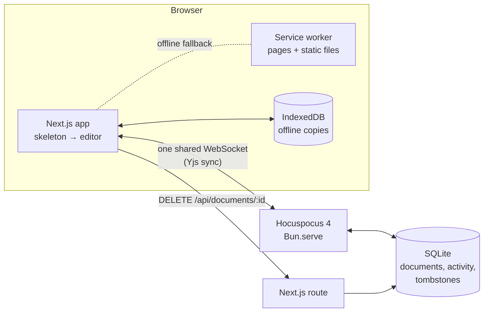

# TinyDocy

[](https://github.com/docs-plus/editor/actions/workflows/ci.yml)
[](https://github.com/docs-plus/editor/actions/workflows/nightly.yml)
[](https://github.com/docs-plus/editor/releases)
[](LICENSE)
[](https://tiny.docs.plus)

[](https://docs.plus)
[](https://github.com/docs-plus/docs.plus)
[](https://www.npmjs.com/org/docs.plus)
[](https://discord.com/invite/25JPG38J59)

[](https://bun.sh)
[](https://nextjs.org)
[](https://react.dev)
[](https://tiptap.dev)
[](https://yjs.dev)
[](https://tiptap.dev/docs/hocuspocus)
[](https://www.typescriptlang.org)

TinyDocy is a free, open-source (MIT) document editor where several people edit
the same page at once and see each other's cursors. It is built with Tiptap 3,
Yjs and Hocuspocus, needs no account, installs as an app, and keeps working
offline. It is the public testbed for [docs.plus](https://docs.plus): editor
features land here first and move to docs.plus once they pass collaboration
and scale checks.

**Live demo: [tiny.docs.plus](https://tiny.docs.plus).** Open it in two windows
and watch edits sync. It is a public sandbox: everyone sees the same
documents, so don't type anything private.

## Contents

- [Features](#features)
- [Quick start](#quick-start)
- [How it works](#how-it-works)
- [Configuration](#configuration)
- [Deploying](#deploying)
- [Development](#development)
- [Documentation](#documentation)
- [Community](#community)

## Features

| Area | What you get |
|---|---|
| **Structured documents** | Title-first schema (`heading block*`), with each section folded, dragged to a new position or filtered by heading. |
| **Outline** | Table of contents sidebar: click to jump, drag to move whole sections. |
| **Real-time collaboration** | Live cursors and presence, conflict-free merging with Yjs CRDTs, and synced tabs shared by every visitor. |
| **Rich content** | Lists, task lists, tables, blockquotes, code blocks with highlighting, live Mermaid diagrams and charts, and media embeds (image, video, audio, YouTube, Vimeo, Loom, SoundCloud, Spotify, X). |
| **Installable app** | Web app manifest, install button, offline page, and a service worker that never touches documents or the live connection. |
| **Offline editing** | Documents open from the device before the server answers. Offline edits sync on reconnect, and deleted documents never come back. |
| **Fast with large documents** | Skeleton on first paint, code-split editor, and a single render on mount, so a 1,200-block document shows in about 1 s on desktop. |
| **Hardened for a public demo** | Per-IP and per-document limits, size caps, origin checks, tombstones, CSP, and opt-in analytics that never sees document content. |

## Quick start

Requires [Bun](https://bun.sh) 1.4.4 or later. Node.js is not needed: Next.js,
ESLint, Playwright and the git hooks run on the Bun runtime (`[run] bun = true`
in `bunfig.toml`), and unit tests use `bun test`.

```bash
bun install
```

Then start both services:

```bash
make dev
```

Open [http://localhost:3000](http://localhost:3000), then open the same address
in a second window to see collaboration.

`make dev` runs two processes:

| Service | Port | Entry point |
|---|---|---|
| Next.js app | 3000 | `app/` |
| Hocuspocus WebSocket server (SQLite via `bun:sqlite`) | 1234 | `scripts/hocus-server.ts` |

The service worker and offline page register only in production builds. To try
them locally, build and start the app:

```bash
bun run build && bun run start
```

## How it works



- **Documents are Yjs docs.** Each tab is one document; the tab list itself is
  a shared document named `global-tabs`. Hocuspocus stores the encoded state in
  SQLite and enforces the guardrails in `lib/security/`.
- **One WebSocket per browser tab.** `lib/collab-session.ts` multiplexes every
  document on a shared socket. It reuses sessions across remounts, keeps
  sessions with unsynced edits alive, and restores offline copies
  (`lib/offline/`) before the socket attaches.
- **The page renders before the editor loads.** The server sends an app-shell
  skeleton with real intro text (good for SEO and slow connections). The
  editor bundle loads separately while the tab list syncs.
- **Editor extensions are layered.** Heading fold, drag, filter and scale live
  in `extensions/` and work in any Tiptap 3 app. Links, inline code, indent,
  placeholders, Mermaid and media come from the `@docs.plus/extension-*`
  packages.

### Where things live

```text
app/                 Routes: editor, /about, /privacy, /offline, metadata, API
components/
  app-skeleton/      Server-rendered loading shell
  document-editor/   The integrated editor
  editor-app/        Client shell: tabs, lazy editor, offline states
  pwa/               Service worker registration, install button, offline UI
  tab-bar/  toc-sidebar/  tiptap-ui/  tiptap-node/  ui/ (shadcn/ui)
extensions/          Standalone Tiptap extensions (heading-*, render-once,
                     table-of-contents, title-document)
hooks/               React hooks (synced tabs, Yjs document, connection state)
lib/
  collab-session.ts  Shared sessions on one socket
  offline/           Offline document copies (IndexedDB)
  pwa/               Service worker and its routing rules
  security/          Guardrails, CSP, tombstones, rate limits
scripts/             Hocuspocus server, retention purge
tests/               Unit, e2e, PWA, perf, soak, load (see tests/TESTING.md)
docs/                Runbooks, plans, brainstorms
```

## Configuration

Everything is configured through environment variables, and most of them have
safe defaults. There are two kinds.

### Build-time settings (`NEXT_PUBLIC_*`, `SEO_NOINDEX`)

These are inlined by `bun run build`. Put them in `.env.production` **before**
building; setting them at runtime has no effect.

| Variable | Default | Purpose |
|---|---|---|
| `NEXT_PUBLIC_HOCUS_URL` | `ws://127.0.0.1:1234` | Collaboration server URL. Production needs `wss://`. |
| `NEXT_PUBLIC_SITE_URL` | `https://tiny.docs.plus` | Canonical origin for metadata, sitemap and JSON-LD. Site copy lives in `lib/site-config.ts`. |
| `SEO_NOINDEX` | unset | `1` for previews and staging: noindex, `Disallow: /`, empty sitemap. |
| `NEXT_PUBLIC_GA_MEASUREMENT_ID` | unset | Opt-in Google Analytics 4 (`G-…`). Visitors must click Allow; GPC and DNT are honoured. See the [analytics runbook](docs/operations/analytics-runbook.md). |
| `NEXT_PUBLIC_PRIVACY_CONTROLLER`, `NEXT_PUBLIC_PRIVACY_EMAIL` | unset | Data controller and contact on `/privacy`. Set both before enabling analytics. |
| `NEXT_PUBLIC_SERVICE_WORKER` | on | `0` unregisters the worker and deletes its caches. See the [service worker runbook](docs/operations/service-worker-runbook.md). |
| `NEXT_PUBLIC_OFFLINE_CACHE` | on | `0` turns off offline document copies and deletes stored ones. |
| `NEXT_PUBLIC_BUILD_ID` | short git commit, else package version | Build identifier the client sends as `build=` on the socket URL; shows up in the server's per-minute `client_schema` log line. |
| `NEXT_PUBLIC_MAX_EMBED_IMAGE_BYTES` | 262144 | Images are downscaled in the browser to this size before embedding. |
| `NEXT_PUBLIC_MAX_TABS_PER_CLIENT` | 50 | Tab cap in the UI. |
| `NEXT_PUBLIC_DISCORD_INVITE_URL`, `NEXT_PUBLIC_GITHUB_REPO_URL` | project links | Community links in the status strip. |

### Runtime settings (server processes)

These are read when the Next.js app, Hocuspocus or the retention script
starts. The full list, with defaults, is in `lib/security/guardrail-config.ts`;
operational guidance is in the
[abuse guardrails runbook](docs/operations/abuse-guardrails-runbook.md).

| Variable | Default | Purpose |
|---|---|---|
| `DB_PATH` | `./db.sqlite` | SQLite file. The Next.js app and Hocuspocus must use the same one. |
| `HOCUS_PORT`, `HOCUS_HOST` | 1234, `0.0.0.0` | Where Hocuspocus listens. |
| `TRUSTED_PROXY` | off | `1` only when every request comes through one reverse proxy that appends `X-Forwarded-For`. |
| `HOCUS_ALLOWED_ORIGINS` | any | Comma-separated browser origins allowed to open sockets. |
| `MAX_DOC_SIZE_BYTES` | 1 MiB | Per-document cap; production sets 2 MiB. Playground and tab-list caps are separate. |
| `WS_CONNECTION_LIMIT`, `WS_SOCKETS_PER_IP`, `MAX_WS_SOCKETS` | 10, 30, 5000 | Connection limits. |
| `DOC_CREATION_RATE_LIMIT`, `MAX_TOTAL_DOCUMENTS` | 10/h, 2000 | Document creation limits. |
| `RETENTION_DAYS`, `TOMBSTONE_RETENTION_DAYS` | 30, 90 | Idle documents are deleted and tombstoned; tombstones outlive offline copies. |
| `HOCUS_LOGGER`, `HOCUS_THROTTLE`, `HOCUS_REDIS` | on, on, off | Optional Hocuspocus extensions. |
| `HOCUS_MIN_CLIENT_SCHEMA` | 0 | Raises the minimum client schema above the built-in floor of 2 (`SCHEMA_FLOOR`); lower values have no effect. Never set it above the highest schema a shipped bundle sends (currently 2). See the [schema rollout runbook](docs/operations/schema-rollout-runbook.md). |
| `HOCUS_REWRITE_LEGACY_HIGHLIGHTS` | off | `1` rewrites stored legacy highlight colours (`var(--tt-color-highlight-X)`) to their token on load. Turn it on only once release N tabs are gone. |
| `HOCUS_ALLOW_ISOLATED_TABS_DOCS` | off | `1` in dev and tests only. The server refuses to start with it in production. |

## Deploying

Production runs as three PM2 processes defined in `ecosystem.config.cjs`:
Next.js on 3847, Hocuspocus on 3848, and an optional Redis on 6380. They sit
behind a TLS-terminating reverse proxy.

To deploy or update:

```bash
git pull && bun install --frozen-lockfile && bun run build && bunx pm2@6.0.14 restart ecosystem.config.cjs --update-env
```

Requirements:

- **TLS and the proxy.** The collaboration URL must be `wss://`. Only the
  proxy may reach the app ports, because `TRUSTED_PROXY=1` trusts its
  forwarding headers.
- **Service worker headers.** The proxy must not change `Cache-Control` on
  `/_next/static/service-worker/sw.js`; it must stay
  `public, max-age=0, must-revalidate`.
- **Retention.** Run `bun scripts/purge-retention.ts` daily (cron or a systemd
  timer) and rotate the PM2 logs; abuse events contain IP addresses.
- **Taking content down.** Delete the document; never reset its stored state,
  because offline copies would push it back.

Release notes for each change, including deploy steps, are in the
[changelog](CHANGELOG.md).

## Development

| Command | What it does |
|---|---|
| `make dev` | Next.js and Hocuspocus together. |
| `bun run build` / `bun run start` | Production build and server. |
| `bun run test` | Unit tests with `bun test` (the stress probe runs with `test:stress`). |
| `bun run test:e2e` | Playwright against `make dev` (set `CI=` to reuse running servers). |
| `bun run test:pwa` | Service worker and offline tests against a production build (`PWA_BASE_URL`). |
| `bun run test:perf`, `test:soak`, `test:load` | Typing latency, long-running soak and the Yjs load harness. |
| `bun run typecheck` | TypeScript for the app (including the Hocuspocus server) and the service worker. |
| `bun run lint` / `bun run check` | ESLint (Next.js rules) and Biome. |

Test layers, environments and CI notes: [tests/TESTING.md](tests/TESTING.md).

**Conventions:**
- Bun only (`bun`, `bunx`; never npm or npx).
- Conventional Commits, enforced by commitlint.
- Named exports; kebab-case files; PascalCase components with title-case
  acronyms.
- shadcn/ui for new UI.
- Every pull request adds an entry to [CHANGELOG.md](CHANGELOG.md).

The full conventions are in [AGENTS.md](AGENTS.md).

**Stack:** Bun · Next.js 16 (App Router, Turbopack) · React 19 · Tiptap 3 and
ProseMirror · Yjs and Hocuspocus 4 · SQLite · Tailwind CSS 4 and Sass ·
TypeScript (strict) · Biome, ESLint, Husky and commitlint · `bun test` and
Playwright.

**CI** (`.github/workflows/ci.yml`) runs on every pull request and push to
`main`. One job runs `bun audit`, Biome, ESLint, the typecheck, unit tests
and the production build; the other runs the Playwright Chromium suite. A nightly
workflow (`.github/workflows/nightly.yml`) runs the service worker, soak and
load layers twice a day (03:41 and 08:00 UTC).

**Releases:** tag `main` with `vX.Y.Z` and push the tag;
`.github/workflows/release.yml` publishes the GitHub release, listing the pull
requests merged since the previous tag and linking to
[CHANGELOG.md](CHANGELOG.md).

The `@docs.plus/extension-*` packages are refreshed daily (04:17 UTC) by
`.github/workflows/docs-plus-extensions.yml`. It opens a pull request after a
read-only verification job, which needs "Allow GitHub Actions to create and
approve pull requests" in the repository's Actions settings.

## Documentation

| Document | For |
|---|---|
| [CHANGELOG.md](CHANGELOG.md) | What changed in each release, with deploy steps. |
| [Abuse guardrails runbook](docs/operations/abuse-guardrails-runbook.md) | Limits, abuse events, alerts, scheduled jobs, content takedown. |
| [Schema rollout runbook](docs/operations/schema-rollout-runbook.md) | Client version gate, ingress allowlist, release order, rollback rules, update banners. |
| [Service worker runbook](docs/operations/service-worker-runbook.md) | Caching rules, kill switch, deployment checks. |
| [Analytics runbook](docs/operations/analytics-runbook.md) | GA4 setup, privacy settings, event list. |
| [tests/TESTING.md](tests/TESTING.md) | Test layers and how to run them. |
| [AGENTS.md](AGENTS.md) | Repository conventions and project facts. |
| [docs/plans](docs/plans), [docs/brainstorms](docs/brainstorms) | Design history of the editor features. |

## Community

TinyDocy is the validation testbed for docs.plus: features are proven here
before they land in the production editor.

- [docs.plus](https://www.docs.plus): the live platform
- [docs-plus/docs.plus](https://github.com/docs-plus/docs.plus): the
  production repository
- [Discord](https://discord.com/invite/25JPG38J59): the community

## License

MIT. See [LICENSE](LICENSE).
