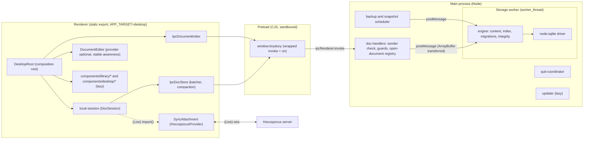
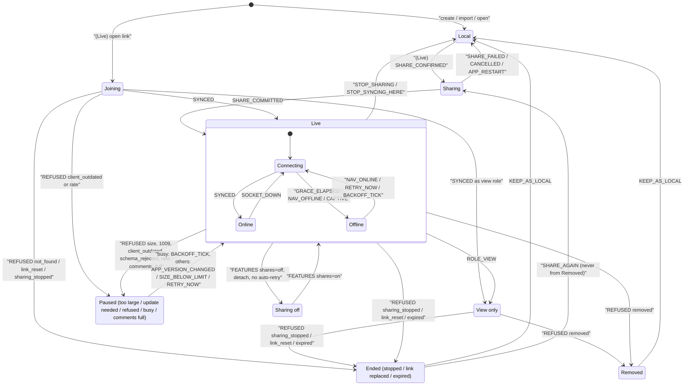
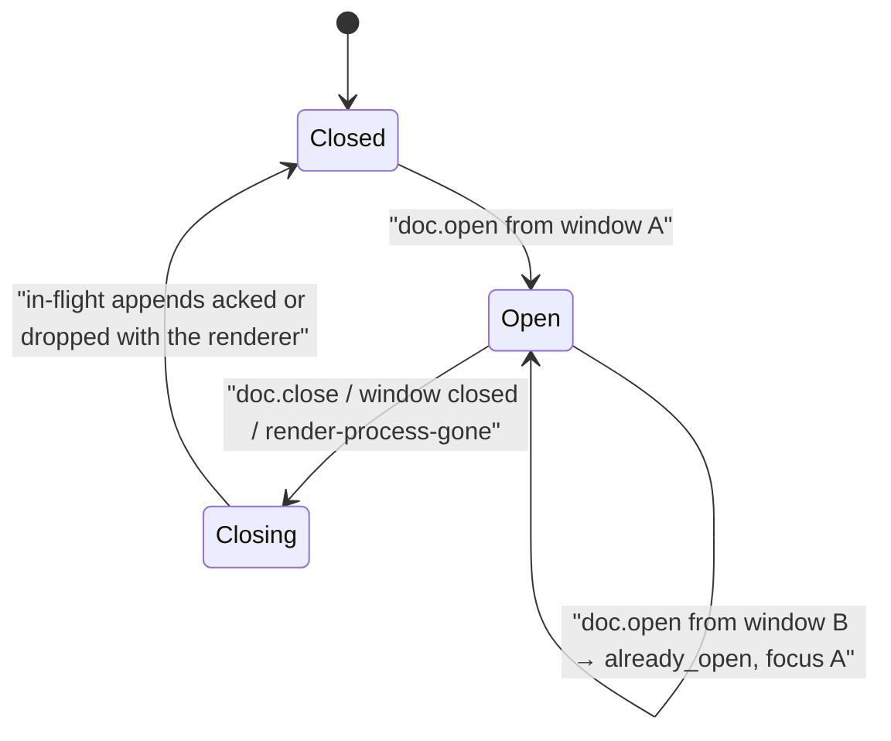
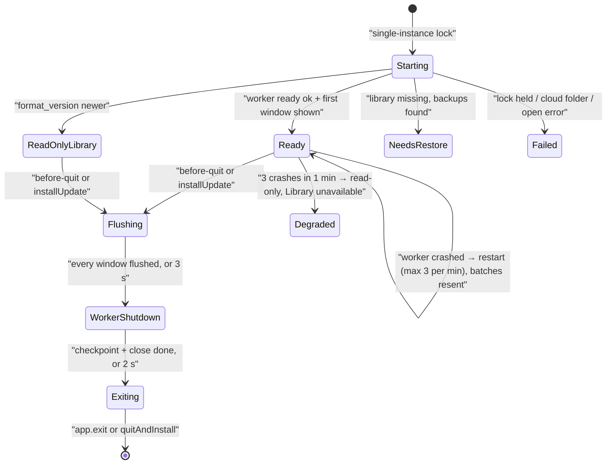
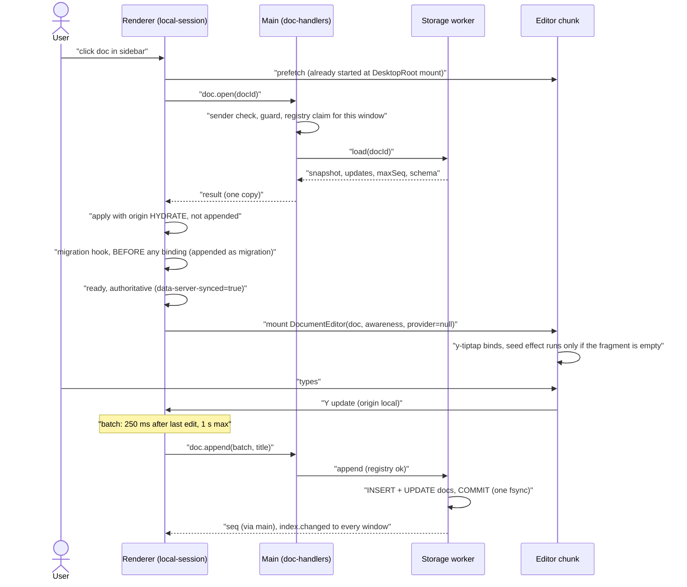
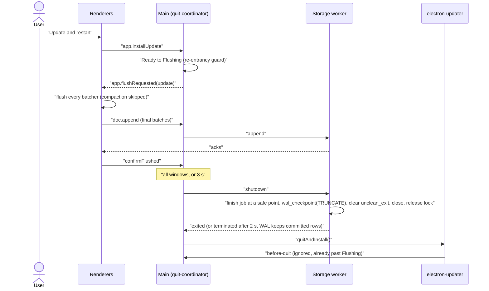
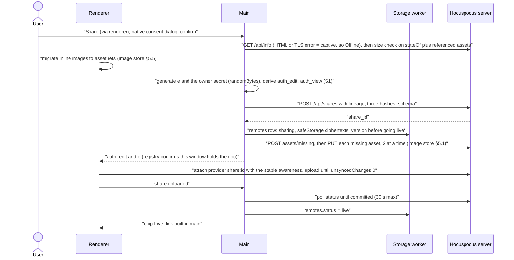

# TinyDocy Desktop: architecture

- **Status:** decided by the HoE on 2026-11-15, after a simplification review. Items that wait on a spike say "decided by S1", "S2", "S3" or "S5".
- **Details spec:** [documents, pages, sharing and editor details](2026-11-15-desktop-documents-and-editor-details.md) amends this document in §1 (WriteGate, failure path, title cap, presence store) and §8.2 (derived view secret).
- **Plan:** [Desktop local-first design, v8](2026-11-15-desktop-local-first-design.md). This document replaces its §4 at the level of modules and contracts. Everything else in the plan stands.
- **Feature designs (v6)** that add tables, ports and channels here: [web library](2026-11-16-web-library-design.md), [image store](2026-11-16-image-store-design.md), [comments](2026-11-16-comments-design.md), [preferences](2026-11-16-preferences-design.md). Where they go further than this document, they win for their feature.
- **Plan v7 (D23–D32):** D-A8 now follows D24 (metadata search, no body text). §5.3 gains `docs.link_key`, `docs.kind` and `import_sources`. The v7 designs: [onboarding, templates and import](2026-11-16-onboarding-templates-import-design.md), [languages and RTL](2026-11-16-languages-rtl-design.md), [search and links](2026-11-16-search-linking-design.md), [test and release](2026-11-16-test-release-strategy.md).
- **Plan v8 (D33–D41):** D40 approves the trimmed v1 seams of the [post-v1 roadmap](2026-11-16-post-v1-roadmap.md) §4 (seam ids, unrelated to the spike ids S1–S5 used elsewhere here). Here: `docs.link_key` is `NOT NULL` and minted at insert (S16, §5.3); backups write `TINYDOC2` only (S8, §5.4); main generates link secrets and receives only `share_id` (S1, §8.3); §12 lists the sync seams. D33 freezes the HKDF labels, IndexedDB and Web Lock names, the file magic and in-document `tinydocy:` links whatever the name; the first signed Gate 3 build locks `appId`, `userData`, the backups folder, the `tinydocy://` scheme, the UTI and MIME type, the Linux WM class and the signer name.
- **Scope:** the Local release in full. Live-release parts are marked **(Live)** and are only sketched, enough that the Local release doesn't block them. By owner decision D6, "Local release" and "Live release" now name internal milestones of one combined v1 release.
- **Evidence the decisions rest on:**
  - One synchronous commit with WAL, `synchronous=FULL` and `fullfsync` on an Apple SSD takes 4 ms for a small write, 7 ms median for 1 MB, and 26 ms at worst.
  - Compaction in Node takes 75 ms for a 1.9 MB document plus 500 updates.
  - AFFiNE's DocFrontend keeps the Y.Doc in the renderer.

---

## 1. Decisions

| # | Decision | Reason |
|---|---|---|
| D-A1 | **Two processes, renderer and main.** No storage `utilityProcess`. `node:sqlite` runs in a `worker_thread` inside main, the **storage worker**, which is the only SQLite writer. Requests go renderer → main over IPC, then main → worker by `postMessage`. No MessagePort hand-off. | In Electron, input reaches the renderer through main, so an fsync (up to 26 ms) must never run on main's event loop. A worker costs one hop and no extra process. **Decided by S2/S5:** they measure keystroke-to-paint latency in the renderer while commits loop with `fullfsync`, on macOS and on Windows with Defender on. If commits on main's own thread stay within budget, the worker is dropped. **S2 result (2026-11-16, [write-up](../../research/2026-11-16-spike-s2-storage-worker.md)):** `node:sqlite` runs in the worker on macOS, Windows and Linux and passes crash atomicity and the F_FULLFSYNC evidence, so the worker design stands as written. Whether commits may move to main's own thread is S5's commit-arm row alone; until both verdict machines report, the worker stays. |
| D-A2 | **The renderer owns the Y.Doc** and appends every update in batches: 250 ms after the last edit, 1 s at most. | Fewer fsyncs and less IPC. **Durability bound: power loss can lose about the last second of typing.** A clean quit loses nothing. |
| D-A3 | **Compaction runs in the renderer.** It sends `encodeStateAsUpdate` plus the highest `seq` that state covers. The worker upserts the snapshot and deletes `seq ≤ X` in one transaction. Main keeps a **registry of open documents**, which replaces leases. Main and the worker write content only to documents that are not open. No `rev` compare-and-set. | The renderer already holds the merged state, so compaction costs one encode. This is correct **only because a document is open in at most one window** (§5.2). The web library can't enforce one tab per document, so its compaction merges into the stored snapshot and deletes only the rows its own session applied (web library W-D3). That rule needs no invariant, and desktop can adopt it later. |
| D-A4 | **A thin `local-session`** (about 100 lines: load, apply, append, no timeouts) sits behind a `DocSession` interface, which `use-yjs-document` consumes. It and the batcher are platform-neutral (`lib/platform/local-session.ts`, `lib/platform/batcher.ts`), because the web library reuses them over IndexedDB (D3). The sandbox's `collab-session` is untouched except for the P1.1 and P1.1b fixes. The only shared editor changes: the provider becomes optional, and `document-editor.tsx` gets one stable y-protocols `Awareness`, under a byte allowance. (Live) The provider attaches on top of `local-session`. | Keeps the web path and its bundle as they are, and keeps desktop code small enough to read in one sitting. |
| D-A5 | **Local-release tables:** `meta` (with the `prefs` row), `docs`, `snapshots`, `updates` (with an `origin` column), `folders`, `tags` and `doc_tags` (D7), `doc_view` (per-document width, continue position and remote-image consent, D10), and the asset index `blobs` and `doc_blobs` (D4; the bytes are files under `<userData>/assets/`). `remotes`, `versions`, `share_blobs` and pre-wipe snapshots come in the Live release. A lineage UUID is written at creation from day one; `.tinydoc` import (P2.8) reads it to match backups. `docs.schema` stays, with a minimal migration hook that runs after hydrate and before the editor binds, as forward edits outside undo. Today's legacy-mark migrations run at **import**. | Ships only what the Local release uses, and keeps the two columns that are expensive to backfill. |
| D-A6 | **Safety core:** WAL, `synchronous=FULL`, `fullfsync` on macOS, `quick_check` after an unclean exit, the `format_version` read-only guard, `VACUUM INTO` before every migration, and a daily `VACUUM INTO` keeping 7 copies. The daily copies are the Local release's restore points ("Restore from a daily snapshot"). | One mechanism covers both restore points and protection against corruption, with no `versions` table. **Confirmed by S2:** the pragmas read back as set on all three OSes (`wal`, `synchronous` 2, and on macOS `fullfsync` and `checkpoint_fullfsync` 1); on an Apple-silicon Mac a 4 KB commit takes 4.0 ms p50 with `fullfsync` against 0.13 ms without it, so F_FULLFSYNC reaches the drive. |
| D-A7 | **Readable backups:** changed documents are mirrored as `.tinydoc` plus `.md` into `~/TinyDocy Backups`, each written to a temp file and renamed. The renderer makes the Markdown on idle and on close with the existing Tiptap Markdown serializer and sends it to main. Retention is by count. | No DOM-free walker. Counting copies needs no clock-jump guard. |
| D-A8 | **Search matches metadata only, never document body text. No FTS5** (owner D24, plan v7). Searched: titles, tags, folder names and document properties (dates, Local/Live, template kind), on desktop and in the web library. One shared normalizer (`lib/search/normalize.ts`: diacritics, Arabic→Persian letter folding, Persian/Arabic-Indic digits → ASCII; `Intl.Segmenter` only if titles need it) makes Quick Open and list filters accent- and case-insensitive. Metadata operators: `tag:`, `in:folder`, `is:live`. Rows with `kind='template'` are skipped. Full-text body search is later and not planned. Identity stays in `localStorage` (`tinydocy-user`, validated by F2: try/catch, a 32-grapheme name, an allowlisted colour) until P4.0 moves it into `meta('identity')`. | Cuts the walker, the FTS table, the text extractor and the identity migration from v1. Metadata is already in `docs`, `folders` and `doc_tags`, so search needs no new index. |
| D-A9 | **Local-release ports:** `DocSession`, `DocStore`, `DocumentIndex`, `AppShell`, and `BlobStore` for images (D4). (Live) adds `SyncAttachment`, `ShareService` and `SecretStore`. Each port is chosen inside a composition-root component. The two roots are `app/page.web.tsx` and `app/page.desktop.tsx`, picked through `pageExtensions` (**decided by S1**). Hand-written guards run in main only. The IPC build version is checked at startup. The staged app folder holds CJS bundles made by Bun.build (**decided by S1/S3**). | One literal decides the target. Neither build carries the other's import graph. The signed main bundle gets no validation dependency. |
| D-A10 | **The state machine is a pure reducer.** Sync and editability are separate parts, and app health is kept apart. Live-only states are marked. | One table drives the chip and the notices, and it can be tested without a UI. |
| D-A11 | **App origin:** either `app://tinydocy` with a Referer rewrite for YouTube embeds, or an https-style origin through `protocol.handle("https")` with `bypassCustomProtocolHandlers`. **Decided by S1.** | YouTube refuses embeds that send no Referer. The https-style option intercepts a scheme that every request uses. |
| D-A12 | **CI smoke test on every Electron bump:** `node:sqlite` is present, WAL works, `node:sqlite` works inside a `worker_thread`, and the protocol handler serves the export. | Electron ships a major version every 8 weeks (K13), and each of these four could silently break. |

### 1.1 What this changes in plan v3 §4

| Plan v3 §4 says | Now |
|---|---|
| A storage `utilityProcess` | A storage worker thread in main (D-A1) |
| `DocStoreBackend { load, append, listMeta, remove }` | `DocStore` (content) and `DocumentIndex` (list and metadata). The old name already belongs to `lib/offline/local-doc-store.ts:33`. |
| Compaction in storage, with compare-and-set on `rev` | The renderer compacts. One window per document is the invariant (D-A3). |
| Leases | Main's registry of open documents |
| `acquireCollabSession(name, { sync })` for desktop | `local-session` behind `DocSession`. `collab-session` stays web-only (D-A4). |
| `remotes`, `versions` and `docs_fts` in v1 | Live release, or dropped (D-A5, D-A8) |
| A Node walker for FTS, titles and `.md` | Titles come from the renderer. `.md` comes from the renderer's serializer (D-A7). |
| Clock-jump guard | Dropped. Retention is by count (D-A7). |
| Identity in `meta` | `localStorage` until P4.0 moves it to `meta('identity')` (D-A8) |
| Per-document handles issued by main (§7) | Main's registry, plus native dialogs for anything that leaves the app |

---

## 2. Components



**Process roles**

- **Renderer.** Owns one Y.Doc per open document, the editor, batching, compaction and Markdown export. No Node, no file system, no network beyond the CSP.
- **Main.** Owns windows, the protocol and CSP, menus, dialogs, deep links, the updater, quitting and the backup scheduler. It validates every renderer call, keeps the registry of open documents, and never parses Yjs.
- **Storage worker.** The only SQLite connection. It writes the mirror files and the daily copies. It never sees the renderer: every request comes from main, already validated.

---

## 3. Repository layout and build

```text
app/
  page.web.tsx                 # web root: <EditorApp/>
  page.desktop.tsx             # desktop root: dynamic <DesktopRoot/> (pageExtensions, decided by S1)
  privacy/page.web.tsx, sitemap.web.ts, robots.web.ts, llms.txt/route.web.ts, api/documents/[id]/route.web.ts
components/
  editor-app/                  # web shell; provides the web DocSession factory
  document-editor/             # provider optional, stable Awareness; imports no platform code
  library/                     # shared with the web library (D3): files sidebar, Quick Open, lists, Trash, tags
  desktop/                     # desktop-only UI, every entry lazy: root, titlebar, menus, status chip, first run, help
  settings/panes/              # Settings panes, shared by the desktop window and the web dialog (W13)
  prefs/                       # PrefsRuntime (leaf, never in the editor shell), PageFrame, the Page popover
hooks/use-yjs-document.ts      # consumes DocSession from context; no longer imports collab-session
lib/
  collab-session.ts            # sandbox only; unchanged except P1.1 and P1.1b
  platform/ports.ts            # DocSession, DocStore, DocumentIndex, AppShell, BlobStore (+ Live ports later)
  platform/doc-session-context.tsx
  platform/local-session.ts    # shared by desktop and the web library (moved out of platform/desktop/)
  platform/batcher.ts          # batching and the compaction trigger, shared the same way
  platform/web/                # sandbox DocSession adapter over collab-session, global-tabs index, browser shell;
                               # web/library/: IdbDocStore, IdbDocumentIndex, IdbBlobStore, web lease (web library §7.2)
  platform/desktop/            # IpcDocStore, IpcDocumentIndex, IpcBlobStore, ElectronShell, dev bridge
  prefs/                       # schema (pure, imported by main too), web and desktop stores, apply, boot script
  assets/                      # asset refs, sniffing, metadata strippers, prepareImageAsset, resolver
  comments/                    # model and validate.ts, shared with the server guard and the import guard
  sync/doc-sync-state.ts       # pure reducer (section 6)
  sync/refusals.ts             # refusal table shared with the web notices (Live)
  doc-migrations/              # pure Yjs forward migrations; the open hook and import use them
desktop/
  shared/                      # no runtime imports: ipc-contract.ts, guard.ts, errors.ts, limits.ts
  preload/index.ts
  main/                        # index, windows, app-protocol, csp, doc-handlers, quit-coordinator, menus,
                               # dialogs, deep-links, backups, updater (lazy), diagnostics
  storage/worker.ts            # worker_thread entry
  storage/engine/              # SQL logic over a SqliteDriver; no electron, node:* or bun:* imports
  storage/drivers/node-sqlite.ts
  dev/storage-host.ts          # dev and test only: doc-handlers + engine on bun:sqlite over a localhost WebSocket
  build/build.ts, build/electron-builder.yml
```

### 3.1 Build

1. **Renderer.** `NEXT_PUBLIC_APP_TARGET=desktop bun next build`.
   - `next.config.ts` switches three things on that literal: `output: "export"`, `headers()` (web only), and `pageExtensions`: web `["web.tsx", "web.ts", "tsx", "ts"]`, desktop `["desktop.tsx", "tsx", "ts"]`.
   - **Decided by S1:** whether Turbopack honours `pageExtensions` for `sitemap`, `robots` and `opengraph-image`. The fallback is a prebuild step that writes an `app/` overlay.
2. **Main, worker and preload.** `bun desktop/build/build.ts` calls `Bun.build({ target: "node", format: "cjs", external: ["electron"] })` on `main/index.ts`, `storage/worker.ts` and `preload/index.ts`.
   - `node:*` stays external, and `electron-updater` is bundled into `main.cjs`.
   - CJS everywhere, because a sandboxed preload must be CJS (**decided by S1**).
   - Bundles find each other through `app.getAppPath()`, never `__dirname`: for a `"type": "module"` package, `Bun.build` inlines the *source* directory into `__dirname` (found in S2).
3. **Stage.** Write `dist/desktop-app/`: a `package.json` with only `name`, `version` and `main`, the three bundles, and `renderer/` copied from `out/`.
   - electron-builder points `directories.app` here, so the root `dependencies` (next, react…) never reach the asar.
   - Run it as `bun electron-builder` (**confirmed by S3**, [write-up](../../research/2026-11-16-spike-s3-packaging-updates.md)): electron-builder 26.18.0 builds the DMG and zip, NSIS, `.deb` and AppImage with the `node` stub on PATH, and no step needs a `node` exception. On Windows, CI pairs the sh stub with a compiled `node.exe` stub, because Windows spawns never run the extensionless one.
4. **Checks.** `scripts/check-editor-chunk-size.ts` runs on both targets (`--dir out/_next` for desktop). A unit test asserts that the main and worker bundles contain no `bun:` imports and no React.

### 3.2 TypeScript projects

| Project | Covers | Types |
|---|---|---|
| `tsconfig.json` (existing) | app, components, hooks, lib, `desktop/shared` | DOM, `bun`. Excludes the rest of `desktop/`. |
| `tsconfig.sw.json` (existing) | service worker | unchanged |
| `tsconfig.desktop-node.json` (new) | `desktop/{main,storage,build}` | `node` plus Electron's types. No `bun` types, so a Bun-only API fails the typecheck in code that runs on Node. |
| `tsconfig.desktop-preload.json` (new) | `desktop/preload` | DOM plus Electron |

`bun run typecheck` runs all four.

### 3.3 Dependency rules

These are enforced by one test, `tests/unit/ci/import-boundaries.test.ts`. It reads imports with `Bun.Transpiler().scanImports()`, resolves `@/` and relative paths, and follows them transitively, in the style of `workflow-permissions.test.ts`.

| From | Must not import |
|---|---|
| `desktop/shared` | anything outside itself |
| `desktop/storage/engine` | `electron`, `node:*`, `bun:*`, React, `@tiptap/*` |
| `desktop/main`, `desktop/storage` | React, `lib/**` (except `lib/security/content-security-policy.ts`, `lib/doc-migrations`, `lib/prefs/schema.ts`, and the pure `lib/comments/validate.ts` and `lib/assets` sniffers) |
| `desktop/preload` | anything except `desktop/shared` and `electron` |
| `lib/platform/desktop` | `desktop/{main,preload,storage}` |
| `app`, `components`, `hooks`, `lib` | `desktop/**` except `desktop/shared` types; `lib/platform/desktop/**` except from `components/desktop/desktop-root.tsx` |
| `components/document-editor/**`, `hooks/use-yjs-document.ts` | `lib/platform/{web,desktop}/**`, `lib/collab-session.ts` |
| `components/library/**` (with `app/(library)/**` and `lib/platform/web/library/**`) | `lib/collab-session.ts`, `hooks/use-synced-tabs.ts`, `hooks/use-connection-state.ts`, `lib/offline/**`, `lib/analytics*.ts` (web library §7.3). Inferred here: also `components/desktop/**` and `lib/platform/desktop/**`, so the web library can import it. |

---

## 4. Ports

All live in `lib/platform/ports.ts`, as types only.

| Port | Shape | Web sandbox | Web library (D3) | Desktop |
|---|---|---|---|---|
| **`DocSession`** | `open(docId) → { doc, awareness, provider: HocuspocusProvider \| null, ready, authoritative, readOnlyReason, subscribe, release }` | An adapter over `acquireCollabSession`: `authoritative` = server synced, `readOnlyReason` = `rejectedReason` | `web-doc-session.ts`: `local-session` over `IdbDocStore` for the writer tab; a read-only mirror (`open_elsewhere`) in other tabs | `local-session` (§5.1) |
| **`DocStore`** | `load(docId) → { snapshot?, updates[], maxSeq, schema }` · `append(docId, { origin, update, title? }) → seq` · `compact(docId, state, upToSeq)` · `close(docId)` · `flush()` | none: the sandbox keeps `LocalDocStore` inside `collab-session` | `IdbDocStore` (W2): strict appends, merge-into-snapshot compaction (W-D3) | `IpcDocStore` (§5.2) |
| **`DocumentIndex`** | `snapshot() → { rev, items }` · `subscribe(cb)` · `create`, `rename`, `move`, `pin`, `trash`, `restore`, `purge`, `searchTitles` | the internals of today's `useSyncedTabs` (`global-tabs`) | `IdbDocumentIndex` (W2), with the rev feed over BroadcastChannel | `IpcDocumentIndex` over `docs`, `folders` and the tag tables, with a change feed |
| **`AppShell`** | `onFlushRequested(cb)`, `confirmFlushed()`, `openExternal`, `reveal(docId)`, `onMenuIntent`, `updateStatus`, `installUpdate`, `copyDiagnostics` | `beforeunload` guard (today's `useUnsyncedChangesGuard`), `window.open` | `BrowserShell`: flush on `visibilitychange`, `pagehide` and `blur`; no `reveal` | `ElectronShell`. Registers no `beforeunload`. |
| **`BlobStore`** (D4) | `put(docId, bytes, mime) → { hex }` · `url(hex)` · `get(hex)` · `has(hexes)` · `recount(docId, hexes)` · `gc(now)` (image store §3.1) | none: the sandbox stays inline | `IdbBlobStore` (W11) with reference-counted object URLs | `IpcBlobStore` → main → worker; files under `<userData>/assets/` |
| (Live) `SyncAttachment` | `attach({ doc, awareness, serverUrl, name, token }) → detach` | the web's built-in provider | `HocuspocusProvider` on the shared socket, `import()`ed when needed (W10) | `import()`'d only when a live document opens |
| (Live) `ShareService`, `SecretStore` | share flow; `safeStorage` in main | none | `fetch` to the share endpoints; `IdbSecretStore`, unencrypted (web library §8.2) | main |

**How a port is selected.**
- `app/page.web.tsx` renders `EditorApp`, and `app/page.desktop.tsx` renders a dynamic `DesktopRoot`.
- Each root puts its `DocSession` factory and index into `DocSessionContext` **inside the component**, never at module scope.
- `use-yjs-document` reads the factory from that context. So `collab-session` (which adds window listeners when it loads, `collab-session.ts:321-326`) never enters the desktop graph, and the editor chunk imports neither adapter.

**Shared editor changes** stay within their lines in the editor-chunk ledger (owner D23, ≈1,540 B gz in all, ≈1,580–1,660 B with D41's conditional phone line; P2.2's line, no provider plus `WriteGate` and the decoration-host stub, is 300 B; details spec §1 rule 5), checked by the chunk script on both targets, with `EDITOR_CHUNK_BUDGET_BYTES` lowered to `main` plus the ledger:

1. **`provider` becomes `HocuspocusProvider | null`.** `CollaborationCaret` is configured with the session's stable `awareness` (**decided in P2.2**, against the extension's runtime). The `useMemo` deps hold `awareness`, never the provider, so a provider attached later never rebuilds the extensions array.
2. **`CollabStatusGroup` renders only when `provider` is non-null.** Today it calls `useConnectionState`, which **creates the shared socket**, so a Local document would dial the server. The desktop chip is rendered by the desktop shell, outside the editor chunk.
3. **Seeding stays as it is.** `authoritative` feeds the existing `serverSynced` prop, and `local-session` sets it once hydrate finishes, because the library *is* the authority. The seed effect (`use-document-editor-effects.ts:78`) runs unchanged, and `data-server-synced` doubles as the readiness hook for the `local` and `electron` projects. (Live) A joined document becomes authoritative only after its first server sync.

---

## 5. Storage

### 5.1 `local-session` (renderer, about 100 lines)

```text
open(docId):
  registry claim (main) → already_open → main focuses the owning window, return
  { snapshot, updates, maxSeq, schema } = DocStore.load(docId)    // no timeout: wait, or show "Library unavailable" after 10 s
  apply snapshot + updates with origin HYDRATE                    // never appended
  if schema > DOC_SCHEMA → readOnlyReason = "doc_too_new"
  else run DOC_MIGRATIONS[schema+1..] in doc.transact(MIGRATION_ORIGIN), outside undo, appended with schemaTo
  doc.on("update", (u, origin) → origin !== HYDRATE && batcher.push(origin, u))
  ready = authoritative = true                                    // then the editor mounts and y-tiptap binds
release(docId): deferred 1 s (same tick re-open reuses the session), then batcher.flush → compact → DocStore.close
```

- **Migration order is a hard rule.** Migrations run after hydrate and before the editor binds. y-prosemirror deletes whole text runs whose marks the schema doesn't know (`lib/yjs-mark-migration.ts:13-14`).
- **The hook list starts empty.** Legacy-mark renames and the editor-root sweep run at import, on `.tinydoc` and web downloads, through the same pure functions in `lib/doc-migrations/` (D-A5).
- **Titles:** the renderer sends the first heading's text with an append (`title?`), so the worker never parses Yjs.
- **Per-document view:** `open` also reads the document's `doc_view` row and returns `{ width, place }` before the editor mounts, so `PageFrame` renders at the document's own width with no jump (preferences design §5.8).
- **Inline images** convert to asset refs on idle, **after** the editor binds, not in this hook: hashing and `put` are async, and the bytes must be durable before the reference exists (image store §5.5).

### 5.2 `IpcDocStore`: batching and compaction

- **Batching** (D-A2):
  - Updates are merged per (document, origin) with `Y.mergeUpdates`, flushed 250 ms after the last update or 1 s after the first.
  - Blur, `visibilitychange` to hidden, close, quit and the flush request flush immediately.
  - Each document has one append in flight. Each batch is one transaction, so one fsync.
- **Retry:** unacked batches are resent after a worker restart. That is safe because applying a Yjs update twice changes nothing.
- **Failure:** a failed append (disk full, I/O error) keeps its batch queued and retries in order with backoff, and is never skipped. A gap would strand every later update from that client. App health becomes `cant_save` (details spec §1, rule 3).
- **Compaction** (D-A3):
  - **Triggers:** more than 500 rows since the snapshot, more than 1 MiB of rows, or close. It runs in `requestIdleCallback`, except on close, so the encode never lands on a keystroke.
  - **Steps:** wait until no append is in flight; in the same task, take `X` = the highest acked `seq` and `state = Y.encodeStateAsUpdate(doc)`; send `compact(docId, state, X)`. The worker runs `BEGIN, UPSERT snapshots, DELETE updates WHERE doc_id = ? AND seq <= X, COMMIT`. Batches still queued are in `state` and are appended later with `seq > X`; the overlap is harmless.
- **Invariant** (why there's no compare-and-set): **while a document is open, its window's renderer is the only writer of its content.**
  - Every row with `seq ≤ X` was either loaded into this Y.Doc or appended from it, so the encoded state covers every row it deletes.
  - Main's registry enforces the invariant, and the worker refuses content writes from main for any document the registry holds open: import-into, restore, purge, migration-at-import.
  - (Live) Remote updates are also appended by this renderer, so the invariant still holds.
  - **The invariant must be revisited** before "multiple windows on one document" (deferred, plan §15) ships. The web library's rule (merge into the stored snapshot, delete only the rows this session applied; web library W-D3) is the candidate.

### 5.3 Tables (Local release)

```text
meta(key PRIMARY KEY, value)       -- format_version, yjs_encoding='v1', library_id, unclean_exit, last_daily_copy,
                                   -- prefs (JSON, validated by lib/prefs/schema.ts; preferences design §5.2)
docs(id TEXT PRIMARY KEY, title, folder_id, sort_key, pin_key, pinned, created_at, modified_at, opened_at,
     trashed_at, trash_group, trashed_from, schema INTEGER, lineage TEXT NOT NULL, size_bytes, snippet,
     mirrored_at,                  -- the details spec §6.3 columns
     link_key TEXT NOT NULL UNIQUE,  -- 32 hex, random; minted at insert, never lazily (v8, S16; search-linking §4.1)
     kind TEXT NOT NULL DEFAULT 'doc')  -- v7: 'doc' | 'template' (onboarding §3.2)
import_sources(doc_id TEXT PRIMARY KEY REFERENCES docs(id) ON DELETE CASCADE,
     relative_path TEXT, source_app TEXT,   -- v7: path inside the import set; LK5 "Link imported notes"
     source_hash TEXT, imported_at)         -- duplicate skip (onboarding §4.3); to confirm, see below
snapshots(doc_id TEXT PRIMARY KEY, data BLOB, upto_seq INTEGER)
updates(seq INTEGER PRIMARY KEY AUTOINCREMENT, doc_id TEXT, data BLOB, origin TEXT, created_at)
folders(id TEXT PRIMARY KEY, parent_id, name, sort_key, trashed_at, sort, view, "group")
tags(id TEXT PRIMARY KEY, name TEXT UNIQUE COLLATE NOCASE, color)     -- D7, details spec §3
doc_tags(doc_id, tag_id, PRIMARY KEY (doc_id, tag_id))
doc_view(doc_id TEXT PRIMARY KEY REFERENCES docs(id) ON DELETE CASCADE,
         width TEXT,               -- narrow | standard | wide | full; NULL = inherit the app default
         place TEXT,               -- continue position: a data-toc-id
         remote_images INTEGER NOT NULL DEFAULT 0)                    -- D10, preferences design §5.2
blobs(hash TEXT PRIMARY KEY, mime, size, width, height, created_at, origin)  -- P2.6b; bytes are files in assets/
doc_blobs(doc_id, hash, kind, dropped_at, PRIMARY KEY (doc_id, hash, kind))  -- kind: provisional | current | version
INDEX updates(doc_id, seq); INDEX docs(folder_id, trashed_at, opened_at); INDEX doc_blobs(hash)
INDEX import_sources(source_hash)
-- Live release adds: remotes, versions, pre-wipe snapshots, share_blobs(share_id, hash, confirmed_at)
```

`tags`, `doc_tags` and `doc_view` are created by P2.6, so no later migration is needed. **v7 (one P2.6/W2 amendment):** `docs.link_key`, `docs.kind` and `import_sources` are created by P2.6 too. Every insert mints `link_key` (v8, S16: `NOT NULL`, never lazily, so two synced devices can't mint different keys later). Duplicate, New from Template and `.tinydoc` import always get a new `link_key`; only a backup zip or `library.json` restore keeps it (S8c). Search, backlinks and the ⌘K picker skip `kind='template'`. **To confirm:** the staff review listed `import_sources(doc_id, relative_path, source_app)`; the onboarding design keys duplicate skip (never cut, D30) on `source_hash`. Both are kept here, keyed by `doc_id` with an index on `source_hash`, until the owner confirms the shape. `blobs` and `doc_blobs` arrive with P2.6b (image store §3.2). Comments live in the Y.Doc's `comments` root, not in a table.

### 5.4 Storage worker modules (`desktop/storage/engine/`)

| Module | Job |
|---|---|
| `open.ts` | Opens the database:<br>- **path:** `app.getPath('userData')`, with `%LOCALAPPDATA%` on Windows (plan Appendix A, P2.6), and refuses to open inside iCloud Drive, OneDrive or Dropbox<br>- **lock file:** `library.lock`, holding the pid; a stale lock is detected with a pid liveness check<br>- **pragmas:** WAL, `synchronous=FULL`, `fullfsync` on macOS<br>- **unclean exit:** the `unclean_exit` flag is set on open and cleared on clean shutdown, and `quick_check` runs if it was still set |
| `migrations.ts` | `format_version` runner:<br>- **newer than the app:** read-only, with `library_too_new`<br>- **older:** take `VACUUM INTO library.pre-v<n>-<utc>.sqlite` (keep 2), then run each step in its own transaction; a failure means read-only with `migration_failed` |
| `content.ts` | `load`, `append` (an INSERT plus the `docs` title and `modified_at`, in one transaction), `compact`, `stateOf` (`Y.mergeUpdates`, for `.tinydoc` and restore) |
| `index.ts` | CRUD on `docs` and `folders`, `rev` and the change feed, metadata search (D-A8: titles, tags, folder names and properties, matched on normalised strings; never body text), purge of Trash after 30 days |
| `daily-copy.ts` | Once a day on the first idle: `VACUUM INTO daily/library-<local date>.sqlite`, keeping 7. "Restore from a daily snapshot" opens a copy read-only and returns one document's state, which the renderer applies to the open document as a forward edit through `updateYFragment` (the `schema-repair.ts` approach). |
| `mirror.ts` | For each document where `modified_at > mirrored_at` and the renderer has sent Markdown: write `<clean title>-<short id>.tinydoc` (`TINYDOC2`: magic, JSON header with `v`, `minReader`, `enc: null` and `lineage`, then `stateOf`; v8, S8) and `.md`, writing each to a temp file and then renaming it. It keeps one current copy per document. When a document is permanently deleted, its copies move to `Deleted/` and are removed after 30 days. Image files go once to `assets/<hex>.<ext>` beside them, and backup `.tinydoc` files reference them as external assets (image store §5.4). No build writes or reads `TINYDOC1` (D40). |
| `filenames.ts` | Cleans names: path separators, `..`, Windows reserved names, trailing dots and spaces, and paths over 240 characters |
| `assets.ts` (P2.6b) | Owns `<userData>/assets/`: the temp-fsync-rename write order, dedupe, the startup `tmp/` sweep, `recount` and GC with a 30-day grace (image store §3.2–§3.4). |
| `jobs.ts` | One queue. Foreground calls run first; daily copy and mirror run on idle, meaning 30 s without an append. Each job yields between documents. |

**Backup failures.** EPERM, EACCES and Defender blocks on the backup folder raise app health `backups_failing` (§6.1; plan §5.5 "Backups failing"). The library itself is never affected.

---

## 6. State machines

### 6.1 Document sync and editability (`lib/sync/doc-sync-state.ts`)

The reducer is pure: `(state, event) → state`, with no imports. The chip is a pure function of `(sync, editability, appHealth)`, held in a lazy table in `components/desktop/status-chip/present.ts`. A table test covers every row of plan §5.5.



**Local release.** Only `Local` is reachable. The reducer and the chip ship anyway, so the Live release adds rows to the table without restructuring.

**Live rules** (sketch):
- **Every refusal ends in a stop or a jittered backoff:** 2 s base, doubling, 5 min cap, ±50%.
- **Unknown reasons** go to Paused(refused) and are never retried automatically. **Captive portal:** HTML or a TLS error leads to Offline, never to a refusal.
- **Paused reasons persist**, except busy, in `remotes.status_reason`, so a restart never redials a document the server refused. That includes `comments_full` (comments design §7.3), whose recovery is Retry after deleting comments.
- **Downgrade or reset while edits are unsynced:** before the fork, `flush(docId)` runs and its ack is awaited, because the batcher may still hold up to 1 s of edits.

**Editability**, highest priority first:

| Reason | Source | Effect |
|---|---|---|
| `library_too_new` | the worker's `format_version` guard | Whole app read-only. Banner: "Update TinyDocy to edit your documents." |
| `doc_too_new` | `docs.schema` > `DOC_SCHEMA`, or the schema guard's `outdated` | Read-only, chip "Read-only", action Update |
| `unrepairable` | the schema guard | Read-only, with today's copy |
| `view_only` (Live) | sync is ViewOnly | Read-only, enforced by `WriteGate` in the editor (details spec §1); updates are never dropped after they exist |

**App health** (not a document state): `backups_failing`, `library_unavailable`, `saving_behind` (more than 4 MiB unacked), `cant_save` (a failed append is being retried, details spec §1 rule 3). It shows as the ⚠ on "Local", and in Settings.

**Web library rows** (the same reducer, web library §7.1): editability gains `open_elsewhere` (another tab is the writer), and app health gains `library_removed` and `library_reload`.

### 6.2 Open-document registry (main)



Main and the worker run content writes (import-into, restore, purge, import migrations) only in `Closed`. Otherwise they return `document_open`.

### 6.3 App lifecycle



- **Re-entrancy:** `quitAndInstall` fires `before-quit` again, and the coordinator ignores it once it is past `Flushing`.
- **No `beforeunload` on desktop.** It would silently block quitting (`editor-app.tsx:58-62`).

---

## 7. IPC contract

`desktop/shared/ipc-contract.ts` declares every channel once, with guard-built types:

```ts
export const IPC_BUILD = "<git sha>";            // preload sends it at startup; main refuses a mismatch (build_mismatch)

export const calls = {                           // renderer → main (ipcRenderer.invoke); main forwards doc.* and index.* to the worker
  "doc.open":    { req: obj({ docId: uuid }), res: obj({ snapshot: opt(bytes(MAX_DOC)), updates: arr(bytes(MAX_DOC)), maxSeq: int(), schema: int() }) },
  "doc.append":  { req: obj({ docId: uuid, origin: oneOf(ORIGINS), update: bytes(MAX_BATCH), title: opt(str(200)), schemaTo: opt(int()) }), res: obj({ seq: int() }) },
  "doc.compact": { req: obj({ docId: uuid, state: bytes(MAX_DOC), upToSeq: int() }), res: none },
  "doc.close":   { req: obj({ docId: uuid }), res: none },
  "doc.markdown":{ req: obj({ docId: uuid, md: str(MAX_MD) }), res: none },  // for the mirror
  "index.snapshot": …, "index.create": …, "index.rename": …, "index.move": …, "index.trash": …, "index.searchTitles": …,
  "dialog.import": …, "dialog.export": …, "restore.listDays": …, "restore.readDay": …,
  "app.installUpdate": …, "app.reveal": …, "diagnostics.copy": …,
  "prefs.get": …, "prefs.set": …,                 // P2.9b; main validates against lib/prefs/schema.ts and stores meta('prefs')
  "asset.put": …, "asset.has": …, "asset.ensure": …, "asset.recount": …,  // P2.6b; main re-hashes and sniffs every put
} as const;
export const events = {                          // main → renderer (webContents.send)
  "index.changed": obj({ rev: int(), changes: arr(IndexChange) }), "app.health": Health,
  "app.flushRequested": obj({ reason: oneOf(["quit", "update"]) }), "app.menuIntent": …, "app.updateStatus": …,
  "prefs.changed": …,                             // broadcast to every window, so open documents update live
} as const;
```

- **Validation.**
  - `desktop/shared/guard.ts` holds about 100 lines of combinators: `str(max)`, `uuid`, `int`, `bytes(max)`, `oneOf`, `opt`, `arr(max)`, `obj` (which rejects unknown keys), and `Infer<>`.
  - They run **in main only**, the one trust boundary. The worker trusts main, and the renderer trusts replies, so the renderer bundle doesn't grow.
  - **Why hand-written instead of zod or valibot:** the messages are flat, the caps are one-liners, and the signed main bundle stays free of a dependency (K6, `minimumReleaseAge`). Revisit past about 60 channels.
  - A fuzz test checks that no guard throws and none accepts input out of bounds.
- **Sender checks.** Every handler checks that `event.senderFrame` is the top frame of a window main created, that its URL has the app origin (**decided by S1**), and that the channel is in `calls`. For `doc.append`, `doc.compact`, `doc.markdown` and `asset.put`, the registry must hold `docId` open **for this window**. The YouTube iframe gets no preload.
- **No path from the renderer, ever.** Import, export, the backup folder and Reveal all take paths from main's native dialogs or settings.
- **Error envelope.** Nothing is thrown across IPC:

  ```ts
  type Result<T> = { ok: true; value: T } | { ok: false; error: { code: ErrorCode; retryable: boolean } };
  ```
- **Bytes.** Main passes `ArrayBuffer`s to the worker in the transfer list, so there is one copy, at the IPC boundary.

---

## 8. Sequences

### 8.1 Opening a document



### 8.2 Quitting to install an update



### 8.3 (Live) Going live



---

## 9. Errors and diagnostics

`desktop/shared/errors.ts` holds one `ErrorCode` union. Each code has a fixed `{ retryable, severity, copyKey }`.

| Family | Codes |
|---|---|
| Contract | `invalid_argument`, `forbidden`, `build_mismatch` |
| Storage | `not_found`, `already_open`, `document_open`, `library_read_only`, `library_too_new`, `migration_failed`, `disk_full`, `io_error`, `corrupt`, `locked_elsewhere`, `cloud_folder`, `worker_restarting`, `library_unavailable` |
| Content | `doc_too_new`, `unknown_schema`, `import_too_large` |
| App | `backup_failed`, `update_failed`, `update_unverified` (Linux) |
| (Live) Sync and share | the reasons in `lib/sync/refusals.ts` (`document_too_large`, `frame_too_large` for 1009, `client_outdated`, `schema_rejected`, `busy`, `captive_portal`, `sharing_stopped`, `link_reset`, `expired`, `removed`, `view_only`, `comments_full`), plus `shares_disabled`, `upload_failed`, `commit_timeout`, and the image store's `asset_store_full` and `assets_disabled` |

**Diagnostics log.**
- Main holds a ring of 2,000 entries, also written to `logs/diagnostics.jsonl` (2 × 1 MiB, rotated). The worker and the renderer send their entries to main.
- `log(code, fields: SafeFields)` takes only enums, numbers, booleans and `hashedId()` (the first 8 hex characters of an HMAC keyed by `library_id`), so free strings don't type-check.
- **Never logged:** document text, titles or names made from them, tokens, secrets, share links, IP addresses, or full paths (the home folder becomes `~`). An e2e run seeds a known title and checks that it never appears in the log.

**Copy diagnostics** (Help menu): versions (app, Electron, Chrome, Node, OS and arch, `format_version`, `DOC_SCHEMA`, channel); library stats (document count and size, rows waiting for compaction, the last daily copy, mirror and `quick_check` results); the last 200 log entries; crash dumps listed only, and attached after a second consent click.

---

## 10. Startup budget

| | Eager | Deferred or lazy |
|---|---|---|
| Main | lock, protocol and CSP, windows, `doc-handlers`, the worker (started in parallel with the first window), quit coordinator, menus | updater (10 s after the first editable document), daily copy and mirror (on idle), diagnostics export |
| Renderer | the preferences boot script (allowed by CSP hash, fed main's snapshot through the preload), static shell skeleton (painted before JS), `DesktopRoot`, `local-session` | editor chunk (prefetched at `DesktopRoot` mount), list views, search, the Page popover, first run, Help, About, the chip, the asset resolver; (Live) `@hocuspocus/provider` only when a live document opens. Settings is its own window and page (`/settings`) and never loads the editor chunk. |

**Targets.** "Mac" means an M1. "Win" means a mid-range Windows 11 laptop with an SSD. The library has 1,000 documents and 200 MB. The document is 500 KB. The previous exit was clean.

| Mark | Mac | Win |
|---|---|---|
| Process start → window created | ≤ 150 ms | ≤ 250 ms |
| Worker ready (open + pragmas + `format_version`) | ≤ 150 ms | ≤ 300 ms |
| First paint of the skeleton | ≤ 400 ms | ≤ 700 ms |
| Sidebar populated | ≤ 600 ms | ≤ 1.0 s |
| **First editable document, cold** | **≤ 1.2 s** | **≤ 2.0 s** |
| Warm start | ≤ 700 ms | ≤ 1.2 s |
| After an unclean exit | + `quick_check`, ≤ 2 s at 200 MB; "Checking your library…" after 1 s | same |
| Keystroke to paint while commits loop with `fullfsync` | within 10% of Chrome (**S2/S5**, D-A1) | same, with Defender on |

**Measurement:** main records `process.hrtime` marks, and the renderer relays `performance.mark`s. The `electron` project asserts these on the macOS PR runner with 1.5× slack, and runs them nightly on all three OSes.

---

## 11. Testing seams

| Layer | Test | Runs against |
|---|---|---|
| `DocStore` contract: load, append, origins, idempotent resend, compaction with `upToSeq`, flush, `already_open` and `document_open` | one suite | `MemoryDocStore` (fake); the engine on `bun:sqlite` (`bun test`, every PR); the engine on `node:sqlite` in an Electron worker (D-A12 smoke, plus nightly) |
| `DocSession` contract: ready, authoritative, migration-before-bind, deferred release, seed-once | one suite | the web adapter over `collab-session` (memory backend); `local-session` over `MemoryDocStore` |
| Compaction invariant | property test: random appends, compactions and reopens, with the Y.Doc state compared against a reference | engine on `bun:sqlite` |
| Guards and `doc-handlers` | fuzz plus golden messages, sender and registry checks | pure modules |
| Reducer and chip | a table row for each plan §5.5 state; "every refusal ends in a stop or a backoff" | pure |
| Durability T1–T8, T16–T18 | `tests/load/desktop-durability-soak.ts`: SIGKILL Electron during append, compaction, migration, asset writes and image migration; a year of image churn | packaged app |
| `BlobStore` contract and asset GC | one suite plus a property test: GC never deletes a referenced blob | `MemoryBlobStore`; the worker on `bun:sqlite`; `IdbBlobStore` in the web library |
| Preferences boot script | parity with `resolveBoot()` over about 40 stored payloads; the desktop CSP hash matches the script (build test) | happy-dom; build |
| Main | `argv` filter, navigation and `window.open` denial, fuses | `_electron` |

**Fakes** (`tests/helpers/platform-fakes.ts`): `MemoryDocStore` (with `loadDelayMs` and `failNext`), `MemoryDocumentIndex`, `MemoryBlobStore` (with `failNext` and `missing`), `FakeAppShell` (records flush requests), `FakeClock`.

**Playwright projects**
- **`local`:** `NEXT_PUBLIC_APP_TARGET=desktop` with `NEXT_PUBLIC_DESKTOP_BRIDGE=dev` under `next dev`, with no Hocus.
  - The renderer's `window.tinydocy` is a dev bridge speaking the **same contract** over a localhost WebSocket to `bun desktop/dev/storage-host.ts`, which runs the real `doc-handlers` (guards and registry) and the real engine on `bun:sqlite`, with a temp library per worker.
  - It binds to 127.0.0.1 with a random token and is refused in production builds. Tests wait on `data-server-synced`.
- **`electron`:** the packaged internal build with `NEXT_PUBLIC_TEST_HOOKS=1`, which exposes `window.__tiptap_editor` (a static export is a production build, so `NODE_ENV` can't gate it).
  - `TINYDOCY_USER_DATA` and `TINYDOCY_BACKUP_DIR` give each test its own folders.
  - Covers S4 persistence across relaunch, T4 quit and update, fuses and perf marks. Runs on macOS for each PR and on all three OSes nightly.
- **Release check:** the release artifact must contain neither the dev-bridge nor the test-hook marker string.

---

## 12. Future seams (cut now only where they cost nothing)

- **(Live) Sharing:** the `origin` column, `lineage` from day one, a nullable `DocSession.provider`, the stable awareness. **v8 (S1):** main generates link secrets; the server stores only hashes of HKDF-derived tokens, under the labels in `lib/crypto/labels.ts` (S1c).
- **Self-hosted servers:** `SyncAttachment` takes `serverUrl`, and sockets are keyed by URL, not by today's single `sharedSocket`.
- **Multi-window on one document:** out of scope. It breaks the D-A3 invariant, so it would need worker-side compaction with compare-and-set first, or the web library's merge-into-snapshot rule (W-D3), which already works with any number of writers.
- **Mobile:** the engine has no runtime imports and sits behind `SqliteDriver`; `DocStore` doesn't depend on its transport.
- **Library sync** (E2EE only, D37; v2.0, D38): `library_id`, UUID ids, UTC times, lineage, plus the D40 rules: `library_id` is never a device identity (S2) and never leaves the device (S2b); identity is per person and never exported (S7); every metadata write goes through `index.ts` operations (S10); `link_key` is minted at insert (S16). Dropped by D40: a writer column (S9) and preference scopes in code (S11).

**Not done:** a generic RPC framework, a plugin system, or abstracting the shell for a Tauri fallback. `desktop/main` and `desktop/preload` are the only Electron-specific code.
