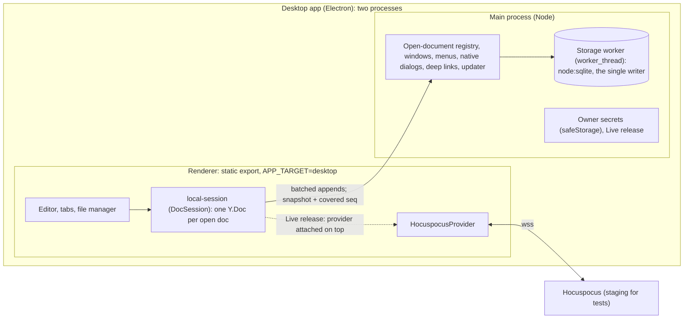

# TinyDocy Desktop: local-first documents, live when you share

- **Status:** Draft v8, decisions D0–D41 answered (2026-11-16). Nothing is built yet.
- **Architecture:** [2026-11-15-desktop-architecture.md](2026-11-15-desktop-architecture.md)
- **Details** (titles, tags, page preferences, organizing, review, sharing, editor details): [2026-11-15-desktop-documents-and-editor-details.md](2026-11-15-desktop-documents-and-editor-details.md)
- **Feature designs** (v6; each wins over this plan for its own feature):
  - [Web library](2026-11-16-web-library-design.md) (D3)
  - [Image store](2026-11-16-image-store-design.md) (D4)
  - [Comments](2026-11-16-comments-design.md) (D9)
  - [Preferences](2026-11-16-preferences-design.md) (D10, and every app and page setting)
- **Feature designs** (v7; each wins over this plan for its own feature, as amended by D23–D32 in §13):
  - [Onboarding, templates and import](2026-11-16-onboarding-templates-import-design.md) (D27, D28, D29)
  - [Languages and the right-to-left interface](2026-11-16-languages-rtl-design.md) (D26)
  - [Search and links between documents](2026-11-16-search-linking-design.md) (D24, D25)
  - [Test and release strategy](2026-11-16-test-release-strategy.md) (D31, D32)
- **Feature designs** (v8; each wins over this plan for its own feature, as amended by D33–D41 in §13):
  - [Phones and tablets](2026-11-16-phones-tablets-design.md) (D36, D41)
  - [Name, app icon, visual identity and website](2026-11-16-brand-icon-website-design.md) (D33, D34, D35)
  - [After v1: roadmap and the seams v1 must leave](2026-11-16-post-v1-roadmap.md) (D37, D38, D40)
- **Revisions:**
  - **v2** added the first round of reviews: head of engineering, staff engineer, UX lead, builder check.
  - **v3** adds the second round:
    - a head-of-engineering blind-spot review
    - a staff review of data and sync
    - a staff review of platform, security and supply chain
    - a pre-mortem
  - **v4** simplifies the architecture: two Electron processes instead of three, a thin desktop session, and a smaller Local-release storage core (§4).
  - **v5** adds the details spec.
  - **v6** records the owner's answers to D0–D10 and folds in the four feature designs above.
  - **v7** folds in four more designs (onboarding, templates and import; languages and RTL; search and links; test and release), a staff integration review, and the owner's answers D23–D32.
  - **v8** folds in three more designs (phones and tablets; name, icon and website; the post-v1 roadmap and the seams v1 must leave), a staff and head-of-engineering review of them, and the owner's answers D33–D41.
  - §17 logs what changed in each round.
- **Scope:** an installable desktop app for macOS, Windows and Linux that:
  - works fully offline on local documents
  - has a file manager
  - can make one document **live** on a sync server so people can edit it together
  - needs no accounts
- **Shape:** two milestones, one public release.
  - **The Local milestone** is the offline app and file manager. It never talks to a sync server.
  - **The Live milestone** adds sharing and comments.

  **D6 answer: one combined release.** "Local release" and "Live release" in these docs now name two **internal milestones**. Only v1, which includes both plus the web library, ships publicly (§8.2).
- **Research behind it** (all in `docs/research/`, with sources):
  - [Desktop shell and packaging](../../research/2026-11-15-desktop-shell-and-packaging.md)
  - [Local-first storage and sharing](../../research/2026-11-15-local-first-storage-and-sharing.md)
  - [Codebase server-dependency audit](../../research/2026-11-15-codebase-server-dependency-audit.md)
  - [File manager and sharing UX](../../research/2026-11-15-desktop-file-manager-and-sharing-ux.md)

---

## 1. Intent

Today every TinyDocy document lives on the public server. The browser keeps a 14-day offline cache, and every visitor sees the same tab list. The owner wants the opposite default:

- **Documents belong to the person who made them.** They live on that person's machine and work without a network. They survive app updates, crashes, server actions and uninstalls.
- **Collaboration is opt-in, one document at a time.** Share a link and the document goes live on a server. Stop sharing and it is yours alone again.
- **The app installs like any desktop app** on macOS, Windows and Linux, and keeps itself up to date.

**Why now, and for whom (D0)** is answered: **private local documents**. People who want their documents on their own machine, offline-first, with sharing as an occasional extra. It decides what gets cut first if time runs short (local durability and the offline experience are kept) and how success is measured (§13).

### Goals

1. A user can install the app and create, organise and edit documents with no network at all. Nothing in the app needs the network unless the user asks, and that includes fonts, images, spellcheck and the Playground.
2. No local document is lost through an app update, a crash, power loss, a server action or an uninstall. A sudden power cut can lose at most the last second of typing.
3. Any local document can go live with one deliberate action. Collaborators open it from a link, in the app or in a browser.
4. The web app at tiny.docs.plus keeps shipping throughout. It stays on `next start`, with its current headers and CSP. The web also gets a personal library stored in the browser (D3, [web library design](2026-11-16-web-library-design.md)).
5. The app ships as signed, auto-updating builds:
   - macOS arm64 and x64
   - Windows x64
   - Linux x64, as `.deb` and AppImage

### Non-goals

- Accounts, sign-in, per-person permissions, identity.
- End-to-end encryption. The server operator can read live documents, and the UI says so.
- Syncing a whole library between one person's devices.
- Peer-to-peer or LAN sync.
- Mobile apps.
- Editing Markdown files in place.
- Creating shares from the public sandbox. The sandbox can only *open* share links. The web library can share (W10, D3).
- Self-hosted servers in v1. The desktop app joins only the default server.
- Managed or enterprise installs: silent per-machine install, admin policies.
- Uploading crash reports. Crash dumps stay on the device.
- Undo history surviving a tab switch. Today the editor remounts on every switch (`editor-app.tsx:167`), and that limit stays as-is.

### Anti-goals (failure even if it "works")

- A local document disappears, or is overwritten by server state, in any scenario.
- A document becomes visible to others without the user saying so. That includes ending up in `global-tabs`, or the app quietly loading tracking images.
- Closing a tab deletes anything.
- An old desktop build gets the user's IP banned by reconnect loops, or gets frozen by a collaborator using a newer feature.
- The web editor gets slower or bigger.
- A compromised dependency or CI job can ship signed code to users.

---

## 2. What exists today

Each fact below was checked against the code during the audit and the two review rounds.

### Storage and sessions

| Fact | Where | Consequence |
|---|---|---|
| A fresh install with no server never gets past the intro screen. Verified by a trial static export. | `hooks/use-synced-tabs.ts:70`, `lib/collab-session.ts:281`, `document-editor.tsx:418` | Readiness and seeding must come from local state. |
| Offline copies are a cache: 14-day expiry, a 30-document cap, keys scoped to the server host, wiped on an epoch bump. A server delete, the sweep, and "forget" all remove the device copy. | `lib/offline/*`, `collab-session.ts:194,302`, `use-synced-tabs.ts:88` | Desktop needs *primary* storage that ignores all of these. |
| Edits made offline pause at 512 KiB. Images are data URLs of up to 256 KiB each. | `OFFLINE_EDIT_BUDGET_BYTES` | With no server, two images make a document read-only. Library documents therefore keep images in the image store (D4); the sandbox stays inline. |
| "Can't sync" and "can't edit" are one field. Mounting the app opens the WebSocket. | `rejectedReason`, `useConnectionState` | A sync refusal freezes editing, and with sync off the socket retries forever. |
| **A bug confirmed by reading the code (not yet reproduced).** When IndexedDB takes more than 1 s, the next save replaces the stored copy and loses unsynced offline edits. | `collab-session.ts:259-267`, `local-doc-store.ts:284-297` | A web data-loss bug today. Fixed first, in P1.1. |
| The IndexedDB `open()` has no `onblocked` or `onversionchange` handler. | `local-doc-store.ts:365-373` | Web storage changes need a new namespace, not an in-place upgrade. |
| `beforeunload` is armed while there are unsynced changes. | `editor-app.tsx:58-62` | In Electron this silently blocks quit. |
| Migrations run only on the server, in `afterLoadDocument`: legacy mark renames, the editor-root sweep, the schema allowlist. | `scripts/hocus-server.ts:210`, `lib/security/hocus-document-guard.ts:367,384` | Local-only documents never get them, so the desktop needs client-side migrations. |

### Server, sharing and embeds

| Fact | Where | Consequence |
|---|---|---|
| `DELETE /api/documents/[id]` deletes any document by name. `global-tabs` is publicly writable. | `app/api/documents/[id]`, `lib/tab-api.ts` | Live documents need owner secrets and must stay out of `global-tabs`. |
| `onLoadDocument` creates any unknown valid name. There is no `onAuthenticate`. `SAFE_ID_REGEX` rejects `/`. Tombstones are checked before auth. | `hocus-server.ts:161,186-208`, `doc-id-validator.ts:5` | Shares need their own validator, no auto-create, and a reason stored on each tombstone. |
| A read-only connection's writes are answered with `writeSyncStatus(false)`. The TOC-id and title plugins write from `appendTransaction` even when the editor isn't editable. | `MessageReceiver.ts:234-283`, `toc-id-plugin.ts:28-54` | Read-only must be enforced in the editor by `WriteGate`, never by dropping updates (details spec §1). |
| The frame cap (2 MiB) equals the production document cap. The code's default document cap is 1 MiB. Close code 1009 is not a stop-sync reason. | `guardrail-config.ts:43,84`, `collab-session.ts:39` | Near-cap uploads can loop into an IP ban. |
| Each IP gets 10 concurrent document connections and 30 sockets. `MAX_TOTAL_DOCUMENTS` (2,000) counts **stored** documents. Throttle: 15 attempts in 60 s per IP, then a 5-minute ban. The rate-limit key table fails closed at 50,000 keys. IPv6 clients are keyed per /64. | `guardrail-config.ts:25-40,105`, `rate-limit.ts:51`, `client-ip.ts:58-91` | Shares need their own cap. Reconnects need jitter. A /48 can exhaust the key table. Roughly 10 people behind one network address is a v1 limit. |
| X embeds inject `platform.twitter.com/widgets.js` into the top-level document. The CSP allows X's hosts, `'unsafe-inline'` and `img-src https:`. The Playground uses picsum.photos images. | hypermultimedia `dist/index.js`, `content-security-policy.ts:15-22,47-53`, `playground-scenarios.ts` | On desktop, a third-party script would sit next to the bridge. Remote images track readers and break offline. |

### Build and release

| Fact | Where | Consequence |
|---|---|---|
| `output: 'export'` works after adding `force-static` to 7 metadata routes and moving the one API route. Headers are dropped. The export includes `/privacy` (which says "Your documents are public"), the sitemap and `llms.txt`. | audit §1.3 | Static export is for the desktop build only, and those web-only pages are left out of it. |
| Old clients are refused (`client_outdated`), and unknown marks are refused (`schema_rejected`). | `lib/schema-*`, `docs/operations/schema-rollout-runbook.md` | Auto-update is required, and a minimum-schema rule is needed for live documents. |
| `release.yml` publishes a GitHub Release for every `v*` tag. electron-updater's GitHub provider reads `/releases/latest` and has no tag-prefix option. | `.github/workflows/release.yml`, electron-updater `GitHubProvider.ts` | The desktop update feed can't live in this repo's Releases. |
| `bunfig.toml` sets `minimumReleaseAge` to 3 days. | `bunfig.toml:6` | Same-day Electron security fixes need a documented override. |
| One person commits, working with agents. About 45 PRs merged Nov 8–14. Smart toolbar v1 needed about 20 follow-up PRs. | `git log`, `CHANGELOG.md` | Plan for that team, not a hypothetical one (§8). |

---

## 3. Approaches considered

### 3.1 Desktop shell (recommended: Electron)

| | Electron | Tauri 2 | Electrobun | PWA only |
|---|---|---|---|---|
| Engine | Chromium on all three OSes, the same engine as our Playwright tests | WKWebView / WebView2 / WebKitGTK | Same as Tauri, or bundled Chromium | The user's browser |
| Installer size | ~80–120 MB | 3–15 MB | ~14 MB (+140 MB with Chromium) | 0 |
| Editor risk | Low (Linux Wayland IME needs checking in S5) | WebKit IME and contenteditable bugs affect ProseMirror | As Tauri | Low |
| End-to-end tests on macOS | Playwright `_electron` | No WKWebView driver | None documented | Playwright |
| Maturity | AFFiNE, Obsidian, Notion, Linear, Joplin, Logseq | Stable; its Chromium runtime is still alpha | One maintainer; macOS 14+ / Windows 11+ only | Shipped |

**Recommendation: Electron.** An editor lives or dies on input handling, and Electron gives one engine everywhere — the same one we test against.

The cost is that **Node ships inside the app**. The main process and its storage worker run Node, not Bun. All tooling stays on Bun. This is decision **D1**.

### 3.2 Where documents live (recommended: app library plus readable backups)

| | A. App library in SQLite (recommended) | B. Visible folder of `.tinydoc` files |
|---|---|---|
| What it is | `library.sqlite` in the app-data folder | One file per document in a user folder |
| Durability | Append-only writes, WAL, full fsync, renderer compaction guarded by one window per document, daily library copies, readable backups | Every save rewrites a binary file. Sync tools can truncate it or create conflicted copies. |
| Trust | Lower: you can't see the data. The mitigations below close most of the gap. | High |
| Cost | No file watching | About 2 extra weeks: file watching, external renames, duplicate-ID repair |

**Recommendation: A.**

- **Readable backups.** A copy of every document you change goes to a visible `~/TinyDocy Backups/` folder in your home folder.
  - Keeping it out of `~/Documents` avoids iCloud syncing, OneDrive Known Folder Move, and macOS's Documents-access prompt (§5.2).
  - The folder keeps one current copy of each document. Copies of documents you permanently delete move to `Deleted/` and are kept there for 30 days.
- **Export all** is always available.
- **Uninstall never deletes the library or the backups.**

The UX lead prefers B. This is decision **D2**.

### 3.3 Sharing (recommended: capability links on the existing Hocuspocus)

- **Rejected: peer-to-peer.** It needs signalling and TURN servers, and it is unreliable behind NAT.
- **Rejected for v1: end-to-end encryption.** The server's guardrails need to read content, and the maintained libraries for it are stale.
- **Chosen:** links that can't be guessed. The server stores only hashes of tokens derived from the secrets, which the client generates (v8, seam S1), and an owner secret is required to delete or reset a link (§6).

### 3.4 Web app scope (recommended: the public sandbox, plus a share-link view)

- The web keeps its tabs and the Playground, now labelled "Public sandbox".
- `/s/<id>` opens one live document. It never joins `global-tabs`, has no delete, and cannot create shares.
- The web also gets a **Download** action (`.tinydoc` / `.md`), so sandbox users can bring a document into the desktop app.

This is decision **D3**.

**Owner answer (D3):** the web gets a personal library too, stored in the browser, and it can share. The sandbox and `/s/` stay as above. See the [web library design](2026-11-16-web-library-design.md) (W2–W12).

### 3.5 Images (recommended: inline in v1, an asset store later)

- Images stay inline as data URLs.
- The share dialog checks the size before upload.
- Remote images (`https:`) show as placeholders until the user clicks "Load images" for that document.

This is decision **D4**.

**Owner answer (D4):** an image store now. Library and shared documents store `asset:sha256-<hex>` refs instead of data URLs. Desktop keeps the bytes as files on disk with an SQLite index, the web library keeps them in IndexedDB, and the server stores them per share. The public sandbox stays inline. Remote images still wait for a click. See the [image store design](2026-11-16-image-store-design.md).

### 3.6 Release order (recommended: Local release first, then Live)

| | One release | **Local first, then Live (recommended)** |
|---|---|---|
| What ships first | Everything, together | The offline app, file manager, backups, signed auto-updates |
| What gates the first public build | Schema skew, server capacity, link scanners, staging, abuse and legal work, plus everything local | Only local durability, signing and updates |
| Risk | The server and legal work hold up the part that is ready | Users get something useful sooner, and the Live release builds on a desktop that already auto-updates |
| User scope | Same | Same: sharing follows in the Live release |

This is decision **D6**.

**Owner answer (D6):** one combined release. "Local release" and "Live release" now name internal milestones. The 10 named testers get signed builds from the Local milestone (Gate 3). The first public release is v1 (Gate 5): desktop with sharing and comments, plus the web library (§8.2, §10).

---

## 4. Architecture (summary)

The full architecture lives in [2026-11-15-desktop-architecture.md](2026-11-15-desktop-architecture.md). It covers the repository layout, ports, IPC contract, state machines, storage engine, error taxonomy, startup budget, testing seams and sequence diagrams.

The v4 architecture round settled the following. A challenger review benchmarked SQLite commits: about 4 ms for a small commit, 7 ms median and 26 ms worst for 1 MB with WAL, FULL and `fullfsync` on an Apple SSD. Compaction took 75 ms for a 1.9 MB document. That review also corrected an assumption about AFFiNE: it keeps the Y.Doc in the renderer.

| # | Decision | Why |
|---|---|---|
| D-A1 | **Two processes.** `node:sqlite` runs in a `worker_thread` inside main, the single writer. **Keep the storage worker** (S5: main-thread commits fail the rule on every machine measured; verdict machines pending). Provisional until the owner's M1 and a Windows laptop with Defender on are measured ([S5 write-up](../../research/2026-11-16-spike-s5-latency.md)). | Electron routes input through main, so blocking it causes typing jank. A worker keeps main free without a third process. |
| D-A2 | **The renderer owns the Y.Doc** and appends updates in batches: 250 ms after the last edit, 1 s at most. | Fewest failure modes. One copy in memory. Same pattern as AFFiNE. |
| D-A3 | **Compaction happens in the renderer.** It sends a snapshot plus the highest `seq` it covers. The worker upserts the snapshot and deletes rows up to that `seq` in one transaction. **Invariant:** this is correct only because each document is open in at most one window. Main's open-document registry enforces that, and main writes content only to documents that are not open. The web library can't enforce one tab per document, so its compaction instead merges into the stored snapshot and deletes only the rows its own session applied (web library W-D3). Desktop can adopt the same rule later to lift this invariant. | No Yjs in main. No `rev` compare-and-set. No leases. |
| D-A4 | **A thin desktop `local-session`** (load, apply, append, no timeouts) sits behind a `DocSession` port. It lives in `lib/platform/local-session.ts`, with the batcher in `lib/platform/batcher.ts`, because the web library reuses both (D3). The sandbox's `collab-session` is unchanged apart from P1.1 and P1.1b. Shared code changes only by making the provider optional and keeping one stable Awareness in `document-editor.tsx`, within a byte allowance. | Removes the web storage migration, the readiness rework and the policy split from the Local release, along with most of K14. |
| D-A5 | **Local release tables:** `meta` (including the `prefs` row), `docs`, `snapshots`, `updates` (with `origin`), `folders`, `tags` and `doc_tags` (D7), `doc_view(doc_id, width, place, remote_images)` (D10), and the asset index `blobs` and `doc_blobs` (P2.6b, D4; the bytes are files under `<userData>/assets/`). `remotes` and per-document `versions` come with the Live release. A lineage UUID is written at creation from day one. **v7 schema amendment (one P2.6/W2 change):** `docs.link_key` (UNIQUE; **`NOT NULL`, minted at insert since v8**, seam S16), `docs.kind` (`'doc'` or `'template'`), and `import_sources(doc_id, relative_path, source_app)`, plus the onboarding design's `source_hash` and `imported_at` for duplicate skip **pending owner confirmation** (architecture §5.3). Duplicate, New from Template and `.tinydoc` import always get a new `link_key`. Search, backlinks and the ⌘K picker skip `kind='template'`. `docs.schema` plus a minimal migration hook runs after hydrate and before the editor binds. | Cheap seams now, so documents made in the Local release work with the Live release. |
| D-A6 | **Safety core:** WAL, `synchronous=FULL`, `fullfsync` on macOS, `quick_check` after an unclean exit, a read-only guard when `format_version` is newer than the app, and `VACUUM INTO` before migrations and once a day (keeping 7). The daily copies are the Local release's restore points. | Covers "no data loss" with the fewest moving parts. |
| D-A7 | **Readable backups:** changed documents are mirrored as `.tinydoc` and `.md` to `~/TinyDocy Backups`, each written to a temp file and then renamed. The renderer makes the Markdown with the existing serializer. Retention is by count. | No DOM-free text walker and no clock-jump guard needed. |
| D-A8 | **Search covers metadata, never document body text** (D24), on desktop and in the web library: titles, tags, folder names and document properties (dates, Local/Live, template kind). One shared normalizer (diacritics, Arabic→Persian letter folding, Persian/Arabic-Indic digits → ASCII) makes Quick Open and list filters accent- and case-insensitive. Metadata operators: `tag:`, `in:folder`, `is:live`. Templates (`kind='template'`) are skipped. Identity stays in localStorage (`tinydocy-user`, validated by F2) until P4.0 moves it into `meta('identity')`. | Cuts FTS5, the text extractor and any body index from v1 ("contents search is heavy", D24). Full-text search is later (§15). |
| D-A9 | **Local release ports:** `DocSession`, `DocStore`, `DocumentIndex`, `AppShell`, and `BlobStore` for images (D4). The Live release adds `SyncAttachment`, `ShareService` and `SecretStore`. The adapter is chosen inside the component tree, never at module load. `page.web` and `page.desktop` are picked with `pageExtensions` (S1 verifies). Hand-written guards run in main only. The IPC build version is checked at startup. | Keeps the renderer bundle and web chunk unchanged. |
| D-A10 | **Sync state is a pure reducer.** Sync and editability are separate parts, and app health is tracked on its own. | Every state in §5.5 is derived, never set ad hoc. |
| D-A11 | **Origin: `app://tinydocy`** with a Referer rewrite for YouTube subframes (S1; confirmed by the coordinator under the owner's delegation, 2026-11-16). | S1 ran both on macOS, Windows and Linux. Each passed every origin-dependent row with one header fix (without it YouTube shows Error 153 on both). The rows that failed failed identically on both. `app://` intercepts no https traffic, and its WebSocket `Origin` is not `null`. |
| D-A12 | **CI smoke test on every Electron bump:** `node:sqlite` is present, WAL works, SQLite works in a worker, and the protocol handler serves the app. | Electron 37.2.0 shipped without `node:sqlite` (electron/electron#47671). |

**Durability bound (Goal 2).** No saved document is lost. A power cut can lose at most the last second of typing.

**Security model, unchanged from v3 §7:**
- The derived auth tokens and the edit secret `e` live in the renderer while a live document is open (v8, seam S1).
- Owner secrets stay in main.
- Going live and joining use native dialogs.

---

## 5. User experience

The full copy deck is in the UX research. This section is what the plan adopts. The UX lead may revise wording at design review.

### 5.1 Layout

- **Files sidebar** (collapsible). From top to bottom:
  - Search by title (⌘O / Ctrl+O)
  - Playground: local, bundled images, can't be shared or deleted
  - Recent
  - Pinned (after the first pin)
  - Live
  - Library (ARIA tree)
  - Tags (collapsed by default, D7; details spec §3)
  - Trash (emptied after 30 days)
- **List views.** Clicking a section opens a list view.
- **Tabs** belong to their window, and closing one never deletes anything.
- **Sidebar and outline:**
  - The outline docks in the margin when the main area beside the sidebar is at least the page card's width + 302 px (the 270 px outline plus a 32 px gutter). Card width follows the page width and text size preferences (preferences design §5.9).
  - Otherwise it uses its overlay, closed by default.
  - Collapsing the sidebar widens the main area, so the outline may dock.
- **Status chip and Share button:**
  - They are a shadcn ghost Button with a lucide icon and one word.
  - On narrow windows they show the icon only, with an aria-label.
  - On desktop the chip replaces the connection strip.
  - Status changes are announced through `announce()`.
- **Notices:** `document-notice.tsx` gets desktop copy, with no "copy into a new tab" and no Reload.

### 5.2 Storage, first run, Settings, reinstall

**First run** (one screen, with the Playground open):

> Your documents are kept in TinyDocy's library on this computer. A readable copy of each document you change goes to the TinyDocy Backups folder in your home folder. Uninstalling TinyDocy doesn't delete either.

Options: **[Change backup folder…]**. If you pick a folder that iCloud, OneDrive or Dropbox syncs, the app says: "Backups in this folder will also be copied to [service]."

**Settings** has six panes: General, Page, Writing, Storage, Updates and About ([preferences design](2026-11-16-preferences-design.md) §4.1).

**Settings › Storage**
- Library path, with Show.
- Backup folder, with Show and Change….
- Back up now.
- Export all….
- Restore from backup….
- This note: "Cleaner apps that remove app data will delete the library. Your backups stay."
- *(Live release)* On Linux without a keyring: "Share links on this computer are stored without encryption."

**Reinstall.** If the library is missing but backups exist: "Restore your documents from the 12 Nov backup? [Restore] [Start empty]".

**Moving to a new computer** (also in the in-app Help):
1. Export all → Import on the new computer.
2. Live documents come back as Local. Open their links again to reconnect.

**Help menu**
- Where are my documents?
- Getting started
- Sharing safely
- Backup and restore
- Moving computers
- Report a problem…
- Copy diagnostics
- About (version, licences, third-party notices)

All help pages ship inside the app and work offline.

### 5.3 File operations

**Basic actions**
- New, rename, duplicate, move (Move to… or drag), pin, restore.
- Delete moves a document to Trash, with a 5 s Undo.

**Import and export**

| | Formats | How |
|---|---|---|
| Import, Gate 3 | Markdown files and folders (including Obsidian vaults), `.txt`, `.tinydoc`, TinyDocy backup zips | Drag in, Open With, or File › Import (onboarding design §4) |
| Import, Gate 5 | HTML, Notion zips, TextBundle; Word `.docx` (D28, first import format to cut) | Same |
| Export | Markdown, HTML, `.tinydoc` | PDF comes later |

**Opening a `.tinydoc`**
- If you already have the document (same lineage), the app asks: "This is a backup of "Q4 plan" from 12 Nov. [Open current] [Restore this version…] [Open as separate copy]".
- Otherwise it imports as a new Local document.

**Live documents in Trash** (Live release)
- When you trash a document you shared: "Also stop sharing "Q4 plan" for everyone? [Stop sharing] [Keep link running]".
- When you permanently delete it while its link still runs: "If you keep the link running, no one will be able to stop it. It keeps running as long as anyone edits it. [Stop sharing and delete] [Delete, keep link running]".
- When you trash a document you joined, it only stops syncing on this device.

**Two 30-day clocks.** The copy always says which one it means:
- "Trash empties after 30 days"
- "the server deletes it after 30 days without edits"

### 5.4 Going live and joining (Live release)

**Sharing**

1. Click **Share**. The main process opens a native dialog that says:
   - anyone with the link can edit
   - there is no sign-in, so treat the link like a password
   - a copy goes to the server, and its operator can read it
   - the server deletes it after 30 days without edits
   - your copy stays here
   - the terms of use apply (linked)
   - if the document has comments: "Everyone with the link will see this document and its 12 comments." (comments design §6.4)

   If you haven't set a name yet, the dialog asks for one.
2. The app runs the server check and the size pre-check, which counts the document plus its images.
3. The chip shows **Sharing…** while the images and then the document upload (image store design §5.1). The link appears only once the server reports the share **committed**. If the upload fails, or the app quits mid-upload, the document stays Local and nothing is published.
4. **Copy link** offers an edit link, and optionally a view-only link.
5. **Later, the sharer can:**
   - Reset link
   - Make view-only
   - Stop sharing

   **Someone who joined can:** Stop syncing here.

**Joining from a link**

Opening a link shows a handoff page. The page:
- **does nothing until the user clicks** Open in app or Continue in browser, so mail link scanners and chat link previews never open the document
- strips the secret from the address bar and history with `history.replaceState`
- sends no analytics
- sets `noindex` and `no-referrer`
- **on phones and touch tablets (v8, D36; phones design PT-D9):** hides Open in app on iOS, iPadOS and Android, and offers Copy link on iOS outside the Home Screen app, built by seam S1b's shared `lib/sharing/link.ts`
- uses a generic preview title
- has a **Report** link

**In the app**

- File › Open Link… accepts a pasted link.
- A link to a document you already have opens that document.
- The first join shows a one-time banner: "You joined a live document. Anyone with the link can edit it."

### 5.5 States

The chip shows one fixed icon and one word. The popover holds the detail.

**Local and sharing**

| State | Chip | Popover | Actions |
|---|---|---|---|
| Local | Local | Only on this device and its backups. Not shared. | Share live… |
| Backups failing | Local ⚠ | Backups aren't being written to [folder]. Your documents are safe in the library. | Open Settings |
| Remote images blocked | — (in-document placeholder) | This document has images from the internet. Loading them tells those sites you opened it. | Load images |
| Sharing | Sharing… | Uploading "Q4 plan". The link appears when it's ready. | Cancel |
| Share failed | Local | Couldn't finish sharing. Nothing was published. | Try again |

**Live**

| State | Chip | Popover | Actions |
|---|---|---|---|
| Live | Live | Anyone with the link can edit. Changes sync as you type. | Copy link, Manage sharing, Report |
| Live, offline | Offline | You're offline. Your changes are saved here and will sync when you reconnect. | — |
| Paused: too large | Paused | Sync paused: this document is larger than the server allows (2.3 MB of 2 MB). Your changes are saved here. | Make a Local copy |
| Paused: update needed | Paused | Sync paused: this version of TinyDocy is too old for the server. Your changes are saved here. | Update and restart, or Download update where self-update isn't verified (§8, S3) |
| Paused: server busy | Paused | Sync paused: the server is busy. We'll try again shortly. | Try now |
| Paused: refused | Paused | Sync paused: the server didn't accept a change. Your changes are saved here. | Make a Local copy, Copy diagnostics |
| Paused: comments full | Paused | This document has more comments than the server allows. Your changes are kept on this computer and aren't syncing. Delete some comments, then choose Retry. | Show Comments, Retry |
| View-only | View only | You can read this live document. Ask for an edit link to make changes. | Make a Local copy |
| Made view-only with offline edits | View only | The sharer made this view-only. Changes you made offline are in a Local copy. | Open it |

**Ended and read-only**

| State | Chip | Popover | Actions |
|---|---|---|---|
| Ended: stopped | Ended | The person who shared this stopped sharing. Your copy is kept and still editable. | Keep as Local, Share again |
| Ended: link replaced | Ended | This link was replaced. Ask for the new one. Your copy is kept. | Keep as Local, Open Link… |
| Ended: expired | Ended | The server deleted this after 30 days without edits. Your copy is kept. | Keep as Local, Share again |
| **Removed** | Removed | The server operator removed this document. The link no longer works. Your copy is kept. | Keep as Local (no Share again) |
| Too new | Read-only | This document was made with a newer TinyDocy. Update to edit it. | Update |
| Library too new | Read-only | This library was saved by a newer TinyDocy. Update TinyDocy to edit your documents. | Update |

**Outside the app**

| Where | Message |
|---|---|
| Handoff page or web view, link not found | This live document doesn't exist anymore. Ask for a new link. |

**What the actions do**
- **Keep as Local** converts this document to a Local one.
- **Make a Local copy** duplicates it.
- **Share again** always creates a new link.

**Other prompts** *(Live release)*
- When a collaborator removes most of a document, a toast says ""Q4 plan": a collaborator removed most of the text. [Restore]".
- Restoring a live document asks you to confirm: "This replaces the text for everyone with the link. The current version is saved first."

### 5.6 Desktop conventions

**Menus.** File, Edit, Format, View, Document, Window and Help (Format before View, as in TextEdit and Pages). Format mirrors the toolbar's action registry. Edit › Undo runs the editor's Yjs undo.

**Desktop UX spec.** [2026-11-15-desktop-ux-design.md](2026-11-15-desktop-ux-design.md) covers:
- native feel per OS
- speed targets
- navigation and the full keyboard map
- every Local-release empty state and edge state, with copy
- feedback and motion
- the Settings window
- accessibility
- copy rules

Its decisions, adopted here (§14):
- **Command palette:** one palette, opened with ⌘⇧P / Ctrl+Shift+P or Alt+/. ⌘K stays Link.
- **Settings:** ⌘, opens Settings on desktop. Subscript moves to ⌘⇧, there; the web keeps its keys.
- **Sidebar clicks:** a click opens the document in the current tab; ⌘-click opens a new tab.
- **Local chip:** always shown.
- **Saving:** ⌘S saves pending edits immediately. The first time per install it explains: "TinyDocy saves as you type." There is no Save menu item.
- **Find bar:** ⌘F, ⌘G, ⌘⇧G and Esc, scoped to the document.

**Shortcuts**
- ⌘ on macOS, Ctrl on Windows and Linux.
- On Windows and Linux, shortcuts that use Ctrl+Alt are available from the menu only.
- The ⌘⇧S and ⌘⇧R clashes are fixed in P1.2.
- On desktop, ⌘+ / ⌘− / ⌘0 change the document's **text size**, and Ctrl/⌘ + wheel steps it. Interface zoom (75–200%) has no key: it is in Settings › General and the palette. The web never captures ⌘+ / ⌘− / ⌘0, which stay browser zoom (preferences design C2).

**Keyboard (required by P2.7a)**
- F6 moves between regions.
- Enter opens an item; F2 renames it.
- Move to… is the keyboard alternative to drag.
- In destructive dialogs, Cancel has focus.
- Focus returns to where it was.

**Updates.** "Update and restart" replaces "Reload".

**Web copy**

| Where | Text |
|---|---|
| Sandbox banner | Public sandbox: anyone can see and edit these tabs. For private documents, use My documents or the desktop app. |
| Close-tab tooltip | Delete tab for everyone |
| `/s/` header | Live document · Anyone with the link can edit · Report |

---

## 6. Server changes (Live release)

| Change | Details |
|---|---|
| Share names | `share:<uuid>` gets its own validator. The **server** generates `share_id`. The validator also refuses the reserved prefix `sync:` (v8, seam S6b: device sync never uses `share:` names, `MAX_TOTAL_SHARES` or the 30-day expiry). |
| `shares` table | Columns: `share_id, lineage, edit_hash, view_hash, owner_hash, status, ended_reason, created_at, created_ip_hash, size_bytes, schema`. **v8 (seam S1, D40):** secrets are 128-bit and **generated by the client**. The server stores only `edit_hash = SHA-256(auth_edit)`, `view_hash = SHA-256(auth_view)` and `owner_hash = SHA-256(owner)`, each exactly 32 bytes, and never receives the edit secret `e` ("Link secrets" below). `created_ip_hash` is deleted after 30 days. An ended share never comes back. |
| Create and commit | `POST /api/shares {lineage, edit_hash, view_hash, owner_hash, schema}` → `{share_id}` creates the row (v8, seam S1: the client sends three hashes; the server mints only `share_id`). The server refuses a hash that isn't 32 bytes and a create whose three hashes aren't distinct. The client uploads. The share becomes `committed` after the debounced store. `GET /api/shares/:id/status` reports it. |
| `onLoadDocument` | Never creates a `share:*` document without its row. Shares are excluded from `MAX_TOTAL_DOCUMENTS` and capped by `MAX_TOTAL_SHARES` (default 2,000). |
| `onAuthenticate` (new) | Share documents look the row up by `share_id`, then compare `SHA-256(token)` with the stored hash using `timingSafeEqual` (v8, seam S1). A view token (`auth_view`) means `connection.readOnly`. Other documents pass with an empty token, as today. |
| Failed tokens | Rate-limited **per `share_id`**: guessing a 128-bit secret is pointless, so the limit protects the server, not the secret. Also counted per /64 and per /48. |
| Tombstones | Each stores a reason: `sharing_stopped`, `link_reset`, `expired` or `removed`. |
| Owner endpoints | `DELETE /api/shares/:id`, `POST …/reset` and `POST …/view-only` need the owner secret and close live connections. **Reset** (v8, seam S1) takes the old owner secret plus three new hashes made from new client secrets, and returns a new `share_id`; the old link ends with `link_reset`. |
| `GET /api/info` | Returns `{ serverSchema, minClientSchema, minDesktopSchema, allowedSchemas, maxDocBytes, maxFrameBytes, yjsFormat, features }`, plus `maxAssetBytes`, `maxShareAssetBytes`, `maxShareAssets` and `assetTypes` for the image pre-check. `features` is the **runtime kill switch** that installed apps obey. **v8 (seam S3, D40):** also `apiVersion: 1` and `serverVersion` (semver). Clients read an unknown `apiVersion` major as "This server needs a newer TinyDocy" and a missing feature as off, and ignore unknown keys. |
| **Schema floor for shares** | Share documents accept only nodes and marks that `minDesktopSchema` knows, and require `CLIENT_SCHEMA` 3 ("knows asset refs") from day one. The web `/s/` view disables toolbar actions above that floor. This way a collaborator on a newer build can never freeze an older desktop. |
| **Root allowlist** (P4.2f-1, any time) | Each document kind accepts only its own Y.Doc roots: `global-tabs*` → `tabs`, `meta`; sandbox and `playground` → `default`; `share:*` → `default`, `comments`. Delete sets are root-checked too. A read-only `audit-doc-roots.ts` runs on production first (owner). |
| **Comments validator** (P4.2f-2) | The shared `lib/comments/validate.ts` rejects bad `comments` updates and never repairs them. Caps refuse as `comments_full` (4409). Per-connection rate limits. `HOCUS_COMMENTS`. ([comments design](2026-11-16-comments-design.md) §7) |
| **Image assets** (S-A1, S-A2) | `PUT`, `GET` and `missing` endpoints in the Hocus process, next to share auth. The token goes in a header. Bytes are verified, deduplicated on disk under `dirname(DB_PATH)/assets/`, and never revealed by an existence oracle. Per-share and global quotas. `HOCUS_ASSETS`. Hocus refuses `asset:` refs in non-share documents. ([image store design](2026-11-16-image-store-design.md) §4) |
| HTTP security | CORS for the desktop origin and the web library origin only (W10), an Origin check, JSON-only bodies, per-IP creation limits, and a global creation cap per hour. |
| `/s/[id]` web route | The click-to-open handoff page and the single-document view, served by `next start`. Excluded from analytics and from `global-tabs`. **Continue in browser** can add the document to the web library (W10). |
| **Abuse reporting** | A Report link on `/s/` and in the app's share popover posts `{share_id, reason, optional contact}`, plus `thread_id` for a comment. Reasons include "An image in this document". Reports are rate-limited and email the operator. |
| **Operator tool** | `bun scripts/share-admin.ts list-reports | inspect <id> | export <id> | end <id> --reason removed`, plus `assets <id>`, `block-asset <hex>`, `end … --preserve` (S-A2), and `comments` and `delete-comment` (P4.2f-2). `export` keeps a copy for legal evidence, now with its assets. |
| **Alerts** | Hourly counts (shares created, failed tokens, bans, reports, asset bytes uploaded, quota refusals, blocked-hash hits) go to the operator's email when they cross thresholds set in env. |
| Existing delete route | Moves into the Hocus process in its own PR, with a Deploy note for the Traefik route. It refuses names starting `share:`. |

**Link secrets (v8, seam S1; D40).** The roadmap's S1 seam, with the staff review's rules:
- **Generated by the client** with a CSPRNG: `randomBytes` in main on desktop, `crypto.getRandomValues` in the library page on the web, **never on the `/s/` handoff page**. The 128-bit edit secret `e` and the 128-bit owner secret are generated independently; the owner secret is never derived from `e`.
- **Derived tokens:** HKDF-SHA-256, empty salt, the label as `info`, 32-byte output, base64url. `view = HKDF(e, "tinydocy/view/v1")`, `auth_edit = HKDF(e, "tinydocy/auth/edit/v1")`, `auth_view = HKDF(view, "tinydocy/auth/view/v1")`. Every label lives in one registry, `lib/crypto/labels.ts` (S1c), with test vectors for Node `hkdfSync` and WebCrypto `deriveBits` (details §8.2).
- **The server** sees only `SHA-256(auth_edit)`, `SHA-256(auth_view)` and `SHA-256(owner)`. Unsalted SHA-256 is correct here because every input is a high-entropy random token. It looks a share up by `share_id`, then compares hashes with `timingSafeEqual`.
- **Tokens are bearer tokens,** sent only over TLS, in a header (`Authorization: Bearer` for assets and owner calls) or in the WebSocket auth message. Never in a URL, never in a log. The fragment carries `e` (or `v`), and it never reaches the server.
- **Reset** makes new client secrets and returns a new `share_id`, so every token rotates.
- **Why now** (roadmap §4.1, corrected in v8): v1 shares are plaintext to the server anyway, so this buys no confidentiality in v1. The reasons are that the server never holds the root secret, there is no permanent dual-token branch to carry later, and private links (T2) get one derivation scheme. S1 is the **first seam to drop** if Gate 4 runs tight.

**Kill switches.** `HOCUS_SHARES=on|readonly|off`, `HOCUS_ASSETS=on|readonly|off` and `HOCUS_COMMENTS=on|readonly|off`, reported in `/api/info.features`.

**As built: P4.1 and P4.2a–d (dark, 2026-11-22).** Code in `lib/sharing/`, `lib/security/hocus-delete-route.ts` and `scripts/hocus-server.ts`. Both flags default to off. These choices fill gaps in the rows above; P4.4 and W10 build on them.
- **Wire format (frozen).** Every token and hash is unpadded base64url. `auth_edit` and `auth_view` are 32 bytes and the owner secret is 16. The server hashes the **decoded bytes**, so `edit_hash = base64url(SHA-256(bytes(auth_edit)))`, and the same for the view and owner hashes. Test vectors are in `tests/unit/lib/sharing/share-name-token.test.ts`.
- **Endpoints.**
  - `POST /api/shares` takes exactly `{lineage, edit_hash, view_hash, owner_hash, schema}`. Any other key is refused, so a client bug that sends `e` fails loudly. It returns `201 {share_id}`.
  - `GET /api/shares/:id/status` takes any token of the share (owner, edit or view) as `Authorization: Bearer`. It returns `{status: pending|committed, view_only}` or `{status: ended, reason}`.
  - `POST …/reset` takes `{edit_hash, view_hash, owner_hash, schema}` and returns `201 {share_id}`.
  - When `HOCUS_SHARES=readonly`, create and reset answer `503 shares_readonly`. Stop and view-only still work, and every connection is read-only.
- **Refusals.**
  - An unknown share and a wrong token both get `share_unavailable` (HTTP 404), so only token holders learn a share's state.
  - The order is the failed-token limits, then the row, then the token, then the state.
  - Ended shares answer with their reason (HTTP 410 on owner calls).
  - An edit token on a view-only share gets `view_only`. Failed-token and capacity limits answer `busy` (HTTP 429).
- **Tombstone reasons.** The reason is stored in `shares.ended_reason` (CHECK-constrained), not as a new column on `document_tombstones`. That table is shared with Next.js and the purge job on the production database, and a dark deploy must not migrate it. An ended row is never deleted, so it is the share's permanent tombstone. Ending a share also deletes its stored document and writes a `document_tombstones` row, so the existing store paths refuse the name.
- **Extra columns.** `view_only` keeps `edit_hash` (Make view-only turns editing off; it doesn't drop the hash), so an edit token is told `view_only` instead of counting as a failed token. `last_edit_at` drives the 30-day expiry, which is checked when a share is used. `ended_at` dates the end.
- **Capacity.** Share connections have their own per-IP counter (`SHARE_WS_CONNECTIONS_PER_IP`, 10), separate from `WS_CONNECTION_LIMIT`. Shares never get `document_activity` rows, so the sandbox retention purge can't end them. The socket gate (`WS_SOCKETS_PER_IP`) and Throttle are still shared. **Open for Gate 4:** with production Throttle (15 attempts per 60 s per IP), 20 clients reconnecting behind one IP after a restart will be banned, so the P4.2 restart criterion fails until share connections get their own Throttle allowance or a raised one.
- **Trade-off for the OWASP write-up.** The per-`share_id` failed-token limit follows this section literally. Anyone who knows a share id (it is in the `/s/` path) can make that share answer `busy` for a minute at a time by sending wrong tokens from several addresses, since each address is also limited per IPv4 address, /64 and /48.
- **`created_ip_hash`** is HMAC-SHA-256 keyed by `SHARE_IP_HASH_KEY` (a random key per process when unset). It is cleared 30 days after creation, each time a share is created.
- **Viewers** are marked in awareness for every read-only connection (`viewer: true`, cursor removed). The server also removes any `viewer` field an editor sends.
- **P4.1.** `DELETE /api/documents/:id` runs in Hocus behind `HOCUS_DELETE_ROUTE=on`, with the Next.js route's contract, and refuses `share:*` and `sync:*`. The Next.js route stays live until the operator moves the Traefik route. Its exit criterion (the close-tab e2e suite on staging) runs then, and the Next.js route is deleted in that follow-up.
- **Not yet built:** `allowedSchemas` runs from the sandbox minimum to `max(CLIENT_SCHEMA, 3)`, so no shipped client can share until A1 raises `CLIENT_SCHEMA` to 3. Reports, `share-admin`, alerts and the runbook are P4.2e.

**OWASP pass**, written up in `docs/operations/` before Gate 4:
- access control: owner secrets, no create-by-guess, server-generated IDs
- crypto: client-side CSPRNG secrets, HKDF-SHA-256 tokens under versioned labels, only SHA-256 hashes of tokens stored, 32-byte hashes required, `timingSafeEqual` after the `share_id` lookup, distinct hashes at create (v8, seam S1)
- the fragment never reaches our server: only tokens derived from it do, in a header or the WebSocket auth message. Mail link rewriters may still see the fragment, and the click-to-open page limits the damage.
- schema and size guards, the root allowlist and the comments validator
- image uploads: type sniffing, hash verification, quotas, no existence oracle
- origins, CORS and CSP
- no identity is claimed
- server URLs are fixed in v1
- logs hold share IDs only
- DoS: caps, open-only connections, 1009 stops sync, /48 keys, jitter

**Legal and trust.** These are owner actions before Gate 4 (§13). **v8:** the privacy page ships in parts (brand design §4.5): the summary and `#desktop` at Gate 3, `#shared-documents` and `/terms` at Gate 4, `#my-documents` at Gate 5. The privacy controller and contact (`PRIVACY_CONTACT`) are owner work before Gate 3.
- a privacy policy covering the desktop app and shares: update checks, what the server stores and for how long, how to have a share removed
- terms of use linked from the share dialog
- a takedown runbook with a response target
- legal advice on what the operator is obliged to do about reported content, including images: scanning, review and preservation (image store Q3)

The plan provides the mechanisms. It doesn't assert legal duties.

Each server PR carries a CHANGELOG Deploy note.

---

## 7. Desktop security

**Sandboxing and IPC**
- Sandbox and context isolation are on, and the renderer has no Node.
- The bridge is a narrow typed API: `doc.*`, `index.*`, `dialog.*`, `restore.*`, `app.*`, `diagnostics.*`, `prefs.*` (P2.9b) and `asset.*` (P2.6b). The Live release adds `share.*`.
- Every IPC call checks which frame sent it and validates its arguments.
- Content calls (`doc.append`, `doc.compact`, `doc.markdown`, `asset.put`) are accepted only for documents that main's registry holds open for the window making the call. Main recomputes every asset's SHA-256 and sniffs its type; the renderer's hash is never trusted.
- Anything leaving the app goes through main's native dialogs.

**What reaches the renderer**
- The auth tokens (`auth_edit`, `auth_view`) and the edit secret `e` do, because the provider runs there (v8, seam S1). The server never sees `e`.
- Owner secrets don't.

**Native dialogs.** Going live and joining use dialogs owned by the main process, so a compromised renderer can't publish a document quietly.

**Third-party content**
- On desktop, X embeds render as link cards in v1, so no `widgets.js` runs (built in #99 on `NEXT_PUBLIC_APP_TARGET`; arch §3.1).
- YouTube stays in its cross-origin iframe.
- Remote images are placeholders until the user clicks "Load images".

**Desktop CSP**
- Built at runtime by main.
- No `'unsafe-inline'`: the one preferences boot script is allowed by its SHA-256 hash, which a build test checks (preferences design §5.3).
- Stored images are served from `/_asset/<hex>` on the app origin, so they need no `blob:` and no new `img-src` host (image store design §3.2).
- No X script hosts.
- `connect-src` lists only the default server.

**Navigation**
- In-app navigation is blocked.
- `window.open` is blocked, except allowlisted `https` links, which open in the system browser.

**Electron fuses**
- `RunAsNode` off.
- `NodeOptions` off.
- Cookie encryption on.
- ASAR integrity on.

**Permissions** are denied by default.

**Origin**
- `app://tinydocy` (D-A11, S1). It is fixed before the first release, because the device copy and IndexedDB are keyed by origin.
- Main sets `Referer` on YouTube `subFrame` requests that arrive with none. YouTube checks the header server-side; `document.referrer` may stay empty.

**Updates**
- Windows and macOS updates are signature-checked.
- On Linux, update manifests must be signed. If S3 can't verify them, Linux shows **Download update** instead of installing silently. **S3 (2026-11-16):** a custom electron-updater Provider verified a detached Ed25519 signature over the exact bytes it parses, and refused a tampered manifest before any download. So the AppImage keeps in-app updates. P3.3's signed envelope must also name the channel file, the feed URL, the version and an issue time, so that an old or wrong-channel manifest can't be replayed. Whether the `.deb` installs in-app (`pkexec dpkg -i`) or shows **Download update** waits on the owner's polkit check.

**Supply chain (P3.1–P3.3)**
- Builds run in a job with no secrets.
- A separate signing job:
  - installs no dependencies
  - signs the downloaded build files
  - runs in a `desktop-release` GitHub environment that needs the owner's approval
- Azure signing uses OIDC, so no secret is stored. The Apple certificate is scoped to that job.
- A tag ruleset lets only the owner create `desktop-v*` tags.
- Each release gets build-provenance attestations and an SBOM.
- `workflow-permissions.test.ts` requires that a job using `secrets.*` names an environment and doesn't install dependencies.

**Security releases**
- Critical Chromium or Electron fixes ship within 7 days.
- A documented override skips the 3-day `minimumReleaseAge` for those packages.
- `SECURITY.md` explains how to report a vulnerability.
- A key-compromise runbook covers revoking the certificate, then using `/api/info` and the update feed to stop the bad build.

---

## 8. Delivery plan

### 8.1 How this team works (planning assumptions)

- **People:**
  - One owner (O) makes decisions, merges, deploys and holds the signing accounts.
  - Agents write the code.
  - "SE", "DE", "UX" and "QA" below are **review lenses and accountable areas**, not separate people. Each PR names the lens that must approve it.
- **Pace:** about 45 PRs a week have merged at peak. A feature then needs about 20 follow-ups. Most PRs take 2–3 review rounds.
- **The real limits are owner-hours and calendar waits:**
  - decisions and design reviews
  - signing enrolment: Apple and Azure identity checks take 1–4 weeks; organisation enrolment (D35) adds a D-U-N-S or entity check that can take weeks more
  - staging setup
  - production deploys
  - real-machine checks on three OSes
  - nightly soak streaks: one flaky night restarts the count
  - **the beta program (v7):** from Gate 3 to Gate 5, running the 10-tester beta takes about **5 of the 10 owner-hours a week** (weekly builds, the check-in, replies, triage and filing sanitised issues from the feedback alias, D31; test strategy §7.1). Only about 5 hours a week remain for reviews, merges and deploys in that window (K23).
- **v8 owner load:** the brand work needs about **16 owner-hours** and phones about **25–35** (real-device checks, five design reviews, the iOS storage check; D36). M18, the counsel search (D33) and D35 enrolment are scheduled **before Gate 3** (K25–K27).
- **Calibration (v7):** about **1 calendar week per 11 agent-days** of PR work, review rounds included, at the owner-hours above.
- **A second person** with signing and deploy access is an owner action (§13). Until then, the bus factor of 1 is a stated risk (K15).

### 8.2 Timeline

| Milestone | Calendar estimate from kickoff | Assumes |
|---|---|---|
| Gate 1 (spikes, D0–D10) | 2–3 weeks | Signing enrolment started in week 0 |
| Gate 2 (internal Local milestone) | 16–22 weeks | About 10 owner-hours a week. Includes the details-spec PRs, the local image store and the preferences PRs. Unsigned builds for the owner and 2 technical testers (D32). |
| Gate 3: signed builds to the 10 testers (D0) | **20–27 weeks** (v8; was 19–26 in v7, 16–23 in v6) | Signing approved, a 7-night soak streak. Adds the Gate 3 import set (Markdown files and folders, `.txt`, `.tinydoc`, backup zips) and the v7 schema seams. Signed `0.2.0-beta` builds to all 10 testers (D32). This is the Local milestone, not a public release (D6). **v8:** the trademark answer (D33) and organisation signing (D35) are in hand, so this build locks the D33 identifiers; B1–B4 are in; M18 has run. |
| Gate 4 (share API, assets and comments server live on production) | 30–40 weeks | Staging ready by Gate 1, legal advice in hand, the root audit done. *(Not re-estimated in v7.)* |
| **v1 public release (Gate 5): desktop and the web library together** | **40–52 weeks** with full phone and tablet support and nothing cut (v8, D36); the pre-approved cut orders (D41's items first, then D30) recover about 2 weeks. *(v7: 40–52, or 36–46 with D30; v6: 30–42.)* | A 7-night streak including sharing and comments cases. Web library PRs W2–W13 run in parallel from week ~12. Public `1.0.0-beta` (D32); stable `1.0.0` after 8 weeks. **v8:** M18–M28 in, and the phones design's §9.4 real-device checklist passes (D36). |

**Tripwire.** If Gate 2 hasn't passed by week 14, cut these and build the Local milestone without them:
- Pinned
- bulk actions in list views
- HTML import
- "Restore from a daily snapshot" (keep "Restore from backup…")
- the details spec §10 additions: Preview view and grouping in P2.7b, block duplicate, tag colours. P2.13 is no longer cuttable: D26 commits right-to-left documents to v1.
- the preferences cut order (preferences design §7.2): letter spacing, the Legible font, style previews, the web contrast and motion overrides, the Mono font

**D41: cut first, ahead of D30 (v8, pre-approved by the owner).** If Gate 5 slips, these move to v1.1 before any D30 item, in this order:
1. B8's launch video (brand design)
2. B6's Atom/RSS feed (brand design; `/releases` stays)
3. M23's in-app-browser banner (phones design; the handoff page's variant stays)
4. M27's shortcut glyphs after a hardware key press
5. M22's tablet outline drag (the menus stay)

**D30: the v7 cut order, pre-approved by the owner.** If Gate 5 slips, these move to v1.1, in this order:
1. LK3 `[[` (search-linking design)
2. IM3 Word `.docx` import
3. the L2 string-extraction sweep (lint new strings instead)
4. LK4 hover preview
5. TM1 templates
6. backlinks (Linked from)
7. links between documents (keep the `link_key` seam)

**Never cut:** Markdown and folder import with its security controls and duplicate skip, the schema seams (`link_key`, `kind`, `import_sources`), the update-channel rule (preferences row 23), and the durability tests.

Each feature design has its own cut order: web library §11.2, comments §12, image store §9, onboarding §6.3, languages §9.2, search-linking §10, phones §10, brand §6. Where they disagree with D41 and D30, D41 and D30 win.

**Why the range grew.** The added scope from D3, D4, D6, D7, D9 and D10:
- the web library: about 6 weeks on its critical path, after P2.1, P2.2 and P2.7
- the image store: about 2–3 weeks before Gate 3, and about 2 weeks before Gate 5
- comments: about 4–5 weeks of work, which moves Gate 5 by about 3 weeks
- full tags and all page preferences

This work is parallel in code but serial in owner-hours, which remain the bottleneck (§8.1).

**Why it grew again in v7.** The four v7 designs add onboarding, templates and import (OB1–OB4, TM1, IM1–IM4), the translation-ready interface and RTL (L-numbered PRs, D26), links between documents (LK1–LK5, D25) and the beta program's owner load (about 5 owner-hours a week from Gate 3 to Gate 5, §8.1). D24 reduces search to metadata, which takes agent-days out of the search-linking design: about 15 by the owner's estimate, about 13 in the revised design (30 → about 17, because the links-only pass and the `links` table that backlinks still need move into LK1 and LK4). At about 1 week per 11 agent-days, Gate 3 moves to 19–26 weeks and Gate 5 to 40–52 weeks, or 36–46 with the D30 cut order applied.

**Why it moved in v8.** D36 makes every phones-design PR (M18–M28, about 28 agent-days plus device time) a v1 PR. The brand design adds B1–B9 (12.5 agent-days, OB4's extra day included), and the S3 spike gains about a day of packaging checks. The approved seams (D40) cost about 1–1.5 agent-days inside existing PRs. Owner time grows by about 16 hours for brand and 25–35 for phones (§8.1). Gate 3 moves to **20–27 weeks**. Gate 5 is **40–52 weeks with full phones**; the pre-approved cut orders (D41's items first, then D30) can recover about 2 weeks. Gate 2 and Gate 4 were not re-estimated.

### 8.3 Week 0: owner actions

- Answer D0–D10. *(Done 2026-11-16, §13. The feature designs' own owner questions are listed there too.)*
- Start Apple Developer ID and Azure Artifact Signing enrolment, or buy an OV certificate, **as an organisation** (D35; the D-U-N-S or entity check can take weeks).
- Provision a staging sync server: a second Hocus process with its own port, `DB_PATH` and subdomain.
- Provision the update-feed host.
- Name a second person, or accept K15.
- Create the dedicated feedback email alias the owner reads (D31), before the Gate 2 builds go out.
- Recruit the testers: 4 macOS, 4 Windows, 2 Linux (D32).
- **v8:**
  - Commission the trademark clearance search (D33). Target: P2.5. Hard stop: the first signed Gate 3 build.
  - Buy the mid-range Android test phone (about US$250) and book a device cloud for the 8 beta weeks (D36; phones §9.3).
  - Recruit 3 phone testers, 2 iPhone and 1 Android, for the web library (D36).
  - Before Gate 3: name the privacy controller and contact (`PRIVACY_CONTACT`), and run M18 on real devices.

### 8.4 Phases

Every PR:
- keeps web behaviour unchanged unless it says otherwise
- states pass/fail exit criteria
- adds tests
- carries a CHANGELOG entry

PRs with visible UI pass **design review with screenshots**. Stacked PRs are retargeted to `main` before their parent merges, and they merge only on CI against the current main. The appendix lists the hardening items each PR must cover.

#### Phase 1: first fixes and spikes (weeks 1–3)

| # | PR | Lens | Exit criteria |
|---|---|---|---|
| P1.1 | Fix the hydrate overwrite (web). Test first: a memory backend with a 1.5 s load and stored unsynced edits. Never save before the first read resolves. A copy that arrives late merges into **storage**, not into the live doc. | SE | The new test fails on `main` and passes on the branch. Unit and e2e suites are green. |
| P1.2 | Fix the ⌘⇧S and ⌘⇧R clashes, and free ⌘, for Settings on desktop (Subscript moves to ⌘⇧, there). Visible change: CHANGELOG note and design review. | UX | Shortcut tests assert the new bindings. The registry has no duplicates. |

**Web PRs that can ship any time** (full rows in each design): W1 soft delete (details §9), P1.1b sandbox merge-on-save (web library §11.1), A0 image privacy fix (image store §9), U1 upstream HyperMultimedia 2.4 (image store §9), P4.2f-1 root allowlist (comments §12), and the preferences fixes F1 dark `--primary` contrast, F2 identity validation, F3 System theme on the web (before P2.9c-1) and F5 link underlines (preferences §7.1).

**Spikes** (throwaway code)

| Spike | Passes when |
|---|---|
| S1 | The static export runs in Electron from the chosen origin. Client navigation, icons and the YouTube iframe work. X shows as a link card. The desktop CSP has no `'unsafe-inline'`. Spellcheck makes no network request on any OS. The `/_asset/<hex>` route works on the chosen origin. Whether the preload can set `<html>` attributes before first paint, or the hashed boot script must do it (preferences §5.3). Native-feel checks (UX spec §14): menu accelerators don't fire twice with editor keymaps, Edit › Undo runs Yjs undo, titlebar drag regions and snap layouts work, native scrollbars, `prefers-contrast` and OS text size apply, accent colour updates live. |
| S2 | `node:sqlite` in a `worker_thread` inside main on all three OSes: WAL, `fullfsync`, renderer-driven compaction (snapshot + covered `seq` in one transaction). SIGKILL during append or compaction loses no committed row. **Typing latency stays within the S5 budget while commits loop with `fullfsync`** (Windows with Defender on, and macOS). This decides between the worker and commits on main's own thread (D-A1). Fallback: `better-sqlite3`. *(v7: no FTS5 or `Intl.Segmenter` check here; body search is out of v1, D24.)* **Result (2026-11-16):** pass on every gate-blocking row: 200 SIGKILLs per target on `macos-26`, `windows-latest` and `ubuntu-24.04` lost no acked row and left every compaction fully before or after, and F_FULLFSYNC shows on a real Apple-silicon Mac. `better-sqlite3` isn't needed. The typing row is S5's ([S2 write-up](../../research/2026-11-16-spike-s2-storage-worker.md)). |
| S3 | `bun electron-builder` builds DMG, NSIS, `.deb` and AppImage in CI with the `node` stub on PATH. `electron-updater` updates each one from N-1 to N from a **generic feed** that ignores this repo's web releases. Linux manifests are signed and checked, or the gap is written down. If enrolment isn't done, signing is checked at Gate 3 instead. **Update channels (v7):** how `updates.channel` maps to electron-updater's `channel` and `allowPrerelease`; whether setting `channel` turns on `allowDowngrade` (it must be set to `false` explicitly, and the spike verifies it stays off); that a prerelease (`-beta.N`) build reads `beta.yml`; and that **stable builds also write `beta.yml`**, so beta-channel installs see stable versions. **v8 (brand design, about 1 more day):** the Xcode 26 runner, `.icon` and `.icns` together, the Linux WM class, the `.deb` MIME entry, AppImage FUSE and AppArmor on current Ubuntu, and per-architecture DMGs.  **Result (2026-11-16, [write-up](../../research/2026-11-16-spike-s3-packaging-updates.md)):** every gate row passes: `bun electron-builder` with no `node` call on any OS, and N-1 → N on NSIS and AppImage. The generic feed never touched GitHub, signed Linux manifests work, and the channel rule holds with `allowDowngrade` reset last. macOS updates and signing are checked at Gate 3 (D35). The `.deb` polkit prompt, the AppImage on a real desktop and the Wayland dock are owner checks. |
| S4 | Playwright `_electron` creates a document in the packaged app, types, quits and relaunches, and the text is still there. |
| S5 | Typing latency is within 10% of Chrome on the `perf` spec. A Japanese IME works on macOS and Windows. A CJK IME works on GNOME Wayland, or the app falls back to XWayland. |

**Gate 1.** All of these must hold:
- the spikes pass
- **D0–D10 are answered**
- staging is reachable
- signing enrolment is under way

If S1 or S2 fails, revisit the shell (Tauri is the runner-up).

#### Phase 2: foundations and the Local desktop (weeks 3–12)

| # | PR | Lens | Exit criteria |
|---|---|---|---|
| P2.1 | `DocSession` port and the platform-neutral `local-session` and batcher in `lib/platform/` (load, apply, append in batches), so the web library reuses them (D3). Shared contract tests run on a memory store and on SQLite **inside Electron**. | SE | The suite passes on `MemoryDocStore`. P2.6 adds the engine, on `bun:sqlite` and on `node:sqlite` in Electron. A kill during a batch loses at most the unflushed window (≤ 1 s). |
| P2.2 | The editor accepts no provider and keeps one stable Awareness. This touches the web editor chunk, so it is held to its line in the editor-chunk ledger (D23: no-provider, `WriteGate` and decoration host, 300 B gz; details §1 rule 5). It also lowers `EDITOR_CHUNK_BUDGET_BYTES` to the size on `main` plus the ledger total. | SE | With no provider, no socket opens. The extension list keeps its identity when a provider is attached. The web chunk stays within its ledger line, and the lowered budget is in CI. |
| P2.3 | `DocumentIndex` port behind `useSyncedTabs` (the web implementation is `global-tabs`). | SE | The tab e2e suite passes with no test changes. |
| P2.4 | Build target: `APP_TARGET`, `force-static`, and a desktop-only export that leaves out `app/api`, `/privacy`, the sitemap and `llms.txt`. Adds a `local` Playwright project. | DE | Web build output differs only in the route flags. The `local` project passes over the dev bridge with `MemoryDocStore`. P2.6 switches it to the engine. |
| P2.5 | Electron shell: origin, desktop CSP, hardened windows (shown on `ready-to-show`, no white flash, no page zoom or reload), typed bridge, fuses, single-instance lock, an `argv` and `open-file` filter (accepts `tinydocy://`, `tinydocy://local/<uuid>`, and existing `.md`, `.html` and `.tinydoc` paths), open-document registry, and an unsigned internal build matrix. | DE | CI asserts the fuses. Navigation, `window.open` and bad `argv` are refused. Opening a document already open in another window focuses that window. Installers install on each OS. The D-A12 smoke test runs in CI. |
| P2.6 | Storage worker: schema (including `tags`, `doc_tags` and `doc_view(doc_id, width, place, remote_images)`, so no later migration is needed), `format_version` guard, append batches, renderer-driven compaction, `quick_check`, daily `VACUUM INTO` (keeps 7), cloud-folder refusal, quit flush, lineage at creation, the migration hook, the import guard. | SE | Soak cases T1–T8 pass. With 1,000 documents, the sidebar populates within the architecture §10 budget (≤ 600 ms on Mac, ≤ 1.0 s on Windows). |
| P2.6b | Desktop asset storage: immutable files under `<userData>/assets/`, the `blobs` and `doc_blobs` index, `asset.*` IPC with guards, the `/_asset/` protocol route, GC (image store §9). Needs A1. | SE + DE | T16 and the GC property test pass. The protocol-route fuzz passes. |
| P2.6c | Migrating inline images in library documents and imports to asset refs, as a forward edit outside undo (image store §5.5). | SE | T17. The size-drop test. The undo stack is untouched. |
| P2.7a | Files sidebar tree in `components/library/` (shared with the web library, D3): folders (4 levels), Pinned, Move to… with recent destinations, drag and drop with keyboard alternatives, title search and Quick Open that ignore accents. **Design review.** | UX + DE | The keyboard checklist (§5.6) passes in Playwright. Dropping a folder into its own descendant is refused. The import-boundary test lets the web library import the components. |
| P2.7b | List views in `components/library/`: sort per folder (including Manual), List and Preview, grouping by date, the filter bar (⌘F when a list has focus; metadata matching per D24), the tag filter, the Tags sidebar section, tag rename and merge (D7), virtualized lists (≤ 100 ms at 1,000 documents). **Design review.** | UX + DE | Sort and view are kept per folder. Lists meet the speed targets at 1,000 and 10,000 documents. |
| P2.8 | File operations: import, export, opening a backup file, filename cleaning, Show in Finder or Explorer. **v7:** also builds the headless schema module (the editor schema plus y-prosemirror without a view) that Markdown export, IM1 and W7 share, so the desktop import path doesn't wait for W7. | DE | Round-trip tests pass. Hostile titles produce safe filenames. |
| P2.9c-1 | Page engine, shared and web-visible ([preferences design](2026-11-16-preferences-design.md) §7.1): `lib/prefs/` schema and web store, boot script v2 with a parity test, CSS variables, HeadingScale in em, the paragraph, list, table and heading fixes, the `classic` state for existing sandbox browsers, text size (14–32 px in rem, default 16, owner Q1), width (30 / 33 / 46 em and Full), spacing, outline docking by formula, the skeleton fix, `PageFrame`, spellcheck, the smart-quotes gate (Q2), `rememberPlace`, reading mode, web contrast and motion overrides (Q4). Needs P2.2 and F3. **Design review.** | UX + SE | No jump on load. `classic` is pixel-identical to `main`. `perf` shows one layout and no regression. Editor chunk ≤ +150 B gz. Reading mode emits no Yjs update (comments excepted, P4.10). |
| P2.9c-2 | Page choices and UI, shared: font with bundled fonts, letter spacing (Q3), the four styles and Custom, the lazy Page popover, the per-document width on desktop (`doc_view`, read in `local-session.open`), the shared Page and Writing Settings panes, palette actions, the web ⋯ Page… item. Needs P2.9c-1 and P2.6. **Design review.** | UX + DE | The WCAG 1.4.12 audit passes. RTL check on three engines. Fonts load only when chosen and work offline. |
| P2.9a | Window chrome and native feel:
 • the sync reducer (Local rows) and the chip, which replaces the connection strip
 • titlebars per OS
 • the full native menu bar
 • native context menus, including spelling suggestions in the editor
 • window-state restore and the Window menu
 • Open Recent, the Dock menu and Jump List
 • the command palette's app group and the Find bar
 • ⌘S saves pending edits
 • the pill host and the sidebar health slot
 • the last 5 tabs per window kept loaded in memory
 • View › Text Size, Page Width, Font, Page… and Reading Mode; ⌘+ / ⌘− / ⌘0 and Ctrl+wheel step text size; the Actual Size and Zoom items are removed; Edit › Spelling reads the `spellcheck` setting (preferences design C2)
 **Design review** on all three OSes. | UX + DE | The UX spec §11 checklist (items 1–14) passes on each OS. Switching tabs takes ≤ 100 ms. Every Local-release state in §5.5 is screenshotted. Reading mode makes no writes except comments. |
| P2.9b | First run, the Settings window with six panes (General, Page, Writing, Storage, Updates, About; Page and Writing mounted from P2.9c-2), the main prefs store (`meta('prefs')`, IPC, validation, broadcast to every window), the preload boot snapshot and CSP hash, interface zoom (75–200%), new `components/ui` Switch, Select and RadioGroup, the tag row and colours (D7), readable backups, "Restore from a daily snapshot" with Undo, remote-image placeholders, bundled Playground images, in-app Help, About with licences. Needs P2.9c-2. **Design review.** | UX + DE | Backup and restore round-trip. Restore can be undone. With the Playground open, the app makes no network requests. Every pane is keyboard-only operable, and a change applies live in every window with no flash at launch. |
| P2.10 | Web Download action (`.tinydoc` / `.md`). Visible web change. **Design review.** | UX | A downloaded file imports into the desktop app with identical content. |
| P2.11 | Find and replace (⌘F / ⌘G / ⌥⌘F; Replace is Ctrl+H on Windows and Linux desktop, and on the web it is reached from the find bar only), shared with the web. | DE | Steps through matches and replaces in a 1,000-heading document with no typing lag. Never counts sidebar text. |
| P2.12 | Markdown paste, word count, block move and duplicate, print stylesheet (shared with the web). | DE | Pasting a Markdown sample round-trips. ⌘⇧V still pastes plain text. Printing hides the chrome. |
| P2.13 | Right-to-left blocks (`dir`), direction commands, Enter inheriting direction, and quotes by script (« »), shipped through the schema rollout runbook. Ledger line 350 B gz (D23). SE review. | SE + DE | Mixed RTL and LTR documents round-trip, and the mixed-version soak passes. The RTL specs pass on the `firefox` project (test strategy Q7), so P2.13's exit depends on Q7. |

**Order for the page and Settings PRs:** F3 → P2.9c-1 → P2.9c-2 → P2.9a, P2.9b and W13 in parallel. P2.9c now comes before P2.9b, because the Settings window mounts its panes. The image store's extensions to P2.8, P2.9b and P2.10 (export, backups and Download with assets) follow P2.6b (image store §9).

**Gate 2 (internal build).**
- T1–T8 and T16–T18 are green for 5 nightly runs.
- There are no open data-loss bugs.
- 10 named testers are recruited and onboarded (D0). Gate 2 builds are **unsigned**, for the owner and 2 technical testers only; all 10 get signed builds at Gate 3 (D32).

#### Phase 3: distribution and the Local milestone (weeks 10–16)

*Phase week ranges are the v6 estimates. v7 re-estimated only Gate 3 and Gate 5 (§8.2), so read Phase 3 and Phase 4 as ending later.*

| # | PR | Lens | Exit criteria |
|---|---|---|---|
| P3.1 | Release workflow: a build job with no secrets, a signing job in the `desktop-release` environment with owner approval, `desktop-v*` tags under a ruleset, provenance, SBOM, and an extended workflow-permissions test. | DE | The workflow test is green. A job that uses secrets and installs dependencies fails the test. |
| P3.2 | Signing: Apple notarization, and Windows through Azure OIDC or an OV certificate. | O + DE | Fresh installs on each OS show no Gatekeeper block. The SmartScreen warning is documented. |
| P3.3 | Update feed on the owner-controlled host (§8.3), `stable` and `beta` channels (prerelease builds default to Beta; the default is computed, never stored; `allowDowngrade` set `false` explicitly), staged rollout, a halt procedure, "Update and restart", and signed Linux manifests or Download update. | DE | N-1 → N passes for every format. A halted rollout stops new downloads within 5 minutes. A web `v*` release is never offered as an update. |
| P3.4 | Support and docs: Help › Report a problem (email to the dedicated feedback alias, D31; GitHub optional; no account needed), desktop issue templates, `SECURITY.md`, `docs/operations/desktop-release-runbook.md` (cadence, halt, rollback, key compromise, renewals with names), the schema runbook extended for desktop, a desktop CHANGELOG section, and a README download section. | O | The runbook has been followed once on a beta. A data-loss report gets a reply within 2 working days. |
| P3.5 | Privacy-policy update for the desktop app (update checks, no telemetry, local storage). | O | Published before the release. |

**Gate 3 = the Local milestone go/no-go (§10):** signed builds to the 10 testers, not a public release (D6).

#### Phase 4: live sharing, comments and the Live milestone (weeks 14–26; v6 estimate, see §8.2)

| # | PR | Lens | Exit criteria |
|---|---|---|---|
| P4.0 | Desktop sync foundations: the Live rows of the sync reducer (§4, D-A10), `remotes` and per-document `versions` tables (with pruning and a pre-wipe version), identity moved into `meta('identity')` with the F2 validator and a Settings › General row, and the `SyncAttachment`, `ShareService` and `SecretStore` ports. | SE | Reducer tests cover every transition in §5.5. Versions stay within count limits in T8. |
| P4.1 | Move the delete route into Hocus and refuse `share:*`. Deploy note. | SE | The close-tab e2e suite is green on localhost and on staging. |
| P4.2 | **Split into (a)–(e), plus (f-1) and (f-2).** (a) The `shares` table, validator, no auto-create, caps. (b) `onAuthenticate`, tombstone reasons, failed-token keys. (c) Owner endpoints with CORS (desktop and web library origins) and CSRF protection. (d) `/api/info`, the schema floor (`CLIENT_SCHEMA` 3), `HOCUS_SHARES`. (e) Reports, `share-admin`, alerts, runbook. (f-1) The root allowlist per document kind and delete-set root checks, after the production root audit; it can ship any time. (f-2) The comments validator, caps, rate limits, `HOCUS_COMMENTS`, `share-admin comments` and `delete-comment` (comments §12). | SE | **Unit:** guessing, a wrong token, a view token that writes, deleted, expired and removed are all refused. **Capacity on staging:** 10 clients behind one IP sync and the 11th pauses as busy, with no ban; a server restart with 20 clients behind one IP causes no ban; shares and the sandbox caps are independent. |
| P4.3 | Web `/s/[id]`: click-to-open handoff, single-document view, Report, toolbar floor. **Design review.** | UX + DE | e2e on staging: open, click, edit, and a second browser sees the edit. A link-preview fetch never connects. The page never appears in `global-tabs`. |
| P4.4 | Desktop share flow and every live state in §5.5, Trash prompts, forks on reset or downgrade, and the identity prompt. **Design review.** | UX + SE | An e2e test for each state. Quitting during upload publishes nothing. |
| P4.5 | Join: `tinydocy://` (DMG, NSIS, `.deb`), Open Link…, the native confirmation, joining a document you already have. | DE | e2e: a link from the web opens in the app. Joining twice opens the same document. |
| P4.6 | Cross-client schema skew: web N+1 and desktop N in one share. | SE | The newer web can't insert a mark the floor doesn't allow. The older desktop never freezes. |
| P4.7 | Presence: avatar row, People list ("Names aren't verified"), Go to, server-marked viewers, a coarse store the toolbar never subscribes to. | UX + SE | Moving a caret doesn't re-render the toolbar. Viewers appear as viewers. |
| P4.8 | The Updated marker, and version history with preview and whole-version restore. A version is saved before a large batch of someone else's changes. Restore touches only the text; "Also bring back deleted comments" is additive (comments C8). | SE + UX | Restoring is one forward edit. A remote wipe can be restored (T14). |
| P4.9 | Comments core: the flat `comments` Y.Map, anchors and re-anchoring, `canComment()`, the `comments` decoration layer (≤ 150 B gz, its line in the D23 editor-chunk ledger). Local documents work without P4.2f-2. | SE | Anchor fuzz, convergence and client-server agreement tests pass. `perf` cases pass. |
| P4.10 | Comments UI: draft card, rail, markers, panel, filters, keyboard, Hide Comments (per window), the reading-mode exception. Needs P2.9c-1 for page widths. **Design review.** | UX + DE | e2e for every copy row in comments §11.10. |
| P4.11 | Comments in sharing and copies: view-only, presence colours, the New dot, the consent count, the `comments_full` Paused state, Send a copy and Duplicate stripping, the import guard. | SE + UX | View clients produce zero Yjs updates. Exports and print never include comments. |
| P4.12 | Suggested replacement. **Cut first** (comments §12). | UX + SE | As comments §9.2. |

The image store's Phase 4 PRs (S-A1, S-A2 after P4.2, then the P4.3+ and P4.4+ asset extensions) and the web library's W10 are in §8.4b.

**Gate 4, before the share API goes to production.** The owner signs off:
- the OWASP write-up
- the Deploy notes
- `/terms` and the privacy page's `#shared-documents` section (v8)
- the takedown runbook
- the legal advice

Internal builds point at staging.

**Gate 5 = the v1 public release go/no-go (§10):** desktop with sharing and comments, plus the web library.

### 8.4b PRs added by the owner's decisions (v6)

Each design doc holds the full rows: exit criteria, dependencies, cut order.

| Group | PRs | Design |
|---|---|---|
| Web fixes, any time | **W1** soft delete with Undo (D8) · **P1.1b** sandbox: two tabs editing one document offline overwrite each other's copy · **A0** strip Exif and GPS from images that skip downscaling | details §9, web library §11.1, image store §9 |
| Image store | **U1** HyperMultimedia `resolveSrc` / paste hook upstream (fallback: a local wrapper) · **A1** shared asset core (`CLIENT_SCHEMA` 3) · **P2.6b** desktop asset storage (files on disk plus an SQLite index) · **P2.6c** migrating inline images · P2.8+ / P2.9b+ / P2.10+ asset support in export, backups and Download · **W11** web asset adapter · **S-A1** server asset storage · **S-A2** asset abuse tooling · P4.3+ / P4.4+ asset upload on share and lazy fetch for joiners | [image store design](2026-11-16-image-store-design.md) |
| Web library | **W2** IndexedDB library core · **W3** multi-tab single writer (Web Locks) · **W4** route, shell and origin · **W5** library UI (shares `components/library/` with desktop) · **W6** storage states and copy · **W7** export, import, backup reminders · **W8** Chromium backup folder (cut first) · **W9** copy a sandbox document into the library · **W10** web sharing · **W12** soak tests · **W13** web Settings dialog (from the preferences design) | [web library design](2026-11-16-web-library-design.md) |
| Comments (D9) | **P4.2f-1** root-map allowlist (can ship any time, after a read-only production audit) · **P4.2f-2** shared comments validator · **P4.9** comments core · **P4.10** comments UI (design review) · **P4.11** comments in sharing and copies · **P4.12** suggested replacement (cut first) | [comments design](2026-11-16-comments-design.md) |
| Preferences (D10 plus research) | **F1** dark `--primary` contrast · **F2** identity validation · **F3** System theme on the web · **F5** link underlines · **P2.9c-1** page engine · **P2.9c-2** page choices and UI · **W13** web Settings dialog · F4 fold-storage hygiene (optional). Added scope inside P2.9a (View menu, ⌘+ / ⌘− / ⌘0), P2.9b (Settings window and prefs store), P3.3 (update rows), W5 (per-document width in the library) and P4.0 / P4.4 / P4.7 / P4.10 (identity, awareness-name sanitising, Hide Comments). About 17.5 agent-days and 7 design reviews. | [preferences design](2026-11-16-preferences-design.md) §7 |

**Added in v7** (each design holds the full rows):

| Group | PRs | Design |
|---|---|---|
| Onboarding (D29) | **OB1** teaching Playground · **OB2** hints, the ⌘/ shortcut sheet and the "Type / for blocks" placeholder · **OB3** What's New (= test strategy Q14; one PR) · **OB4** the web path and `/download` (= test strategy Q16; one PR) | [onboarding design](2026-11-16-onboarding-templates-import-design.md) §6 |
| Templates (D27) | **TM1** | onboarding design §3 |
| Import (D28) | **IM1** engine (Gate 3: Markdown files, `.txt`, `.tinydoc`) · **IM2** folders, zips and backup zips (Gate 3; Notion zips and TextBundle at Gate 5) · HTML import (Gate 5) · **IM3** Word `.docx` (Gate 5, first import format to cut) · **IM4** web library adoption | onboarding design §4, §6 |
| Languages (D26) | **L0**, **L1a** (`t()` core, ledger line 400 B), **L2a–c** extraction sweep (cuttable, D30), **U-L**, the document half of **L4**, and the P2.13 extras in v1. **L1b**, **L3**, **L5**–**L7** and the first **L8.x** languages in v1.1. | [languages design](2026-11-16-languages-rtl-design.md) §9 |
| Search and links (D24, D25) | **SR1** metadata search (normalizer, operators, Quick Open and list filters; SR2–SR4 removed by D24) · **LK1**–**LK5** document links, with the links-only pass and `links` table for backlinks (LK3 `[[` cut first). About 17 agent-days, down from about 30. | [search-linking design](2026-11-16-search-linking-design.md) §10 |
| Test and release (D31, D32) | **Q1**–**Q17** CI, fixtures, beta and release tasks (Q7 defines the `firefox` Playwright project once) | [test strategy](2026-11-16-test-release-strategy.md) §7.3 |
| Keymap | One keymap module merging `APP_KEYMAP`, `matchShortcut` / `visualStep`, `formatKeyCombo` and `lib/shortcuts.ts` (which today only formats keys and binds nothing). Owner PR: **L3**. **Timing open:** L3 is v1.1 (D26), but the ⌘⇧F fix needs `matchShortcut` in v1. | UX spec §4.6, languages design §4.5 |

**Added in v8** (each design holds the full rows):

| Group | PRs | Design |
|---|---|---|
| Phones and tablets (D36, all v1) | **M18** device spike (before Gate 3) · **M19** writing on phone keyboards (ledger line, D41) · **M20** keyboard inset and lifecycle · **M21** library on phones · **M22** touch organise and sections · **M23** storage and install on phones · **M24** export, import and the share sheet · **M25** share links on phones · **M26** comments and presence on phones · **M27** tablets and hardware keyboards · **M28** mobile test ring. About 28 agent-days plus device time, five design reviews. | [phones and tablets design](2026-11-16-phones-tablets-design.md) §10 |
| Brand (D33–D35) | **B1** the mark from one geometry (before Gate 2) · **B2** app and document icons · **B3** checksums and the release record · **B4** `/privacy` summary and `#desktop` (Gate 3) · **B5** `/terms` and `#shared-documents` (Gate 4) · **B6** `/releases` and its feed · **B7** product copy, OG image and JSON-LD · **B8** screenshots and video · **B9** press kit. OB4 grows to about 3 days. About 12.5 agent-days in all. | [brand design](2026-11-16-brand-icon-website-design.md) §6 |
| Seams (D40) | S1, S1b, S1c, S2, S2b, S3 (`apiVersion`, `serverVersion`), S5b, S6b, S7, S8 (`TINYDOC2` only), S8b, S8c, S10, S12–S15, S16 (`link_key NOT NULL`), S17, inside existing PRs (P2.6, P2.8, P4.0, P4.2a–d, P4.3–P4.5, W2, W7, W10, S-A1). About 1–1.5 agent-days. | [post-v1 roadmap](2026-11-16-post-v1-roadmap.md) §4 |

**Moved by D3:** the shared sidebar, list and tag components live in `components/library/`, not `components/desktop/`. `local-session` and the batcher move to `lib/platform/` (affects P2.1, P2.7a and P2.7b).

### 8.5 Kill switches

| Flag | Where | Effect |
|---|---|---|
| `HOCUS_SHARES=on\|readonly\|off` | Server, reported in `/api/info` | Installed apps hide Share and stop joins at runtime. |
| `MAX_TOTAL_SHARES` | Server | Caps live documents separately from the sandbox. |
| `share-admin end --reason removed` | Operator | Takes one share down. |
| Update-feed halt | Feed host | Stops a staged rollout. |
| `NEXT_PUBLIC_OFFLINE_CACHE=0` | Web | Unchanged. It never touches the desktop library or the web library. |
| `HOCUS_ASSETS=on\|readonly\|off` | Server, reported in `/api/info` | Installed apps hide image upload on live documents. |
| `HOCUS_COMMENTS=on\|readonly\|off` | Server, reported in `/api/info` | `readonly` allows reading and deleting only; `off` refuses every comment write except deletes and hides comment creation (comments §7.7). |
| `NEXT_PUBLIC_LIBRARY=0` | Web library | Hides the library and never wipes it. |
| `NEXT_PUBLIC_REMEMBER_CHOICES=0` | Web | Unchanged meaning. Preferences then apply for the session only, with a "not saved" line, and pages fall back to the `classic` look (preferences §5.7). |

---

## 9. Testing

**Unit tests**
- the contract suite, with SQLite running inside Electron
- the `DocStore` and `DocSession` contract suites:
  - on every PR, against memory and `bun:sqlite`
  - in the D-A12 smoke test and nightly, against `node:sqlite` in an Electron worker
- a property test for the compaction invariant
- fuzzing for the guards and `doc-handlers`
- the reducer table
- lineage
- filename cleaning
- migrations
- *(Live release)* the refusal matrix, including close code 1009
- *(Live release)* view-only filtering
- the web library's `IdbDocStore` on the same `DocStore` contract suite (`fake-indexeddb`), and its multi-writer compaction property test (web library §10)
- images: the asset GC property test, the `BlobStore` contract on memory, SQLite and IndexedDB, hash and type verification, the GPS golden test (image store §8)
- comments: anchor fuzz, convergence, and the client-server validator agreement property test (comments §10)
- preferences: boot-script parity, the migration matrix, the token contrast test, identity validation, the smart-quotes gate (preferences §5.15)

**Durability and growth soak** (`tests/load/desktop-durability-soak.ts`, owned by QA)

| Case | What it covers | Release |
|---|---|---|
| T1 | SIGKILL during append | Local |
| T2 | SIGKILL during compaction | Local |
| T3 | Simulated power loss, `fullfsync` off vs on | Local |
| T4 | Quit and update with writes in flight | Local |
| T5 | Migration interrupted | Local |
| T6 | A newer library opened by an older app is read-only | Local |
| T7 | Slow-hydrate overwrite (web) | Local |
| T8 | **One year of simulated editing:** library size, compaction, daily-snapshot retention, startup with 1,000 documents (versions added in the Live release) | Local |
| T9 | Tombstone arrives while offline | Live |
| T10 | Quit during share upload | Live |
| T11 | Share near the size and frame caps | Live |
| T12 | Reset or view-only with unsynced edits from someone who joined | Live |
| T13 | Revoked link: reconnects are counted, and there is no loop | Live |
| T14 | Remote wipe brings back the version from before the wipe | Live |
| T15 | Server restart with 20 clients behind one IP: no ban | Live |
| T16 | SIGKILL during an asset write, at each write step: no reference without bytes, orphans swept | Local |
| T17 | SIGKILL during inline-image migration: each image is either unchanged or fully converted | Local |
| T18 | A year of image churn: asset folder size, GC within the grace period, backup `assets/` GC | Local |
| T19 | Insert an image offline, quit, relaunch, reconnect: it uploads through reconciliation and the peer sees it | Live |

**Playwright**
- `local`: the desktop target in a browser, no server.
- `electron`: the packaged app. Runs on all three OSes nightly and on macOS for each PR.
- `firefox` (new, W12): the web library specs only.
- The existing projects keep their specs. `chromium` gains the preferences checks: no jump on load, the `classic` pixel test, the WCAG 1.4.12 audit, browser zoom left to the browser, and outline docking thresholds (preferences §5.15).
- Nightly gains a 30-minute `library-soak` with several tabs, handoffs, reloads and crashes (web library §10).

**Manual checks on real machines, every release**
- Run against staging, never the live site.
- Install, update, then uninstall and reinstall.
- A document over 1 MB with images.
- A 3-person live session across Mac, Windows and Linux (Live release).
- A share link sent through a mail service with link scanning, to confirm the click-to-open page holds.

**Copy diagnostics.** Help › Copy diagnostics produces a local export containing:
- versions
- recent sync events
- library integrity
- local crash dumps, but only with consent

It never contains document text or secrets.

---

## 10. Release gates

**Local milestone (Gate 3): signed builds to the 10 testers.** QA runs the checklist, and HoE and O sign it.
- [ ] No open data-loss bugs. T1–T8 and T16–T18 green for 7 nightly runs in a row.
- [ ] N-1 → N update passes for every installer format, and a web `v*` release is never offered.
- [ ] Signing, provenance and SBOM are in place. The key-compromise runbook has been reviewed.
- [ ] UX sign-off with screenshots of every Local state on all three OSes.
- [ ] No network requests with the Playground open, and none from spellcheck.
- [ ] The web chunk is within budget for both targets, and `perf` shows no regression. Existing sandbox browsers still see the `classic` look, pixel for pixel. This covers the page, not the icons: B1 changes the icons before Gate 2 (v8).
- [ ] The privacy page's summary and `#desktop` section, Help pages, the support channel and the release runbook are all live. (v8: `#shared-documents` and `/terms` come at Gate 4, `#my-documents` at Gate 5.)
- [ ] The trademark search has answered (D33) and the build is signed as an organisation (D35). This build locks the D33 identifiers.
- [ ] D0's success bar has been checked with the 10 testers: for example, at least 5 still edit weekly in week 4.

**v1 public release (Gate 5): desktop and the web library together.**
- [ ] Gate 4 is signed off.
- [ ] T1–T19 green for 7 nightly runs in a row.
- [ ] P4.6 cross-client skew e2e is green.
- [ ] Capacity and the server-restart test pass on staging.
- [ ] UX sign-off on every live state.
- [ ] Web library W2–W13 complete. Eviction, multi-tab and quota tests are green on Chrome, Firefox and Safari (the `firefox` project, test strategy Q7).
- [ ] The editor chunk is within the D23 ledger, line by line.
- [ ] Image store: the GC property test, hash verification, and migration round-trips are green. Asset abuse tooling is live.
- [ ] Comments: anchor fuzz tests, the server validator and the root allowlist are live. View-only links cannot write comments.
- [ ] Phones and tablets (D36): the phones design's §9.4 real-device checklist passes, and the `mobile` projects are green (M28).
- [ ] The privacy page's `#my-documents` section is live. The sandbox's grey icons and "TinyDocy Sandbox" name ship with the `NEXT_PUBLIC_LIBRARY` launch, with a CHANGELOG entry, a design review and a Deploy note that iOS Home Screen icons won't update (brand design §2.3).

**Stable v1.0, after the v1 public release**
- 8 weeks of beta with no data-loss reports.
- Two auto-update cycles.
- One schema-floor rehearsal.
- One Electron major-version upgrade shipped.
- The phones design's §9.4 real-device checklist, as at every stable promotion (v8, D36).

---

## 11. Risk register

| # | Risk | L | I | Mitigation | Lens |
|---|---|---|---|---|---|
| K1 | Local data loss | Med | Crit | Batched appends, compaction gated by one window per document, a single writer, fsync, quit flush, daily snapshots, readable backups, T1–T8 | SE |
| K2 | Desktop locked out or frozen by schema changes | High | High | Auto-update, `/api/info`, the schema floor for shares (`CLIENT_SCHEMA` 3 from day one), P4.6, read-only on newer content | SE |
| K3 | A leaked link lets strangers edit or wipe a document | Med | High | Click-to-open, hashed secrets, Reset link, versions, the wipe toast, honest consent. Versions bring back deleted comments only through the additive "Also bring back deleted comments" option (comments C8). | SE + UX |
| K4 | Reconnect loops or proxies get users IP-banned | Med | High | Every refusal plus 1009 stops sync, jitter, open-only connections, T13 and T15 | SE |
| K5 | Share links used to host illegal content, including comments and images | Med | High | Report link (with `thread_id` and an image reason), `share-admin` (`delete-comment`, `block-asset`, `end --preserve`), alerts, takedown runbook, legal advice before Gate 4 | O |
| K6 | CI or dependency compromise ships signed malware | Low | Crit | Signing job with no dependencies, environment approval, OIDC, tag ruleset, provenance | DE + O |
| K7 | Third-party script reaches the bridge | Med | High | X shown as link cards, no `'unsafe-inline'`, the open-document registry, native dialogs | DE |
| K8 | Update feed picks up web releases, or a rollout can't be halted | High | High | Generic feed on an owner-controlled host, S3 (passed: no request to `github.com` or `api.github.com` in any update run), P3.3 exit criteria | DE |
| K9 | The library grows without bound | Med | Med | Renderer compaction on idle and close, count-based retention, changed-only backups, T8 | SE |
| K10 | Capacity: offices behind one NAT | Med | Med | Separate caps, "busy" pauses, the P4.2 capacity test; raising per-IP limits for share tokens later | SE |
| K11 | Embeds, spellcheck or Linux IME break | Med | Low | S1 and S5, fallbacks | DE |
| K12 | Windows SmartScreen and antivirus false positives | High | Low | Documented; submit builds to Defender | O |
| K13 | Electron ships a major version every 8 weeks | Certain | Low | Upgrade at least every second major; security fixes within 7 days | DE |
| K14 | The web regresses during Phase 2 | Low | Med | Desktop uses its own `local-session`; shared changes are limited to P2.1 (`use-yjs-document` reads `DocSession`), P2.2 and P2.3, with a byte allowance. The visible web changes (F1, F3, F5, P2.9c-1, P2.9c-2, A0, A1) each get a design review, and P2.9c-1's `classic` state keeps existing sandbox browsers pixel-identical until they choose. | SE |
| K15 | Bus factor of 1: signing, deploys and security fixes | High | High | Name a second person (week 0) | O |
| K16 | Nobody uses it | Med | High | D0 success bar, 10 named testers, the Local-release gate checks retention | O |
| K17 | Orphaned live document after its owner secret is lost | Med | Med | Trash prompts, honest copy, `share-admin` | UX + O |
| K18 | The browser deletes a web library (Safari's 7-day rule, cleared site data, private windows) | High | High | Persistent-storage request, honest storage copy, backup reminders, Export all, a separate library database (web library design) | SE + UX |
| K19 | A private web library shares an origin with the public sandbox and its third-party scripts | Med | High | A separate origin for the library, decided by D11 (was an open question for the owner) | SE + O |
| K20 | Shared images become an abuse vector | Med | High | Per-share and global quotas, report and takedown covering assets, a hash blocklist, legal advice on scanning | O + SE |
| K21 | Comment anchors detach after structural edits | Med | Med | Re-anchoring from ProseMirror mapping plus the previous-anchor fallback, a "Detached" state, fuzz tests (comments design) | SE |
| K22 | The upstream HyperMultimedia 2.4 change (U1) slips and blocks the image store | Med | Med | A local `.extend()` fallback pinned by a test, deleted when U1 lands (image store R1) | SE |
| K23 | Owner time during the beta: running 10 testers takes about 5 of the 10 owner-hours a week from Gate 3 to Gate 5, halving review and merge capacity while Phase 4 and the web library land | High | High | Counted in §8.1 and §8.2; one dedicated feedback alias (D31); the weekly check-in template and triage rules in test strategy §4; the D30 cut order; a second person (K15) | O |
| K24 | The editor-chunk ledger (D23, ≈1,540 B gz; ≈1,580–1,660 B with D41's conditional phone line) overruns as P2.2, comments, smart quotes, i18n, P2.13 and links land | Med | Med | One ledger in details §1 rule 5, each line measured in its PR; `EDITOR_CHUNK_BUDGET_BYTES` lowered to `main` plus the ledger so unrelated work can't spend it; raising it needs an amendment; cut order LK3, « » by script, the i18n core, P2.13 last | SE |
| K25 | Owner time grows again in v8: brand about 16 hours, phones about 25–35 (device checks, five design reviews, the iOS storage check), on top of the beta load (K23) | High | Med | Counted in §8.1 and §8.2; M18, the counsel search and D35 enrolment scheduled before Gate 3; D41's cut items first, then D30 | O |
| K26 | The trademark search (D33) advises a rename late | Med | High | Commissioned in week 0; target P2.5; hard stop at the first signed Gate 3 build, which locks the identifiers; name strings in one constants module per target; in-document `tinydocy:` links, HKDF labels, IndexedDB and Web Lock names and the file magic never depend on the name | O |
| K27 | Organisation signing (D35) waits weeks for D-U-N-S or entity verification and delays Gate 3 | Med | High | A week-0 owner action bundled with D33; Gate 2 builds are unsigned (D32), so only Gate 3 waits | O |

**Comments risks** (from the comments design §12; K21 is CR1 in short):

| # | Risk | Mitigation |
|---|---|---|
| CR1 | A missed re-anchor detaches threads | Preload on idle when threads exist, previous-anchor fallback, Re-attach, the fuzz suite |
| CR2 | A validator bug refuses an honest client, then a reconnect loop and an IP ban (K4) | One shared validator, the agreement property test, client limits below server limits, a staging soak, `HOCUS_COMMENTS=readonly` |
| CR3 | Resolving every thread is slow on very large documents | Resolve only touched threads, idle slices, `perf` gates, cap 300 |
| CR4 | Spoofed names in review | "Names aren't verified." wherever names appear |
| CR5 | Comment spam or illegal content in comments (K5) | Per-thread Report, `delete-comment`, caps, rate limits, the kill switch |
| CR6 | Rail layout complexity with folding, `content-visibility` and page widths | Near-viewport cards only, fixed breakpoints in CSS, the panel always works |
| CR7 | The editor-chunk bytes run out before comments land | Comments have their own 150 B gz line in the D23 ledger (details §1 rule 5). The count button moves to lazy first. |

The web library's own risks are WK1–WK8 (web library §11.3), the image store's are R1–R8 (image store §9), and the languages design's are LR1–LR8 (languages §12).

---

## 12. Costs

| Item | Cost |
|---|---|
| Apple Developer Program | $99 a year |
| Windows signing | about $120 a year with Azure, or about $150–300 a year plus a cloud fee for an OV certificate |
| Update-feed host (static files, e.g. object storage behind a subdomain) | $0–5 a month at beta volume |
| Staging server | $0 on the existing box: one more PM2 process and a subdomain |
| CI (public repo), GitHub Releases, Linux packaging | $0 |
| Server disk for shares | documents ≤ about 4 GiB (2,000 × 2 MiB), plus images ≤ `MAX_ASSET_STORE_BYTES` (5 GiB, D15), plus the same again if backed up on the box |
| Server bandwidth | measured in P4.2. Images: each image once per joining device, for example about 5 GiB a month for 100 active shares × 5 devices × 10 MiB (image store §4.6) |
| Legal advice before Gate 4 | owner's call |
| Trademark search (D33) | owner's call (counsel or a search service) |
| Mid-range Android test phone (D36) | about US$250, one-off |
| Device cloud for real-device testing (D36) | for the 8 beta weeks, Gate 4 → Gate 5 plus 1 week before stable. Roughly US$40–200 a month depending on the provider (unverified; the owner picks a provider). |
| **Engineering time** (the largest cost) | owner-hours per §8.2, plus agent time |
| **Cash total** | **about $220–510 a year**, plus legal and any server growth |

---

## 13. Owner decisions (answered 2026-11-16)

| # | Decision | Owner's answer | Recommended was | What it changes |
|---|---|---|---|---|
| D0 | Who it is for, and why now | **Private local documents.** People who want their documents on their own machine, offline-first, with sharing as an occasional extra. | (open) | Local durability and the offline experience come first when something must be cut. The 10 named testers get internal Local-milestone builds. |
| D1 | Desktop shell | **Electron** | Electron | As planned. |
| D2 | Where documents live | **App library plus backups** | Same | As planned. |
| D3 | Web scope | **The web gets a personal library too**, stored in the browser | Sandbox and link view only | New web library: [web library design](2026-11-16-web-library-design.md). Adds W-numbered PRs. The web can share as well. |
| D4 | Images | **An image store now** | Inline images | New asset store, local and on the server: [image store design](2026-11-16-image-store-design.md). Needs changes in the upstream HyperMultimedia extension. |
| D5 | Share secrets in backups | **Leave them out** | Same | As planned. |
| D6 | Release order | **One combined release** | Local first, then Live | "Local release" and "Live release" now name two **internal milestones**. Only the combined v1 ships publicly (§8). |
| D7 | Tags | **Full tags now**: add, remove, sidebar list, filter, rename, merge, colours | Minimal tags now | Details spec §3 widens. Tags stay on the user's computer. |
| D8 | Web tab close | **Soft delete with Undo** | Same | W1, a separate web PR. |
| D9 | Comments | **Ship with sharing** | A later release | Comments join the v1 release: [comments design](2026-11-16-comments-design.md). Server hardening (root allowlist, delete-set checks) becomes a release blocker. |
| D10 | Page preferences | **All of them**: width and text size, font presets with bundled fonts and spacing, and a per-document width override | Width and text size only | Details spec §4 widens, and the [preferences design](2026-11-16-preferences-design.md) defines every setting. P2.9c splits into P2.9c-1 (engine) and P2.9c-2 (choices and UI), which now land before P2.9b. Per-document width exists wherever a library exists (desktop and the web library); the public sandbox has app-wide width only. It is resolved while the document opens, before the editor mounts. |

**Second batch of decisions (answered 2026-11-16)**

| # | Decision | Owner's answer | Applied in |
|---|---|---|---|
| D11 | Where the web library lives | **A separate origin** (for example `my.tiny.docs.plus`). The public sandbox stays at tiny.docs.plus. | Web library design (W4), §6 CORS and CSP, K19. Owner action: a DNS name and a Traefik route. |
| D12 | Stop-sharing protection on the web | **An optional "Save a stop-sharing key"** offered after sharing | Web library design (W10) |
| D13 | Comments schedule | **Cutting the margin rail is pre-approved** if comments run late. Markers and the Comments panel stay. | Comments design cut order, §8.2 |
| D14 | Production root audit | **The owner runs the read-only audit** before P4.2f-1 deploys | Comments design, Gate 4 |
| D15 | Total server space for shared images | **5 GiB** (an env var, adjustable later) | Image store design, §12 costs |
| D16 | Image limits per shared document | **10 MB and 100 images** (2 MB per image) | Image store design |
| D17 | Abuse protection for images | **Report and takedown, plus a hash blocklist.** Pre-launch legal advice decides whether scanning is required. | Image store design, Gate 4, K20 |
| D18 | Images in the public sandbox | **Stay inline.** No sandbox uploads. | Image store design |
| D19 | Default document text size | **16 px** for new users and desktop. Existing web users keep today's look. | Preferences design |
| D20 | Smart quotes | **Ship the on/off switch** (≤ 150 B, within the 600 B allowance) | Preferences design, details §1 rule 5 |
| D21 | Legibility additions | **Add Atkinson Hyperlegible Next and a Letter spacing control** (the High legibility preset) | Preferences design |
| D22 | Contrast and reduced-motion overrides | **On both platforms.** Desktop also gets in-app overrides beside following the OS (recommended was web only). | Preferences design: Settings › General gets Contrast (System / Increased) and Motion (System / Reduce / Full) on desktop too |

**Third batch of decisions (answered 2026-11-16, v7)**

| # | Decision | Owner's answer | Applied in |
|---|---|---|---|
| D23 | Editor-chunk bytes | **One ledger, approved at ≈1,540 B gz** (replaces the 600 B allowance). Lines, caps and owners: P2.2 no-provider + `WriteGate` + decoration host **300**; P4.9 comments **150**; P2.9c smart-quotes gate **150**; L1a i18n core **400**; P2.13 `dir`, commands, Enter and « » **350**; LK1 `linkHost` **60**; LK3 `[[` **120**; OB2 placeholder **10**. Real headroom is 4,385 B (24,064 − 19,679, latest CHANGELOG). `EDITOR_CHUNK_BUDGET_BYTES` is lowered to `main` plus the ledger so unrelated work can't spend it; raising it needs an amendment. Cut order if over: LK3, « » by script, the i18n core, P2.13 last. LK3 measures `slash-trigger` first. | Details §1 rule 5 (the single ledger), P2.2, P2.13, P4.9, K24; languages LQ2; search-linking LK1/LK3; onboarding OB2 |
| D24 | Search scope in v1 | **Titles, tags, folder names and document properties (dates, Local/Live, template kind), not document body text** ("contents search is heavy"). Removed from v1: FTS5 `search.sqlite`, the web `text` store, MiniSearch/FlexSearch, the renderer text extractor and background pass, the "In documents" group and the Search view. Kept: the shared normalizer (diacritics, Arabic→Persian letter folding, Persian/Arabic-Indic digits → ASCII; `Intl.Segmenter` only if titles need it), accent- and case-insensitive Quick Open and list filters, and metadata operators (`tag:`, `in:folder`, `is:live`). Full-text body search: later, not planned. | D-A8, search-linking design §3 (rewritten), §15; S2 drops its FTS5/`Intl.Segmenter` item. About 15 agent-days less. |
| D25 | Links between documents | **In v1**: LK1–LK5 as designed; LK3 `[[` first to cut | Search-linking design §4, §5, §10 |
| D26 | Interface languages | **English interface in v1, translation-ready**: `t()`, pseudo-locales, RTL documents, Arabic-script and Hebrew fonts. First languages in v1.1, each with an agent draft and a named native reviewer. | Languages design (LQ1 a, LQ3 a) |
| D27 | Templates | **In v1** (TM1) | Onboarding design §3 |
| D28 | Word `.docx` import | **In v1** (IM3), the first import format to cut | Onboarding design §4.4 |
| D29 | Teaching new web-library users | **A web practice copy** (onboarding Q3). Amends the web library design's call to link to the public Playground. | Onboarding design §1.4, OB4 |
| D30 | Cut order | **Pre-approved, to v1.1, in order:** LK3 `[[`, IM3 `.docx`, the L2 string-extraction sweep (lint new strings instead), LK4 hover preview, TM1 templates, backlinks, links (keep the `link_key` seam). **Never cut:** Markdown and folder import with its security controls and duplicate skip, the schema seams, the update-channel rule, durability tests. | §8.2 |
| D31 | Where feedback goes | **A new dedicated email alias the owner reads.** The owner files sanitised GitHub issues. | P3.4, test strategy §4.5. Owner action: create the alias. |
| D32 | Testers and builds | **4 macOS / 4 Windows / 2 Linux.** Gate 2: unsigned builds for the owner and 2 technical testers. Gate 3: signed `0.2.0-beta` for all 10. Gate 5: public `1.0.0-beta`. Stable `1.0.0` after 8 weeks. | §8.2, Gate 2, test strategy §4–§5 |

**Staff integration review (v7), applied with D23–D32:**
- **Keys:** ⌥⌘T (tags) is menu-only on Windows and Linux. ⌘⇧F (heading filter) is scoped to the editor and matched with `matchShortcut`. ⌘F filters a list when a list has focus. Replace is Ctrl+H on Windows and Linux desktop, and only from the find bar on the web. ⌥⌘M (comments) is menu-only on Windows and Linux. Block move and duplicate are menu-only in v1 (details E4). One keymap module, owned by L3 (UX spec §4.6). **Timing open:** L3 is v1.1 under D26, but the ⌘⇧F fix and the module are v1 work.
- **Schema:** one P2.6/W2 amendment (D-A5):
  - `docs.link_key`
  - `docs.kind`
  - `import_sources(doc_id, relative_path, source_app, source_hash)`. `source_hash` is kept for duplicate skip.
  - `doc_links(from_doc, to_link_key, to_toc_id)` and `doc_headings(doc_id, toc_id, text)`, both derived and rebuildable.

  The renderer refreshes both derived tables from the document's link marks and its outline on idle and on close. This is cheap: no text pass. Import fills them when it writes each document. A restored document refreshes on its next open. Until then, ⌘K and the hover card fall back to the title only (calls, v7).
- **Import:** split between Gate 3 and Gate 5 (§5.3); the headless schema moves into P2.8; IM1's desktop path no longer waits for W7; raw HTML tokens from `@tiptap/markdown` in the worker go to the renderer. IM1 keeps wikilinks as text and records each file's relative path; LK5 adds a one-time "Link imported notes".
- **Merged PRs:** OB3 = test strategy Q14 (What's New); OB4 = Q16 (`/download`).
- **Update channel:** prerelease builds default to Beta, computed and never stored; S3 checks the electron-updater mapping, `allowDowngrade` and `beta.yml`.
- **Tests:** the `firefox` Playwright project is defined once, in test strategy Q7; L7 adds the RTL specs to it; P2.13's exit depends on Q7.
- **Playground:** the desktop Playground is a fixed teaching document (onboarding §1.3, accepted); `buildTeachingPlayground` takes a `locale`.
- **Preferences:** row 26 Language, hidden until L1b (v1.1).
- **Owner time:** about 5 of the 10 owner-hours a week go to the beta from Gate 3 to Gate 5 (§8.1, K23).

**A tension worth naming once (not reopening the decisions):**
- D0 puts private local documents first.
- D6, D3, D4 and D9 make the first public release wait for the web library, the image store, sharing and comments.

The mitigation is already in the plan: the 10 named testers use signed internal builds from the Local milestone (Gate 3) onward. Local durability is proven months before the public release.

**Owner questions still open in the feature designs** (each design gives a recommendation; none is decided here):
- Web library: Q1 the library's origin (blocks W4 onward, and K19), Q2 a lost owner secret on the web (blocks W10), Q3 the marker cookie, Q4 analytics on the library origin, Q5 the sandbox `start_url`.
- Image store: Q1 server disk for images, Q2 the per-share image quota, Q3 scanning and legal posture for images (Gate 4), Q4 the sandbox staying inline.
- Comments: Q1 the schedule (about 3 weeks on Gate 5) or pre-approving shipping without the rail, Q2 running the root audit on production.
- Preferences: Q1 default text size 16 px (or 15), Q2 the smart-quotes switch in v1 (≤ 150 B gz), Q3 the Legible font and letter spacing, Q4 contrast and motion overrides on the web only.
- v7 designs: onboarding Q1–Q3 are answered by D27, D28 and D29; languages LQ1–LQ3 by D26 and D23; search-linking Q1 and Q2 by D24 and D25; test strategy owner questions 1–3 by D31 and D32. **Still open:** search-linking Q3 (links resolving for collaborators who hold the same document; the design recommends never in v1).

**Calls on the v7 leftovers** (owner can reverse):
- **The keymap module and the ⌘⇧F fix ship in v1, as L3a inside P2.9a.** The rest of L3 (RTL visual arrow stepping beyond P2.13's needs) stays in v1.1.
- **The i18n core (L1a) is shrunk, never removed,** if the D23 byte ledger overflows. For example, its catalog loader moves out of the eager chunk. D26 makes a translation-ready v1 a commitment.
- **Search savings from D24 are counted as about 13 agent-days**, per the revised search design.

**Fourth batch of decisions (answered 2026-11-16, v8)**

| # | Decision | Owner's answer | Applied in |
|---|---|---|---|
| D33 | The name | **Keep "TinyDocy"**, styled "TinyDocy, by docs.plus". The owner commissions a trademark search now (the brand design flags Tiny®/TinyMCE® and a "Tiny Doc" app). **Target: P2.5. Hard stop: the first signed Gate 3 build.** That build locks the `appId`, the `userData` folder, the backups folder, the `tinydocy://` scheme, the UTI and MIME type, the Linux WM class and the signer name. **Frozen whatever the name:** `tinydocy:` links inside documents, HKDF labels, IndexedDB and Web Lock names, and the file magic. | Brand design §1 (Q1), §8.3, §10 Gate 3, K26 |
| D34 | App icon | **Direction A, "Title page"** | Brand design §2 (Q2), B1, B2 |
| D35 | Who signs the builds | **An organisation.** D-U-N-S and entity verification can take weeks, so enrolment is a week-0 owner action bundled with D33. | Brand design Q3, §8.3, K27 |
| D36 | Phones and tablets | **Full support in v1**, chosen over the reviewers' "phone floor" split, gated on real devices: the owner's iPhone, a bought mid-range Android (about US$250), a device cloud for the 8 beta weeks and 3 phone testers. Every phones-design PR (M18–M28) is v1. Gate 3: 20–27 weeks. Gate 5: 40–52 weeks. | Phones design (MQ1 a, MQ2 a), §8.2, §8.4b, §10, K25 |
| D37 | Device sync (post-v1) | **End-to-end encrypted only, on its own relay.** Never plaintext on our servers. | Roadmap §2.1 (Q1 a), §15 |
| D38 | Order after v1 | **Approved:** v1.1 languages and phone polish → v1.2 self-hosted sync server and multiple windows (plus version compare without attribution) → v2.0 encrypted device sync → v2.1 mobile app. | Roadmap §3 (Q2 a), §15 |
| D39 | Comments in the web library | **Comments also work in the personal web library's documents**, as on desktop. Widens D9. | Comments design §6.3 |
| D40 | v1 seams | **Approved as the staff review trimmed them.** Keep S1 (as cleanup; see the review below), S1b, S1c, S2, S2b, S3 (`apiVersion` and `serverVersion` only), S5b, S6b, S7, S8 (`TINYDOC2` only; no `TINYDOC1` reader, since nothing shipped), S8b, S8c (only for backup zip and `library.json` restore; a single `.tinydoc` import still gets a new `link_key`, and the header carries no id), S10, S12–S15, S16 (`link_key NOT NULL`, minted at insert) and S17. **Dropped in code:** S4, S5, S6 and `assetBaseUrl`, S9, S11 (a doc-only "syncs" column in the preferences design instead) and S18. About 1–1.5 agent-days. S1 is the first seam to drop if Gate 4 runs tight. Seam ids S1–S18 are the roadmap's; the spike ids S1–S5 (§8.4 Phase 1) are unrelated. | Roadmap §4 (Q3), §6 here, architecture §5.3 and §8.3, §8.4b |
| D41 | Bytes and cuts for phones | (1) **D23 ledger amendment:** a conditional phone line: editor attributes ≤ 40 B, plus an undo handler ≤ 80 B only if spike M18 shows the DOM is mutated. The ledger becomes ≈1,580–1,660 B, still within the 4,385 B headroom. M27's hardware-keyboard listener stays out of the editor chunk. (2) **New "cut first" items, ahead of the D30 order:** B8's launch video, B6's Atom/RSS feed, M23's in-app-browser banner, M27's shortcut glyphs, M22's tablet drag. | Details §1 rule 5, phones (MQ3) §10, K24, §8.2 |

**Staff and head-of-engineering review (v8), applied with D33–D41:**
- **Link secrets (S1):** client-generated (a CSPRNG in main on desktop, `getRandomValues` in the library page, never on the `/s/` handoff page); the owner secret generated independently; HKDF-SHA-256 with an empty salt, the label as `info`, 32-byte output and base64url; labels `tinydocy/view/v1` (renamed from `tinydocy-view`), `tinydocy/auth/edit/v1` and `tinydocy/auth/view/v1`; the server stores SHA-256 hashes only, looks up by `share_id`, compares with `timingSafeEqual`, requires 32-byte hashes and refuses a create whose three hashes aren't distinct; tokens are bearer tokens over TLS in a header or the WebSocket auth message, never in URLs or logs; Reset rotates them. Applied in §6, §7, details §8.2, architecture §8.3, web library §8, image store §4.1 and test strategy §1.10. The roadmap's rationale is corrected (§6 "Why now").
- **Seam corrections:** S8: `TINYDOC1` removed from web library §6.1, the architecture's `mirror.ts` row and image store §5.4. S16: `link_key NOT NULL` at insert in architecture §5.3, search-linking §4.1 and LK5.
- **Phones:** PT-D6 (autocorrect and autocapitalize on) is scoped by build target (the web library and the sandbox on touch; desktop unchanged unless decided otherwise), never per render; code opts out through the extensions' `HTMLAttributes` options; preferences notes that iOS Smart Punctuation ignores the D20 switch. PT-D8 flushes without compaction on hidden; M18 tests "switch app within 100 ms, then kill". Comments gain the 640–767 px sheet over the right. Web library W-D7 takes the host flag. The "deleting the Home Screen app deletes the documents" copy ships only after M18 verifies it. The handoff page's Copy link uses S1b's `link.ts`. The §9.4 real-device checklist runs at Gate 5 and stable promotions only. The phones design counts five design reviews, not four. M22 checks whether dnd-kit's activation constraint can vary by pointer type, or uses separate mouse and touch sensors.
- **Brand:** the grey sandbox icons and the "TinyDocy Sandbox" name are tied to the library launch flag `NEXT_PUBLIC_LIBRARY` (Gate 5), with a CHANGELOG entry, a design review and a Deploy note that iOS Home Screen icons won't update. B1 changes the icons before Gate 2, and Gate 3's "classic look, pixel for pixel" clause excludes icons. `/privacy`: `#desktop` and the summary at Gate 3, `#shared-documents` and `/terms` at Gate 4, `#my-documents` at Gate 5; the controller and contact (`PRIVACY_CONTACT`) are owner work before Gate 3. OB4 is re-estimated from 2 to 3 days. B1–B9 total 12.5 agent-days (not 11.5). The S3 spike gains about 1 day: the Xcode 26 runner, `.icon` and `.icns` together, the WM class, the deb MIME entry, AppImage FUSE and AppArmor, and per-architecture DMGs.
- **Capacity:** §8.1, §8.2 and K25–K27.

**Owner questions answered in v8:** brand Q1–Q3 by D33–D35; phones MQ1 and MQ2 by D36, MQ3 by D41; roadmap Q1–Q3 by D37, D38 and D40. **Still open:** search-linking Q3 (as in v7).

**Calls on the v8 leftovers** (owner can reverse):
- **D39 effort:** about 1–2 agent-days. Comments code is shared, and the web library needs only its adapter and the host flag.
- **Phone design amendments:** the UX spec §4.5, the onboarding §1.4, and the web library §3.2, §5.1 and §9 follow the phones-tablets design §14. That design wins where they differ.
- **The "Syncs" value for each preference** is filled in when post-v1 device sync (T1) is designed. It is not needed for v1.

**Owner actions** (week 0 unless noted):
- Start signing enrolment, as an organisation (D35).
- Provision staging and the update-feed host.
- Set up the web library's own origin (D11): a DNS name such as `my.tiny.docs.plus`, a Traefik route, and its own entry in `HOCUS_ALLOWED_ORIGINS`.
- Name a second person with signing and deploy access.
- Create the dedicated feedback email alias (D31) and recruit the testers: 4 macOS, 4 Windows, 2 Linux (D32).
- Name a native reviewer for each v1.1 language before its L8.x starts (D26).
- **v8:** commission the trademark search (D33); buy the mid-range Android phone and book the device cloud (D36); recruit 3 phone testers (D36).
- Before Gate 3: the privacy controller and contact (`PRIVACY_CONTACT`) for the privacy page's `#desktop` section; M18 run on real devices.
- Before Gate 4:
  - legal advice on reported content, including images
  - `/terms` and the privacy page's `#shared-documents` section (`#my-documents` follows at Gate 5)
  - takedown response target
  - a backup for the server's asset folder (image store §4.6)
- Before P4.2f-1 is deployed: run the read-only `audit-doc-roots.ts` on production.

---

## 14. Calls I made (check these while reading)

- **Processes and storage**
  - The renderer owns the Y.Doc, appends with an origin tag, and holds the derived auth tokens and `e` while a document is open (v8, seam S1).
  - Main's storage worker is the only SQLite writer. Compaction runs in the renderer, which is safe because each document is open in at most one window (D-A3).
  - Main holds the owner secrets, encrypted with `safeStorage`.
  - One window per document, and one running instance. The web library can't enforce one tab per document, so its compaction merges into the stored snapshot and deletes only the rows its own session applied (web library W-D3); desktop may adopt that rule later.
- **Backups** go to `~/TinyDocy Backups`, not `~/Documents`:
  - changed documents are mirrored on idle, with image files written once to `assets/`
  - the library gets a daily `VACUUM INTO` copy, and 7 are kept
- **The sandbox's storage path is unchanged** apart from P1.1 and P1.1b. Desktop and the web library share `lib/platform/local-session.ts` (D-A4); the web library stores into its own IndexedDB database.
- **Images** are `asset:sha256-<hex>` refs in library and shared documents, never in the sandbox. No SVG.
- **Comments** live in a flat `comments` Y.Map. Each document kind has a root allowlist on the server. View links read comments and never write them.
- **Restore points.** In the Local release they are the 7 daily library copies ("Restore from a daily snapshot"). Restoring is a forward edit. Per-document versions arrive in P4.0.
- **Content blocked on desktop in v1:** X embeds show as link cards, remote images wait for a click, and spellcheck makes no network requests.
- **v1 joins only the default server.** Self-hosting comes later.
- **Opening a link you already have** opens that document. Copies with the same lineage never merge locally.
- **Trash and live documents:** trashing a document you shared asks whether to stop sharing; trashing a joined one only stops syncing.
- **Formats and releases:** `.tinydoc` is the single extension. Desktop releases use `desktop-v*` tags and a generic update feed, not this repo's Releases.
- **Desktop UX decisions** (UX spec §13): the ⌘⇧P / Alt+/ palette, ⌘, for Settings on desktop only, a click opens in the current tab, the Local chip always shown, and a Find bar in the Local release.
- **Preferences** (preferences design): six Settings panes (General, Page, Writing, Storage, Updates, About), and a web Settings dialog (W13) with the panes that apply. Text size 14–32 px in rem, default 16 (owner Q1). Widths in em: Narrow 30, Standard 33, Wide 46, and Full. Interface zoom 75–200%, desktop only, with no key. On desktop ⌘+ / ⌘− / ⌘0 change text size; the web never captures them. Reading mode and Hide Comments are per window and never stored in `tinydocy-ui`. No preference is ever written to the Y.Doc.
- **Non-goals:** managed installs, uploading crash reports, undo across tab switches.
- **The details spec's calls** (§13 there): folders sort by title, 4 nesting levels, the Share button in the Local release offering Send a copy only, the secret held in memory only, a view secret derived from the edit secret, a per-document width wherever a library exists (desktop and the web library) with app-wide width only in the public sandbox, and Default (Arial) kept as the document font.
- **The share page and reporting:** the click-to-open handoff page, abuse reporting and `share-admin` are mechanisms; their legal obligations are left to the owner.

---

## 15. Deferred (later releases)

- Editing a Markdown folder in place (the `.md` files in backups are copies), and PDF export.
- **Order after v1** (D38): the [post-v1 roadmap](2026-11-16-post-v1-roadmap.md) §3. v1.1 languages and phone polish; v1.2 a self-hosted sync server and multiple windows, plus version compare without attribution; v2.0 encrypted device sync; v2.1 a mobile app.
- Self-hosted servers: a custom server URL, with `/api/info` negotiation and mixed-version soaks (v1.2, D38).
- Windows arm64, `.rpm` and Flathub.
- Multiple windows on one document (v1.2, D38).
- Stored video and audio (the image store covers raster images only; video and audio stay URL-only).
- Library sync across one person's devices: end-to-end encrypted only, on its own relay, never plaintext on our servers (D37); v2.0 (D38).
- Higher per-IP limits for share-token connections.
- X embeds in a sandboxed iframe.
- Undo history that survives a tab switch.
- **Full-text search of document body text** (D24; owner: not planned). The search-linking design keeps its probes (Appendix A there) as evidence if this is ever reopened.
- **v1.1 (D26, D30):** the first translated interface languages (L1b, L3, L5–L7, L8.x), and whatever the D41 and D30 cut orders move out of v1, plus phone polish (D38).

---

## 16. Next step

The paper reviews have stopped finding new classes of problem. The next reviewers are the **week-1 spikes**, which test the riskiest assumptions against real software:
- Electron hosting the export
- `node:sqlite` in a worker, and typing latency during commits
- signing and the update feed
- Playwright driving the packaged app
- IME and latency
- phones and tablets on real devices (M18, before Gate 3, D36)

After owner approval of this design, the next document is the implementation plan for Phase 1.

---

## 17. Review log

| Round | Source | What changed |
|---|---|---|
| v2 | HoE | Runtime kill switch; capacity caps; spikes run alongside P1.1; the delete-route move gets its own PR; web stays on `next start`; internal build matrix; build-time server URL; gates; pass/fail exit criteria; design-review gates; split PRs. |
| v2 | Staff | Share namespace and auth; compaction only in storage; storage `utilityProcess`; quit flush; view-only filtering; close code 1009; P0.2 namespace migration; native dialogs; lineage outside the CRDT; restore as a forward edit; ended shares never revive; CORS and CSRF. |
| v2 | UX | First-run, Settings and reinstall copy; one file extension; open-a-backup dialog; full state table; forks on downgrade; Trash prompts; restore UI; chip replaces the strip; keyboard checklist. |
| v2 | Builder | Deleting live documents, web share scope, joining a document you already have, web hosting, secrets in backups. |
| v3 | HoE blind spots | Abuse reporting and takedown; privacy, terms and licences; bus factor and security-release target; support channel; local crash dumps; success metrics in D0; migration from web via Download; in-app Help; managed installs as a non-goal; v1.0 definition of done; release cadence; the custom-server contradiction (v1 uses the default server only); backup-location copy; the operator Removed state; signing enrolment in week 0; desktop export drops web-only pages. |
| v3 | Staff: data and sync | Storage leases and forward edits for open documents; an `origin` column; X embed and bridge exposure; growth limits (compaction triggers, version pruning, incremental backups, soak T8); FTS5 search; client-side migrations and the import guard; remote images, bundled Playground images and spellcheck; `yjs_encoding` and the `.tinydoc` header; integer `rev` and clock-jump guard; identity in `meta`; the "follows the server" fix; SQL sketch fixes. |
| v3 | Staff: platform and security | Signing-key custody and supply chain; click-to-open handoff and fragment stripping; per-`share_id` and /48 rate-limit keys; filename cleaning; `safeStorage`; Linux AppImage, Wayland IME and `argv` filtering; `%LOCALAPPDATA%`, KFM and TCC; `net.fetch` and captive portals; generic update feed (GitHub provider has no tag prefix); Linux manifest signing; tokens do reach the renderer; spellcheck network fetch; WAL and VACUUM copies hold secrets. |
| v3 | Pre-mortem | Planning around one owner with agents; calendar-and-owner-hours estimates and a tripwire; D0 blocks Gate 1 with named testers and a retention bar; staging as a Gate 1 exit; schema floor and cross-client skew e2e; alerts and abuse reporting; byte allowance and env rollback for Phase 2; SQLite contract suite inside Electron. |
| v3 | Advisor | Local release first (D6); long-tail items moved to the appendix; no third paper review — the spikes come next. |
| v4 | Architecture round (staff architect, staff challenger with benchmarks, HoE) | Two processes, with a storage worker in main (S2/S5 decide whether it can run on main's own thread). The renderer owns the Y.Doc and compacts it, protected by one window per document; leases and `rev` compare-and-set dropped. Thin desktop `local-session`, which removes the web IndexedDB migration, the readiness and policy splits, and `NEXT_PUBLIC_OFFLINE_STORE`. The Local-release storage core is trimmed: no per-document versions (moved to P4.0), no FTS5 (title search), no text walker, no clock guard. Lineage and the migration hook are kept as cheap seams. Durability bound stated: at most the last second of typing. Phase 2 renumbered P2.1–P2.10. |
| v5 | Details round (editor-requests research, title/tags/page, organize/sort/review, sharing, staff feasibility review) | New details spec. `WriteGate` replaces store-side filtering. A failed save is retried in order and never skipped. Title helper and three title bugs fixed. Minimal local tags (D7). App-wide page width and text size (P2.9c). Find, Markdown paste, word count, block move, print, right-to-left (P2.11–P2.13). P2.7 split into P2.7a and P2.7b. Send a copy in the Local release. Derived view secret. Presence (P4.7) and version history (P4.8). The web tab-close deletion surfaced as D8. Timeline re-estimated. |
| v6 | Owner decisions D0–D10 (2026-11-16) and four feature designs: web library, image store, comments, preferences | **Decisions:** D0 private local documents; D3 a web library that can share; D4 an image store now; D6 one combined release, so "Local release" and "Live release" become internal milestones (Gate 3 = signed builds to 10 testers, Gate 5 = the v1 public release); D7 full tags; D8 soft delete (W1); D9 comments with sharing; D10 all page preferences. **Scope added:** web library W2–W13 and P1.1b, with the shared library UI in `components/library/` and `local-session` and the batcher in `lib/platform/`; image store A0, U1, A1, P2.6b, P2.6c, W11, S-A1 and S-A2, with `asset:` refs, `CLIENT_SCHEMA` 3 for shares and T16–T19; comments P4.2f-1, P4.2f-2 and P4.9–P4.12, with a root allowlist per document kind, `HOCUS_COMMENTS`, the `comments_full` Paused state and CR1–CR7; preferences F1, F2, F3, F5, W13, and P2.9c split into P2.9c-1 and P2.9c-2 ahead of P2.9b. P2.6 creates `doc_view`, `tags` and `doc_tags`. Six Settings panes. Text size 14–32 px in rem, default 16 (owner Q1); widths 30 / 33 / 46 em; interface zoom 75–200% on desktop only; ⌘+ / ⌘− / ⌘0 change text size on desktop and are never captured on the web; reading mode and Hide Comments per window. **Timeline:** Gate 2 at 13–19 weeks, Gate 3 at 16–23, Gate 4 at 22–31, Gate 5 at 30–42. Owner questions from the four designs are listed in §13. |
| v7 | Four new feature designs (onboarding, templates and import; languages and RTL; search and links; test and release), a staff integration review, and owner decisions D23–D32 (2026-11-16) | **Decisions:** D23 one editor-chunk ledger at ≈1,540 B gz replacing the 600 B allowance, with `EDITOR_CHUNK_BUDGET_BYTES` lowered to `main` plus the ledger; D24 v1 search covers titles, tags, folder names and document properties, never body text (FTS5, the text extractor, the web `text` store, MiniSearch, In documents and the Search view removed; full-text search later, not planned); D25 links between documents (LK1–LK5); D26 English interface, translation-ready, first languages in v1.1; D27 templates; D28 `.docx` import, first format to cut; D29 a web practice copy; D30 a pre-approved cut order; D31 a dedicated feedback alias; D32 testers 4/4/2 and the build ladder (unsigned Gate 2 for 3 people, signed `0.2.0-beta` at Gate 3, public `1.0.0-beta` at Gate 5, stable `1.0.0` after 8 weeks). **Staff integration review:** keyboard fixes (⌥⌘T and ⌥⌘M menu-only off macOS, ⌘⇧F scoped to the editor through `matchShortcut`, ⌘F list filter, Ctrl+H Replace, E4 block move and duplicate menu-only, one keymap module owned by L3); one schema amendment (`link_key`, `kind`, `import_sources`); import split between Gate 3 and Gate 5 with the headless schema in P2.8; OB3 = Q14 and OB4 = Q16; the computed Beta default for prerelease builds and the S3 channel checks; `firefox` defined once in Q7; `buildTeachingPlayground(locale)`; preferences row 26. **New risks:** K23 owner time during the beta, K24 the editor-chunk ledger. **Timeline:** Gate 3 at 19–26 weeks; Gate 5 at 40–52, or 36–46 with the D30 cuts (calibration: about 1 week per 11 agent-days). Gate 2 and Gate 4 were not re-estimated. |
| v8 | Three new designs (phones and tablets; name, icon and website; the post-v1 roadmap and its seams), a staff and HoE review of them, and owner decisions D33–D41 (2026-11-16) | **Decisions:** D33 keep "TinyDocy" with a trademark search now (target P2.5, hard stop at the first signed Gate 3 build, which locks the install identifiers); D34 icon direction A; D35 organisation signing; D36 full phone and tablet support in v1 (M18–M28) on real devices; D37 device sync E2EE-only on its own relay; D38 the post-v1 order; D39 comments in web library documents; D40 the trimmed seam set (about 1–1.5 agent-days); D41 a conditional phone line in the D23 ledger (≈1,580–1,660 B) and five cut-first items ahead of D30. **Review applied:** client-generated link secrets with HKDF-SHA-256 under versioned labels (`tinydocy/view/v1`), hash-only storage, `timingSafeEqual`, distinct 32-byte hashes, tokens never in URLs or logs, Reset rotating them (§6, §7); `TINYDOC1` removed; `link_key NOT NULL` at insert; PT-D6 scoped by build target; PT-D8 flush without compaction; the 640–767 px comments sheet; the W-D7 host flag; the grey sandbox icons tied to `NEXT_PUBLIC_LIBRARY`; `/privacy` in three parts; B1–B9 at 12.5 agent-days; OB4 at 3 days; about 1 more day in the S3 spike. **New risks:** K25 owner time, K26 trademark, K27 D-U-N-S wait. **Timeline:** Gate 3 at 20–27 weeks; Gate 5 at 40–52 weeks with full phones, and the cut orders recover about 2 weeks. |

---

## Appendix A: Hardening checklist by PR

Each PR's exit includes the items listed for it.

| PR | Must also cover |
|---|---|
| P2.1 | `local-session` has no timeouts. Batches flush on blur, on hide, and when quitting. The contract suite runs inside Electron. |
| P2.2 | With no provider, no socket or awareness traffic. The target flag is compared as a literal. |
| P2.4 | The export leaves out `app/api`, `/privacy`, `sitemap`, `llms.txt` and `robots`. The protocol handler maps `/about` → `about.html` and serves RSC `.txt` files. Extension-less icons get MIME types. |
| P2.5 | `bypassCustomProtocolHandlers` if `https` is intercepted. `will-navigate` is denied and `setWindowOpenHandler` is set. The permission handler denies by default. `argv` accepts only `tinydocy://`. The open-document registry is enforced. |
| P2.6 | `INTEGER PRIMARY KEY` on `updates`. Index on `updates(doc_id, seq)`. Snapshot upsert and `seq` delete in one transaction. Cloud-folder detection. `%LOCALAPPDATA%` on Windows. `quick_check` after an unclean exit. Lineage UUID at creation. Migration hook. Import guard (unknown names, size). |
| P2.2 | `WriteGate` (`filterTransaction`, reads a ref, never `setEditable`). Decoration-host stub. Its D23 ledger line (300 B gz, with no-provider); `EDITOR_CHUNK_BUDGET_BYTES` lowered to `main` plus the ledger. |
| P2.6 | Save-failure path: retry in order, never skip, Can't-save health state. Columns from details spec §6.3. `tags`, `doc_tags` and `doc_view(doc_id, width, place, remote_images)`, whose rows cascade away when a document is purged. |
| P2.6b | Main recomputes the SHA-256 and sniffs the type of every asset. Write order: temp file, fsync, rename, directory fsync, then the row; a document never references bytes that aren't durable. Startup `tmp/` sweep. The `/_asset/` route accepts only `^[0-9a-f]{64}$` and sends `nosniff`. GC never deletes a referenced blob, with a 30-day grace. `quick_check` samples asset rows. |
| P2.6c | Conversion runs after the editor binds, as one forward edit outside undo, replacing a `src` only if it still equals that data URL. Gated by `WriteGate`. |
| P2.9c-1 | The boot script's allowlists are generated from `lib/prefs/schema.ts`. A parity test compares it with `resolveBoot()`. Its SHA-256 is in the desktop CSP, checked by a build test. Never `useState(() => readStorage())`. No subscription in the editor shell. `classic` pixel test against `main`. |
| P2.9c-2 | Fonts are bundled, lazy and cached by the service worker, with no network request on desktop. OFL licences appear in About. Per-document width is read in `local-session.open` before mount. |
| P2.8 | Filename cleaning: separators, `..`, reserved names, trailing dots, paths over 240 characters. The `.tinydoc` header. Secrets stripped from every export. |
| P2.9b | Backups go in the home folder and are written to a temp file, then renamed. EPERM and Defender failures are shown. Only changed documents are mirrored. Owns the "Restore from a daily snapshot" UI. Bundled Playground images. Remote-image placeholders. Spellcheck makes no network calls. About lists third-party licences. Help pages are bundled. Main validates every `prefs.set` against the shared schema; a `prefs` row from a newer build is read but never overwritten until the user changes a setting. Reset never touches identity, per-document widths or the backup folder. |
| P3.1 | A job using secrets must name an environment and must not install dependencies (test). `actions/attest-build-provenance`. SBOM. Tag ruleset. |
| P3.3 | Generic provider. A web release is never seen. Halt by editing the feed. Linux manifest signature or Download update. Rosetta and Windows-on-Arm detection message. |
| P3.4 | Documented `minimumReleaseAge` override for Electron security releases. Security fixes within 7 days. Defender false-positive submission steps. |
| P4.0 | `versions` pruning: 14 automatic and 20 labelled. A pre-wipe version is built from the update rows that came before it. Identity moves from localStorage into `meta('identity')` on first share or join, through the F2 validator. `INTEGER PRIMARY KEY` on `versions`. |
| P4.2 | Failed-token keys per `share_id`, plus /64 and /48. Global creation cap. `created_ip_hash` deleted after 30 days. Lookup by `share_id`, then `timingSafeEqual` on 32-byte SHA-256 hashes; a create whose three hashes aren't distinct is refused; tokens never logged (v8, seam S1). CORS for the desktop origin and the web library origin only. JSON-only bodies. Close connections on reset, view-only and stop. Reason stored on the tombstone. Alerts. |
| P4.2f-1 | The production root audit runs first, and the Deploy note gives the command. Unresolvable roots fail closed except `default`. Over the cap, delete-only frames still pass. |
| P4.2f-2 | One validator shared by the server, the desktop import guard and the client tests. It rejects and never repairs. Caps refuse as `comments_full`, never as `schema_rejected`. The first sync step 2 (offline catch-up) is capped but not rate-limited. |
| P4.3 | Click-to-open. `history.replaceState` strips the fragment. Analytics excluded. `noindex` and `no-referrer`. Generic preview title. Toolbar floor. Report link. Continue in browser can add the document to the web library (W10). |
| P4.4 | Jittered reconnect. Captive-portal responses count as Offline. Owner calls go through main with `net.fetch`. Owner secret encrypted with `safeStorage` (Linux without a keyring gets a disclosure). Fork on downgrade and reset. Identity prompt. |
| P4.7 | Awareness names from other clients are clamped and stripped with the F2 rules before rendering. |
