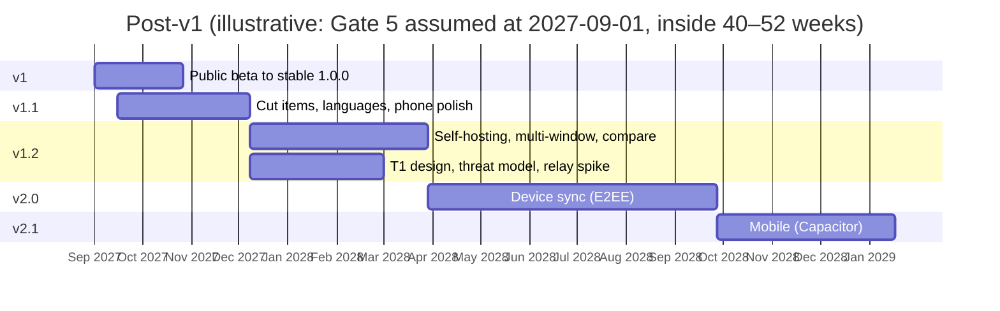

# TinyDocy after v1: roadmap and the seams v1 must leave

> **Owner answers (plan v8, 2026-11-16):**
> - **D37 (Q1 a):** device sync is **end-to-end encrypted only, on its own relay**; never plaintext on our servers.
> - **D38 (Q2 a):** the order is approved: v1.1 languages and phone polish → v1.2 self-hosted sync server and multiple windows (plus version compare without attribution) → v2.0 encrypted device sync → v2.1 mobile app.
> - **D40 (Q3, trimmed by the staff review):** keep S1 (as cleanup), S1b, S1c, S2, S2b, S3 (`apiVersion` and `serverVersion` only), S5b, S6b, S7, S8 (`TINYDOC2` only; no `TINYDOC1` reader, since nothing shipped), S8b, S8c (only for backup-zip and `library.json` restore; a single `.tinydoc` import still gets a new `link_key`, and the header carries no id), S10, S12–S15, S16 (`link_key NOT NULL`, minted at insert) and S17. **Dropped in code:** S4, S5, S6 and `assetBaseUrl`, S9, S11 (a doc-only "Syncs" column in the preferences design instead) and S18. About **1–1.5 agent-days**. **S1 is the first seam to drop if Gate 4 runs tight.**
> - **S1's rationale, corrected (v8 review).** v1 shares are plaintext to the server anyway, so S1 buys no confidentiality in v1. The real reasons: **the server never holds the root secret; there is no permanent dual-token branch** (server-minted and client-derived) to carry later; and **one derivation scheme** serves T2's private links. The label `tinydocy-view` becomes `tinydocy/view/v1`.
> - **D36** puts full phone and tablet support in v1 (M18–M28), so T5's v1.1 phone polish is smaller (§2.5, §3.2). Gate 5 is now 40–52 weeks (plan §8.2).

- **Status:** Draft 2, 2026-11-16, amended by plan v8 (D36–D38, D40). Planning only. Nothing here changes v1 scope, except the seams in §4 that D40 approved, which cost about 1–1.5 agent-days in total across PRs that already exist.
- **Reads with:**
  - [plan v8](2026-11-15-desktop-local-first-design.md): goals, non-goals, D0–D41 in §13, the timeline in §8 and the deferred list in §15
  - [architecture](2026-11-15-desktop-architecture.md): ports in §4, tables in §5.3, future seams in §12
  - the 2026-11-16 designs: [web library](2026-11-16-web-library-design.md), [image store](2026-11-16-image-store-design.md), [comments](2026-11-16-comments-design.md), [preferences](2026-11-16-preferences-design.md), [onboarding, templates and import](2026-11-16-onboarding-templates-import-design.md), [languages and RTL](2026-11-16-languages-rtl-design.md), [search and links](2026-11-16-search-linking-design.md), [test and release](2026-11-16-test-release-strategy.md)
  - the [local-first storage and sharing research](../../research/2026-11-15-local-first-storage-and-sharing.md), §2.2, §3.3 and §5
- **Reconciled in v8:** the [phones and tablets](2026-11-16-phones-tablets-design.md) and [brand](2026-11-16-brand-icon-website-design.md) designs now exist. §2.5 (mobile) defers to the phones-and-tablets design wherever they disagree; D36 puts its PRs in v1.
- **Planning unit:** the plan's calibration of about **1 calendar week per 11 agent-days**, with **owner-hours as the bottleneck**:
  - about 10 owner-hours a week normally
  - about 5 a week during any beta window (plan §8.1, K23)

---

## 0. Summary

**Who post-v1 serves.** D0 says TinyDocy is for people who want **private local documents**. The biggest gaps v1 leaves for that audience, in order:

1. **My documents on my other computer, or my phone.** v1's only answer is "Export all → Import" (plan §5.2).
2. **Confidentiality from the operator when I share.** v1 shares are plaintext to the server, and the UI says so.
3. **Using it in my own language.** v1 is English, but translation-ready (D26).

Everything else on the deferred list is a convenience.

**The central recommendation: device sync is end-to-end encrypted from day one, on its own relay.**
- It must not be Hocuspocus, and it must not use the `share:` namespace.
- Syncing a whole private library through tiny.docs.plus in plaintext would break the D0 promise.
- E2EE is much easier for one person's own devices than for shared documents:
  - there is one principal, so content moderation isn't needed
  - every client is the user's own, and it auto-updates, so a server-side schema allowlist isn't needed
  - only byte quotas and rate limits remain
- **E2EE for documents shared with other people stays at v2 or later**, and it reuses the sync crypto once that has been proven.

**Sequencing** (§3), counted from the v1 public release (Gate 5; stable `1.0.0` follows 8 weeks later):

| Release | When, after Gate 5 | Headline |
|---|---|---|
| **v1.1** | about 10–14 weeks (just after stable `1.0.0`) | The D41 and D30 cut items that slipped, the first translated interface languages (with one RTL language), phone polish (smaller now that phones are fully in v1, D36) |
| **v1.2** | about +14–18 weeks | A self-hosted sync server (custom server URL, `/api/info` negotiation, mixed-version soaks), multiple windows on one document, comparing versions (no attribution) |
| **v2.0** | about +22–30 weeks | Syncing your own devices, end-to-end encrypted, with QR or code pairing and no accounts. Desktop and the web library first. |
| **v2.1** | about +14–20 weeks | A mobile app (Capacitor around the same static export) that joins a sync group. Before this, only installable-PWA improvements. |
| Later, unscheduled | — | E2EE for shared documents; suggestion mode and attributed changes (they wait for Yjs 14 and a Tiptap binding); an asset CDN (only when bandwidth costs justify it) |
| **Not planned** | — | Accounts as identity, a plugin system, full-text body search (D24 stands unless testers ask for it) |

**The seams v1 must leave** (§4) cost a few lines each. The ones that would be expensive to add later:

1. **The server never sees a link's root secret.**
   - **The client generates the edit secret.** Before v8 the plan had the server mint it in `POST /api/shares`. *(D40 approves S1 as cleanup; plan v8 §6 applies it.)*
   - The server still generates `share_id`, and it receives only hashes of tokens *derived* from the secret: `token = HKDF(secret, "tinydocy/auth/edit/v1")`.
   - A future encryption key derived from the same secret then never reaches the server, so a v2 "private link" can keep the same link grammar.
   - **Why now (corrected in v8):** not confidentiality, since v1 shares are plaintext to the server anyway. The server never holds the root secret, there is no permanent dual-token branch, and T2 gets one derivation scheme. It is the first seam to drop if Gate 4 runs tight.
   - **Amend.** It changes a planned server behaviour: P4.2a, P4.2b, P4.2c, P4.4, W10 and S-A1.
2. **Versioned, extensible file and payload headers.**
   - `TINYDOC2` is the only format any build writes.
   - Its JSON header reserves `enc`, and readers ignore unknown keys.
   - `library.json` gets the same rules.
   - **Partly in the plan:** TINYDOC2 exists; the reserved field and the reader rule are new.
3. **`/api/info` declares what self-hosting and a CDN will need,** and every server-side choice is stored per remote:
   - `/api/info` carries `apiVersion`, `serverVersion` and `assetBaseUrl`
   - each remote row stores its server origin (`remotes.server_origin`)
   - the `share_id` is never assumed to belong to tiny.docs.plus

   **New.** P4.0 and P4.2d. **D40 kept only `apiVersion` and `serverVersion`;** `assetBaseUrl` (S6) and `remotes.server_origin` (S5) were dropped, so T3 and T9 add them when they're built.
4. **`link_key` is minted when the document is created, never lazily.** Otherwise two synced devices mint different keys for one document. **Amend** (applied in v8: `NOT NULL`, minted at insert, architecture §5.3).
5. **One author identity per person, not per device,** stored apart from the device, so "own comment" still works across your own devices once sync exists. **New rule.** P4.0.
6. ~~**A writer column on desktop `updates`**~~ **Dropped by D40 (S9).** T6 adds it with a `format_version` migration when multiple windows are built (v1.2).
7. ~~**Each preference declares whether it belongs to the device or the library**~~ **Dropped from code by D40 (S11).** The preferences design keeps a doc-only "Syncs" column instead (preferences §2.4).

**A rule, not a seam:** v1 never treats `library_id` as a device identity. Copies made by Migration Assistant, backups or daily snapshots duplicate it. When sync ships, `device_id` is minted at the moment sync is enabled, and it is never exported. Nothing in v1 consumes a device id, so v1 doesn't need one (S2).

**Things v1 must not do** (§5). The most important:
- let the server mint link secrets, or present the raw secret as a token
- let `library_id` or `device_id` leave the device unhashed
- persist or narrow Yjs `clientID`s
- reuse `share:` documents or their 30-day expiry for sync
- turn off Yjs garbage collection to get version diffs

---

## 1. Framing

### 1.1 What v1 already gets right for later

v1 already cuts most of the expensive seams. Each was paid for once in an existing design:

| Seam already in the plan | Where | What it keeps open |
|---|---|---|
| UUID document, folder and tag ids, with UTC times | architecture §12, web library §2.2 | merging libraries from two devices without id collisions |
| `lineage` written at creation, outside the CRDT, and stored in `shares.lineage` | D-A5, plan §17 v2 | recognising the same document across devices, files and shares. Same-lineage Yjs states merge cleanly, so sync, suggestions-as-drafts and `.tinydoc` round trips all build on it (research §4.2). |
| `link_key`, opaque, per library, never derived from an id (search-linking §4.1) | v7 amendment | links that survive sync and export without leaking ids into shared content |
| Fractional `sort_key` on every document and folder | organize research, details spec | concurrent reorder under last-writer-wins without renumbering siblings |
| `meta.library_id`, `format_version` and `yjs_encoding='v1'`, plus `docs.schema` and a migration hook | architecture §5.3, D-A5, D-A6 | a Yjs 14 or format change without a flag day; reading newer libraries read-only (T6) |
| The two-step `format_version` rollout (reader first, writer 14 days later) | test strategy §5.6 | any later format change, including sync metadata |
| `asset:sha256-<hex>`, content-addressed, with unknown algorithms rendered as "needs newer" | image store §2.1 | sync dedupe, a CDN (immutable bytes), new hash algorithms |
| `BlobStore`, `DocStore`, `DocumentIndex` and `DocSession` ports; an engine with no runtime imports behind `SqliteDriver` | architecture §4, §12 | mobile (a Capacitor SQLite driver), a sync attachment beside `local-session` |
| `/api/info` with `features`, `allowedSchemas` and limits; kill switches per feature | plan §6 | self-hosting negotiation, rolling out E2EE or sync gradually |
| `SyncAttachment` takes `serverUrl`, and sockets are keyed by URL | architecture §12 | custom servers |
| Desktop CSP built at runtime by main | plan §7 | a custom server's `connect-src` without a rebuild |
| Comment heads have `v: 1`; preferences are `{ v: 1, … }` with "newer: read, never overwrite" | comments §4.1, preferences §5.2 | signed comments, synced settings |
| The view secret is derived: `HKDF(edit, "tinydocy/view/v1")` (label renamed from `tinydocy-view` in v8) | details spec §8.2 | a CryptPad-style key hierarchy (research §3.3) |
| `doc.markdown` IPC: main already receives each document's Markdown for the mirror | architecture §7 | a full-text index later, with no new renderer plumbing (if D24 is ever reopened) |

What is **missing** sits mostly at three boundaries: **trust** (what the server learns from a link), **device identity** (what makes two installs distinct), and **forward compatibility of files and payloads** (whether an old reader refuses politely). §4 fills those gaps.

### 1.2 The rule for choosing seams

A seam is cut in v1 only if it meets all three conditions:
- **≤ 0.5 agent-day** in a PR that already exists
- **no user-visible behaviour**
- **no editor-chunk bytes.** The D23 ledger is spent. None of the seams below adds editor-chunk bytes.

Anything bigger is a v1.x feature, not a seam.

### 1.3 Prior art that shapes the themes

- **Ink & Switch, *Local-first software* (2019).** Its seven ideals include "the network is optional", "seamless collaboration with your colleagues" and "you retain ultimate ownership and control". v1 meets the first and partly the third. Device sync is the missing piece for "multi-device" ([essay](https://www.inkandswitch.com/essay/local-first/)).
- **Automerge-repo.**
  - Documents are addressed by an id that doubles as a capability, and sync servers are dumb relays that store what peers send.
  - Its storage rule (compaction deletes only the chunks this process loaded) is the one the web library adopted as W-D3 (research §1.1; [Automerge storage](https://automerge.org/docs/reference/under-the-hood/storage/)).
- **Keyhive and Beelay (Ink & Switch).**
  - Convergent capabilities plus an E2EE relay that can't decrypt.
  - It was open-sourced as a **pre-alpha**, and a later Ink & Switch dispatch says its sync path is to move to a new system ("Subduction").
  - It is not a dependency we can take in 2027, but it is the right shape to copy ([project](https://www.inkandswitch.com/project/keyhive/), [dispatch 010](https://www.inkandswitch.com/newsletter/dispatch-010)).
- **secsync (Serenity Notes).**
  - Snapshot plus updates, each encrypted with AEAD; the server stores ciphertext and orders it.
  - This is the closest published design to an E2EE Yjs relay.
  - It is beta, with no push since 2024-09, so we copy the protocol, not the code (research §3.3).
- **Proton Docs and the CCS 2026 "Data-strophy" paper** ([ePrint 2026/1994](https://eprint.iacr.org/2026/1994)).
  - Per the research doc, the paper shows **three undetected integrity attacks** on Proton's Yjs-based E2EE documents: history rewriting, context manipulation and censorship. Two of them work **with an honest server**.
  - **The lesson for us: integrity is as hard as confidentiality.** Encrypting updates isn't enough. Each update must be bound to its document and its place in history, and missing updates must be detectable.
  - This draft cites only what the research doc states. Read the paper itself before the v2 threat model.
- **Yjs 14.**
  - As of the research check (GitHub, 2026-11-14), 13.6.x is stable and v14 is at `rc.30`.
  - The new `@y/prosemirror` binding (attribution, suggestions, snapshot diffs) is unreleased, and Tiptap 3 still uses `@tiptap/y-tiptap` on Yjs 13.
  - Secondary sources disagree on whether v14 changes the wire format; one lists 53-bit client ids.
  - **Treat v14 as a migration we will do once, behind `yjs_encoding`,** and plan attributed changes and suggestion mode on top of it, not before (research §1.2).
- **Mobile editors.**
  - ProseMirror runs in a WebView on every mobile path: Capacitor, Tauri 2 mobile, and React Native through TenTap. Android `contenteditable` is the known weak spot ([ProseMirror forum](https://discuss.prosemirror.net/t/contenteditable-on-android-is-the-absolute-worst/3810)).
  - AFFiNE ships iOS and Android through Capacitor with custom native plugins ([AFFiNE mobile docs, secondary](https://www.mintlify.com/toeverything/AFFiNE/platforms/mobile)).

---

## 2. Candidate themes

**Effort** is agent-days of PR work, review rounds included, at today's pace. **Owner-hours** cover decisions, design reviews, deploys, real-device checks and external waits.

**Value for D0** is rated for the audience D0 names: people who want private local documents, with sharing as an occasional extra.

| # | Theme | Value for D0 | Effort (agent-days) | Owner-hours | Risk | Depends on |
|---|---|---|---|---|---|---|
| T1 | Syncing your own devices (E2EE, pairing) | **High**: the top gap | 55–75 | 50–70, plus an external crypto review | High | The D40 seams (chiefly S1, S2, S7, S10, S16; S11 is now the preferences design's doc-only "Syncs" column), T3's negotiation work, a relay host |
| T2 | E2EE for shared documents | Medium: confidentiality from us when sharing | 50–80 on top of T1 | 50+, plus legal and abuse review | High | T1's crypto stack, the threat model, the Gate 4 legal posture revisited |
| T3 | Self-hosted sync server | Medium: confidentiality today, for the technical minority | 15–25 | 15–25 | Medium | S3 and S5b (D40); `remotes.server_origin` (S5, dropped by D40) is added by T3 itself; the mixed-version soak |
| T4 | More interface languages (v1.1) | Medium to high, outside English | about 14, plus 2 per language | 2–4 per language, plus finding reviewers | Low | L1a and L2 in v1; a named native reviewer for each language (D26) |
| T5 | Mobile: phone polish, then a native wrapper | Medium alone; **high with T1** | Polish: smaller than the 5–10 first estimated, since D36 puts full phone support in v1; wrapper 40–60 | Polish: small; wrapper 40+ (stores, review, devices) | Medium to high | T1, for any value beyond the web library; the phones-and-tablets design |
| T6 | Multiple windows on one document | Low to medium (power users) | 8–12 | 4–6 | Medium: a durability invariant | A writer column on desktop `updates` (S9, dropped by D40, so T6 adds it with a `format_version` migration) |
| T7 | Full-text body search | Medium for big libraries; **D24 says not planned** | 12–15 if reopened | 4–6 | Low | Only the existing `doc.markdown` path |
| T8 | Show changes, version compare, suggestion mode | Medium (writers who revise) | Compare 10–15; suggestions 25–40 | 6–10; 15+ | Compare low; suggestions high | P4.8 versions; Yjs 14 and a Tiptap binding for attribution |
| T9 | Asset CDN | Low: an operator cost lever | 5–8 | 6–10 (ops, a vendor) | Low to medium | `assetBaseUrl` and client redirects (S6, dropped by D40, so T9 needs a client update first); bandwidth data from P4.2 |
| T10 | Plugin or extension system | Low; negative for trust | 30+ | Ongoing support load | High (security) | — **Recommend against.** |
| T11 | Accounts | Negative as identity | 40+ | Ongoing (GDPR, support, recovery) | High | — **Recommend never as identity.** |
| T12 | docs.plus integration | Low to medium; depends on docs.plus's plans | 6–10 for "Publish to docs.plus" | 6–10 (API and auth agreements) | Medium | A public docs.plus import API; the export pipeline |

### 2.1 T1: syncing your own devices

**User value.** "My library on my laptop and desktop, and later my phone, without an account and without TinyDocy being able to read it." This is the most direct extension of D0. v1's answer, Export all → Import, loses live links, and every later edit forks.

**Model** (recommended):

- **A sync group, not an account.**
  - The first device creates a random 256-bit **group root secret**.
  - Every other key is derived from it with HKDF and fixed labels:
    - `group_id`, which is the only id the relay sees
    - the content encryption key
    - the metadata encryption key
    - a relay auth token
  - Possessing the root secret *is* membership. That is identity without accounts, as in CryptPad and Keyhive (research §3.3).
- **Pairing.**
  - Settings › Sync › **Add a device** shows a QR code. It carries the relay URL and a one-time pairing secret, never the root itself.
  - The new device scans it, and the two complete a PAKE (for example CPace) through the relay's rendezvous endpoint. Only then does the root travel, encrypted under the PAKE key.
  - The fallback is a **10-character code** typed on the new device, using the same PAKE. A short code is safe only with a PAKE, because a passive relay can't brute-force it offline.
  - Each device adds a **device record** to the group: `device_id` (S2), a public Ed25519 key, a name and `added_at`.
  - **Removing a device rotates the root.** Remaining devices re-wrap; from then on new data uses the new keys. Forward-only, stated plainly.
- **A library Y.Doc for metadata** (research §2.2), encrypted like any document. It uses **flat keys**, the same lesson as the comments design §4.1:
  - `d:<docId>:folder`, `d:<docId>:sort`, `d:<docId>:title`, `d:<docId>:trash`, `d:<docId>:pin`, `d:<docId>:kind`, `d:<docId>:link_key`, `d:<docId>:lineage`
  - `f:<folderId>:parent`, `f:<folderId>:name`
  - `t:<tagNameKey>` for tags (see below)
  - `dt:<docId>:<tagNameKey>` for tag assignments

  Behaviour:
  - Each field is last-writer-wins.
  - Folder cycles are repaired on read: the newest move loses.
  - **Tags merge by `name_key`.** Two devices that each made "Work" end up with one tag. That is why the key is the normalised name, not the tag's UUID.
  - SQLite (and IndexedDB on the web) stay the query projection. Every metadata change already goes through `index.ts` operations that emit `IndexChange` (architecture §5.4), so the projection is fed from those operations, not from raw SQL. Seam **S10** keeps it that way.
- **Document content.**
  - Each document syncs as **its own encrypted log**: a snapshot plus updates, secsync-shaped.
  - It is keyed on the relay by `HMAC(group_meta_key, doc_id)`, so the relay never sees a local id.
  - Every update is signed by its device key and carries `(doc, parent snapshot hash, device seq)`. Missing or reordered updates are detectable, which is the answer to the CCS 2026 integrity findings.
  - Clients compact: the relay can't merge ciphertext.
  - Assets travel the same way:
    - the bytes are encrypted with a per-asset key derived from the content key and the hash
    - the relay key is `HMAC(key, hex)`, never the plaintext hash, which would be a confirmation-of-file oracle (image store §4.3)
- **Never `share:`.**
  - Shares expire after 30 days without edits, carry public view links, and are moderated.
  - A sync group has none of those. It has per-group quotas, retention while any device checks in within 180 days, and no public read path. That last point also removes most of its abuse value as file hosting.
- **Interaction with Live documents.** A shared document in a synced library syncs its *local* copy across your devices. Each device attaches to the share with the same edit secret, which travels in the encrypted library doc. That is the opposite of D5, which keeps secrets out of backups, so it needs an owner call (Q1).
- **First pairing merges two libraries.** Documents with distinct ids are simply united. Same-lineage documents (moved earlier by `.tinydoc`) are offered as "These look like the same document. [Merge] [Keep both]". Yjs merges same-lineage states cleanly (research §4.2).
- **Transport port.**
  - The protocol is "per-device signed, encrypted append logs plus snapshots".
  - Over a relay first, because mobile needs it.
  - The same logs could later be written to a user's own cloud folder: one file per device, so there's never a conflicted copy. That would be a zero-server option for the most private users.

**What it costs.**
- A relay: a small Bun service, its own process and its own `DB_PATH`. It can also be self-hosted with T3.
- The crypto module, about 1.5k lines, with an **external review before release**.
- The library-doc projection, pairing UI, a device list, a Sync pane, conflict and merge prompts, durability soaks across two devices, and a two-device Playwright project.

**Risks.** Crypto mistakes (mitigated by the external review, reusing libsodium-class primitives and a published threat model). Data loss when two libraries merge (mitigated by pre-pairing `VACUUM INTO` and the forward-edit rule). Relay abuse (quotas, no public read path).

### 2.2 T2: end-to-end encryption for shared documents

**What it breaks**, from research §3.3:
- the ProseMirror schema allowlist (`schema_rejected`)
- the root allowlist and the comments validator
- size checks by struct analysis, including `addsNoItems` at the cap
- server-side merge and compaction
- the asset magic-byte, pixel and Exif checks (bytes are opaque)
- the operator's `share-admin inspect` and `export`
- **abuse reporting as designed**: the operator can't see what was reported

**Options:**

| Option | What the server still enforces | Cost | Verdict |
|---|---|---|---|
| (a) Don't. Self-hosting (T3) is the confidentiality answer. | everything | 0 | **Until v2** |
| (b) Opt-in "Private link" shares on the T1 relay | ciphertext byte caps, rate and connection limits, signatures (edit vs view, as in CryptPad), tombstones | 50–80 agent-days, once T1 exists | **v2 or later, after T1 has run for one stable cycle** |
| (c) E2EE every share | as (b) | as (b), plus all moderation | No: it removes the abuse controls Gate 4 depends on |

**Under (b), reporting changes shape.** The reporter's client sends the decrypted excerpt **and the derived read key** for that share. The operator verifies the excerpt against the ciphertext and can end the share. This is "message franking" without the full scheme. The share dialog says so.

**Under (b), old clients must refuse politely.** A "Private link" uses the same `/s/` grammar with a different fragment key (seam S1b), so a v1 build shows "Update TinyDocy to open this private link" rather than "not found".

### 2.3 T3: a self-hosted sync server

**User value.** Confidentiality from tiny.docs.plus today, for organisations and technical users. It also fixes the "about 10 people behind one network address" limit for offices (K10).

**Scope:**
- **Packaging.** A container image, plus `bun build --compile` binaries for the Hocus process and the share API. One env file documents `HOCUS_ALLOWED_ORIGINS`, limits and the kill switches.
- **Client.**
  - Settings › Sharing › "Sync server", with Default or a custom URL.
  - Each share records `server_origin` (S5; dropped from v1 by D40, so T3 adds the column).
  - The desktop CSP's `connect-src` gains that origin at runtime.
  - Deep links already carry `server=` in the research's grammar (`tinydocy://open?server=<host>&id=…`), so v1 must parse and keep it (S5b).
- **Negotiation.** `GET <server>/api/info` decides. Sharing is refused when:
  - `apiVersion` is unknown
  - `serverSchema` is below the client's
  - a needed feature is missing

  The copy is "This server needs updating".
- **Mixed-version soaks.** A nightly runs server N−1 against client N, and server N against client N−1, using the existing load harness.
- **The web library** joins custom servers only if its static CSP lists them, so desktop comes first.

**Risk.** A support burden from self-hosters. Keep it to one documented configuration and a "community-supported" label.

### 2.4 T4: more interface languages (v1.1)

This is the languages design's v1.1 track:
- L1b (1.5 days), L3 (3.5), L5 (3), L6 (2), L7 (2.5) and the rest of L4, about **14 agent-days**
- then **about 2 agent-days plus 4–5 reviewer-days per language** (languages §2.3)
- the first set includes one RTL language

**The limit is native reviewers, not code.** The owner names them before each L8.x (D26).

**Document language** (languages §6.3) is a document attribute, so it lives in the Y.Doc. It needs a new root (`attrs`), a root-allowlist entry and a schema floor. Leave it for v1.2 or later. The seam is only the rule in S12.

### 2.5 T5: mobile

**Defer to the [phones-and-tablets design](2026-11-16-phones-tablets-design.md).** **D36 (v8): phones and tablets are fully supported in v1** (M18–M28: the touch sidebar and list-first library, install flows, the Safari 7-day copy, share links, comments). This roadmap's view:

1. **v1.1: phone polish**, smaller than the 5–10 agent-days first estimated here: whatever of D41's phone cut items slipped (M23's in-app-browser banner, M27's shortcut glyphs, M22's tablet drag), the Android `text-scale` adoption if M27 defers it (phones §8), and fixes from the 3 phone testers. Sized after Gate 5.

   Without sync, a phone library is an island. That is acceptable for "read my exported copy" and little more.
2. **v2.1: a native wrapper after T1.**
   - **Capacitor** around the same static export (`APP_TARGET=mobile`).
   - The engine is reused behind `SqliteDriver` on a native SQLite plugin, not IndexedDB, because WKWebView storage can still be evicted under pressure.
   - The image store's `BlobStore` points at app-container files.

   **Why Capacitor over the alternatives:**
   - **Tauri 2 mobile:** its plugin and testing story is weaker for us, and it is the same WebView either way.
   - **React Native with TenTap:** a second UI stack, still a WebView for the editor.

   **Costs:** App Store and Play accounts, review cycles, a Playwright-free test lane (Appium or WebDriver against WebViews), and Android `contenteditable` IME bugs. Capacitor is the path AFFiNE took.

**Seam.** Nothing new beyond what the architecture already keeps: no Electron imports outside `desktop/main` and `desktop/preload`, and a `DocStore` that doesn't depend on its transport. Keep the touch targets and pointer media queries from the phones-and-tablets design.

### 2.6 T6: multiple windows on one document

D-A3 holds only because one window owns each document.

**To lift it:**
- adopt the web library's W-D3 compaction: merge into the stored snapshot, and delete only rows this writer appended (needs a writer column on desktop `updates`; S9 was dropped by D40, so T6 adds it with a `format_version` migration)
- main relays each window's Yjs updates to the other windows of the same document, through the registry, which becomes a fan-out
- each window keeps its own Y.Doc and its own clientID (research §4.4)

**Risk.** It reopens the durability invariant, so it needs new T-series soaks. That is why it waits for v1.2, after a stable cycle.

### 2.7 T7: full-text body search

**Owner decision D24: not planned.**

If testers ask for it repeatedly (track it in the D31 feedback alias):
- main already receives each document's Markdown (`doc.markdown`), so an FTS5 `search.sqlite` is a worker job plus a query
- the search design's Appendix A probes are the evidence base
- 12–15 agent-days

**Seam:** none needed beyond keeping `doc.markdown`. Don't schedule it.

### 2.8 T8: show changes, version compare, suggestion mode

- **Compare two versions** (v1.2).
  - P4.8 stores full versions. Compare decodes two of them into ProseMirror documents and diffs them with `prosemirror-changeset` or a tree diff, rendered read-only.
  - No attribution and no Yjs internals.
  - 10–15 agent-days.
- **Who changed what** (attribution) and **suggestion mode.**
  - Wait for Yjs 14's `@y/prosemirror` (attribution, suggestions, `renderSnapshot` diffs) and a Tiptap binding (research §1.2).
  - Ink & Switch's *Upwelling* is the other path: suggestions as **drafts**, meaning a same-lineage fork that is reviewed and merged. Our `lineage` rule already supports it.
  - Either path is 25–40 agent-days and a Yjs migration.
- **Comments' "suggested replacement" (P4.12)** is the v1 stand-in.
- **Seams:** S14 (never turn off Yjs garbage collection), and keeping versions as full states (already the plan).

### 2.9 T9: an asset CDN

Content-addressed, immutable bytes are ideal for a CDN. The conflict is per-share auth: no existence oracle, and tokens go in a header, which a CDN can't cache on.

**Pattern for later:**
- `GET /api/shares/:id/assets/:hex` answers **302** to a short-lived signed URL, `assetBaseUrl/…?sig=HMAC(share, hex, exp)`.
- The CDN caches by path, and the signature is checked at the edge.

**Seam S6 (dropped by D40):** `/api/info.assetBaseUrl`, and clients following a same-scheme redirect on asset GET. Without it, T9 ships a client update first. Build the CDN only when the bandwidth line in plan §12 grows past what the box serves.

### 2.10 T10: a plugin or extension system: recommend against

- The renderer holds a privileged bridge and edit tokens (plan §7).
- The editor chunk is byte-ledgered (D23).
- One owner can't review third-party code.
- Every plugin ecosystem in local-first editors (Obsidian, Logseq) became a security and support surface.

**Instead:**
- **data-shaped extension points:** templates (TM1), import formats (IM-series), export targets (T12), and preferences
- **files** as the integration surface: backups, `.md` mirrors, and a future local CLI that reads `library.sqlite` read-only

**Seam:** none. The architecture's "Not done: a plugin system" stands.

### 2.11 T11: accounts: never as identity

Accounts would contradict the product's positioning ("needs no accounts"). They would add GDPR duties and account recovery, and break the capability model.

**What people actually want from accounts is met without them:**
- multi-device: T1 pairing
- recovery: a printable **sync recovery code**, or later a passkey-wrapped root using the WebAuthn PRF extension
- "same author": a per-person identity (S7), optionally signed per device later (comments §6.1)

**If a paid hosted tier ever exists,** billing can attach to a sync group id. That is still not an identity.

### 2.12 T12: docs.plus integration

None of the v1 designs mention a product integration. Today the links are shared editor extensions (`@docs.plus/extension-*`) and TinyDocy's role as a testbed.

**Options:**
- **(a) Keep sharing extensions and schema names.** Already true. Any mark or node TinyDocy adds should stay compatible with docs.plus's names.
- **(b) "Publish to docs.plus…" as an export target.**
  - HTML or Markdown plus assets, through a docs.plus import API, using the user's own docs.plus sign-in.
  - The sign-in happens in the system browser; TinyDocy never stores a docs.plus password.
  - 6–10 agent-days.
- **(c) TinyDocy as docs.plus's offline client.** Large, and it couples identity. Not recommended.

**Recommend (a) now and (b) at v1.2 or later, if docs.plus publishes an import API.**

**Seam:** the export pipeline stays target-neutral, producing a document plus an asset manifest (image store §5.4 already does), with a small "export target" registry instead of hard-coded destinations.

---

## 3. Recommended sequencing

### 3.1 Calendar assumptions

- **Gate 5** lands 40–52 weeks after kickoff with full phone support (plan v8 §8.2, D36; the cut orders recover about 2 weeks). **Stable `1.0.0`** is about 8 weeks later.
- The public beta window costs about **5 owner-hours a week**, and stable costs about 10.
- At 11 agent-days a week, owner-hours decide the calendar, not agent capacity. A theme with 50 owner-hours takes at least 5–10 weeks, whatever its agent-days.
- One release at a time ships to stable. Feature work for release N+1 runs behind kill switches while N is in beta.

### 3.2 v1.1: finish v1 and open it to other languages (about Gate 5 + 10–14 weeks)

| Work | Agent-days | Owner-hours | Why now |
|---|---|---|---|
| D41 and D30 cut items that slipped, in reverse cut order (links, then backlinks, then TM1, …; D41's phone and brand items) | 0–40, depending on what was cut | 5–15 | Promised, and their seams (`link_key`, `kind`, `import_sources`) are already in place |
| Languages: L1b, L3, L5–L7, then 2–3 L8.x including one RTL language | about 14 + 2–6 | 6–12, plus reviewer time | D26 commits to v1.1, and reviewers set the pace, not code |
| Phone polish (T5 step 1; D36 put full phone support in v1, so this is smaller) | smaller than the 5–10 first estimated; sized after Gate 5 | small | What D41 cut, plus phone-tester fixes. It still tells us whether mobile demand is real before T5 step 2 |
| Seam audit: a test per D40 seam ("does the golden library still satisfy them?") | 2 | 1 | Locks the doors before the v1.2 and v2 work |

**Rationale.** v1.1 coincides with the stable `1.0.0` window, when owner-hours are scarcest. So it contains only work whose design is finished and whose risk is low.

### 3.3 v1.2: confidentiality without crypto, and power-user basics (about +14–18 weeks)

| Work | Agent-days | Owner-hours | Why this order |
|---|---|---|---|
| T3 self-hosted server | 15–25 | 15–25 | Gives confidentiality from us with **no new crypto**. Forces the `/api/info` negotiation and mixed-version discipline that T1's relay will need. Can itself be self-hosted. |
| T6 multiple windows on one document | 8–12 | 4–6 | Small. Exercises W-D3 on desktop before T1 adds a second writer of a different kind (remote device updates). |
| T8 compare versions (no attribution) | 10–15 | 6–10 | Builds on P4.8. The writing audience asks for it. No Yjs migration. |
| T1 design and threat model, plus the relay spike | 8–10 | 10–15 | The longest owner-hours item. Starting it in v1.2 keeps v2.0 to about 6 months. |

**Rationale.** Each item either removes a constraint T1 will hit (negotiation, several writers) or delivers user value with low risk while the T1 design matures.

### 3.4 v2.0: syncing your own devices, end-to-end encrypted (about +22–30 weeks)

- T1 in full: the relay, pairing, the library doc, content and asset sync, a device list, recovery codes, two-device soaks, and an external crypto review (a cash item for the owner).
- Desktop and the web library only.
- **Gate:** a 14-night streak with two-device durability cases, plus the review's findings closed.
- **Why it isn't earlier:** owner-hours. **Why it isn't later:** it is the D0 audience's top gap, and the mobile app depends on it.

### 3.5 v2.1: mobile (about +14–20 weeks)

T5 step 2, with Capacitor joining a sync group. A phone is only worth shipping once your library is on it.

### 3.6 Later, unscheduled

- **T2 "Private link" shares**, after T1 has had one stable cycle: the crypto stack must be proven first.
- **Attribution and suggestion mode**, after Yjs 14 is stable and Tiptap ships a binding. One `yjs_encoding` migration first, through the two-step format rollout.
- **T9 asset CDN**, when the bandwidth cost justifies it.
- **T12(b) Publish to docs.plus**, if the API exists.

### 3.7 Calendar picture

The dates are illustrative. Each bar starts when the previous release reaches stable, not when agents are free.

---

## 4. Seams v1 must leave now (the main deliverable)

**Columns:**
- **Status:** **Plan** means already decided in a v1 document; **New** means proposed here; **Amend** means a v1 design must change slightly.
- **Cost** is extra agent-time inside the named PR.

None of these seams adds editor-chunk bytes.

> **D40 (plan v8):** the rows below stay as proposed, for the record. **Approved:** S1 (as cleanup; first to drop if Gate 4 runs tight), S1b, S1c, S2, S2b, S3 (`apiVersion`, `serverVersion` only), S5b, S6b, S7, S8 (`TINYDOC2` only, no `TINYDOC1` reader), S8b, S8c (backup-zip and `library.json` restore only), S10, S12–S15, S16 (`NOT NULL`, minted at insert), S17. **Dropped in code:** S4, S5, S6 and `assetBaseUrl`, S9, S11 (doc-only "Syncs" column instead) and S18, each marked in its row.

### 4.1 Trust and links

| # | Seam | What to add | Where | Cost | What breaks later if skipped | Status |
|---|---|---|---|---|---|---|
| **S1** | **The server never sees the link root secret** | **The client generates** the 128-bit edit secret `e` and the owner secret, with a CSPRNG in main on desktop and in the page on the web. The client derives `view = HKDF(e, "tinydocy/view/v1")` (the planned label, renamed in v8), `auth_edit = HKDF(e, "tinydocy/auth/edit/v1")` and `auth_view = HKDF(view, "tinydocy/auth/view/v1")`. `POST /api/shares` sends only `SHA-256(auth_edit)`, `SHA-256(auth_view)` and `SHA-256(owner)`. **The server generates `share_id` only**, as planned. Connections and asset requests present `auth_*` as the token (`Authorization: Bearer` for assets). Reset link follows the same rule. The fragment carries `e` (or `view`), as planned. | P4.2a (create takes hashes), P4.2b (compare), P4.2c (reset), P4.3 (`/s/`), P4.4 (desktop), W10 (web library), S-A1 (asset auth) | ≤ 0.5 d | *(Corrected in v8.)* Not v1 confidentiality: v1 shares are plaintext to the server anyway. Skipped, the server would hold the root secret of every link, and adding private links later would need a permanent second token path beside server-minted secrets instead of one derivation scheme. | **Approved (D40)** as cleanup, applied in plan v8 §6, architecture §8.3 and details §8.2 with the staff review's rules (owner secret independent, empty-salt HKDF-SHA-256, 32-byte base64url, `timingSafeEqual`, distinct hashes, never on the handoff page). First seam to drop if Gate 4 runs tight. |
| S1b | Versioned, tolerant fragment grammar | Parse the fragment as `key=value&…`. Known keys: `e` and `v`. **Reserved:** `k` (a future private-link key), `s` (server, if ever needed), `x`. If a link holds only unknown keys, show "Update TinyDocy to open this link" and never "not found". | P4.3, P4.5, W10 (one shared `lib/sharing/link.ts`) | ≤ 0.25 d | v1 builds report "This live document doesn't exist" for v2 private links, and users believe links are broken | **New** |
| S1c | A labelled HKDF registry | One module (`lib/crypto/labels.ts`) lists every derivation label (`tinydocy/view/v1`, `tinydocy/auth/*`), with Node `hkdfSync` and WebCrypto `deriveBits` test vectors (v8), with a test that labels are unique and never reused | P4.4 | ≤ 0.1 d | Ad-hoc labels collide later, when sync and private links add their own | **New** |
| S2 | **`library_id` is not a device identity** (a rule; no v1 column) | v1 never uses `library_id`, or anything else that copies travel with, as a device identity. Copies made by Migration Assistant, restored daily copies and backups all duplicate it. When sync ships (T1), `device_id` is minted **at the moment sync is enabled**, kept in its own `meta('device')` row, and **never** exported to `.tinydoc`, `library.json`, backups or diagnostics. The pre-pairing snapshot is taken after it exists. Nothing in v1 consumes a device id, so minting it later costs nothing, and a v1 column would need an OS machine-id read (per-OS code, or a new dependency in the signed main bundle, K6), which breaks §1.2. | P2.6 (a rule in the doc comment); T1 later | 0 | If v1 code keys anything per device on `library_id`, two computers restored from one backup look identical to sync, the device-level version of the Yjs clientID hazard (research §4.4) | **New** (rule) |
| S2b | `library_id` stays private | It is used only to key `hashedId()` in diagnostics (as planned) and is never sent to any server. A future sync group derives its own `group_id`. | architecture §9 (already true); state it as a rule in P2.6 | 0 | A server could link a sync group to the library and to diagnostics, which is a privacy regression | **Plan** (made explicit) |

### 4.2 Server protocol

| # | Seam | What to add | Where | Cost | What breaks later if skipped | Status |
|---|---|---|---|---|---|---|
| S3 | `/api/info` versioning (**D40: `apiVersion` and `serverVersion` only**; `serverId` and `assetBaseUrl` dropped) | Add `apiVersion: 1`, `serverVersion` (semver), `serverId` (a random UUID per deployment, stable across restarts) and `assetBaseUrl` (default `null`, meaning same origin) to the planned payload. Clients treat a missing feature as **off**, an unknown `apiVersion` major as "This server needs a newer TinyDocy", and ignore unknown keys. | P4.2d; clients in P4.4 and W10 | ≤ 0.25 d | Self-hosters (T3) and the relay can't be negotiated with. Old clients misread new servers. A CDN needs a client update first. | **Amend** (plan §6 `/api/info`) |
| ~~S4~~ | **Dropped (D40).** Encrypted payloads fit the share model | `shares.payload` with default `'yjs-v1-plain'`; the server refuses any other value in v1. The guards (`DocumentGuard`, root allowlist, comments validator, asset content checks) key on it. | P4.2a | ≤ 0.1 d | Private links (T2) would need a parallel table, and every guard would gain an "is this the other kind" branch later | **New** |
| ~~S5~~ | **Dropped (D40).** Each remote stores its server | `remotes.server_origin TEXT NOT NULL` (desktop), and the same field in the web library's `remotes` store. v1 always writes the default origin. Sockets are keyed by origin (architecture §12 already). | P4.0, W10 | ≤ 0.1 d | A migration with a guessed default for every live document once T3 ships, and wrong server choices for links opened from self-hosted servers | **New** (architecture §12 has only `serverUrl` on attach) |
| S5b | Deep links keep `server=` | The `tinydocy://open?server=<host>&id=<share>#e=…` grammar from research §3.2. A v1 build accepts only the default host, and anything else gets "TinyDocy can't open links from other servers yet". | P4.5 | ≤ 0.1 d | A self-hosted link would open the wrong server, or fail silently | **Plan in research only, adopt** |
| ~~S6~~ | **Dropped (D40)**, with `assetBaseUrl`. Asset GET may redirect | Clients follow one same-scheme redirect on `GET …/assets/:hex` (`net.fetch` in main; `fetch` on the web) and verify the SHA-256 of what arrives, as they already do | S-A1 client side, P4.4+ | ≤ 0.1 d | A CDN (T9) needs a client update first, and old clients break the day it ships | **New** |
| S6b | The relay is not `share:` | Write it down: a sync group never uses `share:` names, `MAX_TOTAL_SHARES` or the 30-day expiry. Reserve the name prefix `sync:` as refused by the v1 validator. | P4.2a (validator), docs | 0 | A tempting shortcut ("sync is just sharing with yourself") inherits public view links, moderation access and expiry | **New** (rule) |

### 4.3 Files and payloads

| # | Seam | What to add | Where | Cost | What breaks later if skipped | Status |
|---|---|---|---|---|---|---|
| S7 | Identity is per person and portable | `meta('identity') = { v: 1, id, name, color }`. The `id` is random (comments §6.1), **never derived from `device_id` or `library_id`**, and importable later by a paired device. Not in backups (it's a credential-like value). | P4.0, F2, comments P4.9 | 0 (a rule) | After sync, "own comment" edits and deletes fail across your own devices, and a fix would rewrite authors in every document | **New** (rule) |
| S8 | `.tinydoc` is `TINYDOC2` only, with an extensible header | Every writer (Export, Send a copy, backups, web Download P2.10, `library.json` entries) writes `TINYDOC2`. The header JSON gets `"v": 2`, `"minReader": 2` and `"enc": null`. Readers ignore unknown keys, refuse `minReader` above their own with "made with a newer TinyDocy", and refuse `enc ≠ null` with the same copy. ~~`TINYDOC1` is read-only, kept for internal testers' files.~~ **D40: no `TINYDOC1` reader, since nothing shipped.** | P2.8, P2.10, W7, IM1, the image store's P2.8+ | ≤ 0.25 d | `TINYDOC1` (magic, lineage, state, with no header map) has no room for flags. An encrypted export, sync bundle or new field would need yet another magic number, and old readers would misparse rather than refuse. | **Amend** (web library §6.1 still says `TINYDOC1`; image store §5.4 introduces `TINYDOC2`) |
| S8b | `library.json` is tolerant | `format: 1`; readers ignore unknown keys and refuse a higher major. Entries carry `id`, `lineage`, `link_key`, `kind`, `folder_id`, tag **names** (not tag ids) and `sort_key`. **Never** `device_id`, identity or secrets (D5). | W7 and IM2 (the shared archive module) | ≤ 0.1 d | Moving a library desktop ↔ web or between versions loses `sort_key` or `link_key`, or collides on tag ids | **Amend** (adds `link_key`, `sort_key` and names-not-ids) |
| S8c | Restore keeps ids, import doesn't (**D40: only for backup-zip and `library.json` restore; a single `.tinydoc` import still gets a new `link_key`, and its header carries no id**) | **Restore** (into an empty library, or at reinstall) keeps document, folder and link ids, plus lineage. **Import** into a non-empty library keeps lineage and mints a new id only on collision. | W7, IM2, P2.9b ("Restore from backup…") | ≤ 0.25 d | After sync, a reinstalled device restored from backups would duplicate every document instead of rejoining it | **New** |
| ~~S9~~ | **Dropped (D40).** A writer column on desktop `updates` | `updates.writer TEXT` (a per-session random id), as the web library's `updates` already has. Unused in v1 except in diagnostics counts. | P2.6 | ≤ 0.1 d | Multiple windows on one document (T6) needs W-D3's "delete only rows this writer appended", which needs a `format_version` migration of the largest table | **New** (copies web library §2.2) |
| S10 | All metadata writes go through index operations | A rule plus a test: nothing writes `docs`, `folders`, `tags` or `doc_tags` except `index.ts` operations that emit `IndexChange`. That includes import, restore and template creation. | P2.6, P2.7a, IM1, TM1 | 0.1 d (lint or grep test) | The library-doc projection (T1) would miss writes that bypass the change feed, and devices would diverge silently | **New** (rule) |
| ~~S11~~ | **Dropped from code (D40):** a doc-only "Syncs" column in the preferences design (§2.4) instead. Preferences declare their scope | Each row in `lib/prefs/schema.ts` gets `scope: "device" \| "library"`. For example: `zoom`, `backupFolder` and `updates` are device; `page.style`, `smartQuotes` and `spellLanguages` are library. Nothing reads it in v1. | P2.9c-1 | ≤ 0.1 d | Sync can't decide which settings travel without re-deciding about 40 settings, and an early guess syncs a backup path to a phone | **New** |
| S12 | Y.Doc roots are versioned with the schema | Rules: a new Y.Doc root (for example `attrs` for document language) is introduced only with a `DOC_SCHEMA` bump, a root-allowlist entry and a client floor. Clients **never sweep unknown roots locally** (the server sweep stays as specified). Desktop's import guard refuses unknown roots with the "newer TinyDocy" copy. | P2.6 import guard, P4.2f-1 (documented) | 0 (rules) | A future root added carelessly is deleted by old clients' repairs, or freezes them | **Plan** (made explicit) |

### 4.4 Content

| # | Seam | What to add | Where | Cost | What breaks later if skipped | Status |
|---|---|---|---|---|---|---|
| S13 | The comment thread head governs its keys | A rule: the head's `v` decides the shape of every `a:`, `s:` and `m:` key in that thread. The validator picks shapes by the head's `v`. A v2 thread can then carry, for example, a `sig` field on messages, without a `v` on every value. | P4.2f-2, P4.9 | 0 (a rule) | Adding signed or richer comments needs a version on every message value, or a flag day | **New** (rule) |
| S14 | Garbage collection stays on; versions are full states | Never construct a Y.Doc with `gc: false` to get diffs. P4.8 versions remain full encoded states. Compare (T8) decodes two of them. | P4.8 | 0 | Unbounded growth for every document, which breaks the 2 MiB share cap and the soak T8 | **Plan** (made explicit) |
| S15 | Yjs ids are never persisted or narrowed | Never persist a clientID (research §4.4). Never store clientIDs or clocks in 32-bit columns or typed arrays. Logs and diagnostics treat them as opaque. | P2.6, diagnostics | 0 | Yjs 14 (53-bit client ids, per a secondary source) silently corrupts anything that narrowed them | **New** (rule) |
| S16 | Links stay opaque per library (**D40: `link_key NOT NULL`, minted at insert**; applied in architecture §5.3, search-linking §4.1 and LK5) | `link_key` is minted **at creation** for every document, never lazily. Architecture §5.3 says "NULL until first needed"; change it to "created with the document". | P2.6, W2 | ≤ 0.1 d | Two synced devices lazily mint different `link_key`s for one document, so links resolve on one device and not the other, and the merge needs a tie-break | **Amend** (search-linking §4.1 says "created with the document"; architecture §5.3 says lazy) |
| S17 | Assets: refs stay plaintext-hash; transport keys may not | Write down that `asset:sha256-<hex>` in content is final, and that a server or relay may store bytes under a different key (an HMAC for E2EE). The `BlobStore` port's `hex` is a local key only. | Image store docs (A1) | 0 | A relay later keyed by plaintext hash would become a confirmation-of-file oracle | **New** (rule) |
| ~~S18~~ | **Dropped (D40).** Export targets are data | Export returns `{ document, assets[] }`, and destinations (a file, the clipboard, later "Publish to…") are registered, not hard-coded | P2.8 | ≤ 0.1 d | T12(b) needs an export refactor | **New** |

**Total new cost:** about **1–1.5 agent-days** for the D40 set (was 2–3 for all of S1–S18), spread over P2.6, P2.8, P4.0, P4.2a–d, P4.4, P4.5, W2, W7, W10 and S-A1. There are no user-visible changes, apart from two refusal messages (S1b, S8) that v1 users will rarely see.

---

## 5. Things v1 must NOT do

| Don't | Because | Instead |
|---|---|---|
| Let the server mint link secrets, or present the raw fragment secret as the server token | Either gives the server every key that will ever be derived from that link (S1) | The client generates secrets; the server sees only hashes of derived auth tokens |
| Put local ids (document `id`, `library_id`, `device_id`, folder ids) in shared content, share rows or URLs | Shared Y.Docs, `/s/` URLs and analytics are seen by others. Ids would let a server join documents, libraries and people. | `share_id` (server-generated), `link_key` (opaque), `lineage` (already in `shares`, by design) |
| Bind anything to an IP address beyond rate limiting | Identity by IP breaks behind NAT (K10), on mobile networks and on self-hosted servers | Capabilities (links, sync group keys) |
| Write `device_id`, identity or share secrets into backups, `library.json`, `.tinydoc` or daily-copy exports meant to move machines | Restored copies would impersonate the original device or person (S2, S7; D5 already covers secrets) | Regenerate on restore; pair to transfer |
| Write `TINYDOC1`, or any format without a version and a "minimum reader" field | An old reader can't refuse politely, and a new feature needs a new magic number | `TINYDOC2` with `v`, `minReader` and `enc` (S8) |
| Reuse `share:` documents, the 30-day expiry or `/s/` for syncing one person's devices | It gives public view paths, operator inspection and expiry to private libraries | A separate relay namespace (S6b) |
| Turn off Yjs garbage collection, or store Yjs clientIDs | Unbounded growth; Yjs 14 id widths; duplicate-clientID divergence (research §4.4) | Full-state versions; ids never persisted (S14, S15) |
| Mint `link_key` lazily | Two devices mint different keys (S16) | Mint at creation |
| Let metadata writes bypass `index.ts` | The future sync projection misses them (S10) | One write path |
| Add a third-party script, a plugin hook or `eval` path to the renderer "for later" | It reaches the bridge and tokens (K7) | Data-shaped extension points (§2.10) |
| Promise "encrypted" anywhere in v1 copy | Shares are plaintext to the operator; WAL and VACUUM copies hold secrets | The honest copy the plan already has |
| Mix `.tinydoc` lineage handling with `link_key` | A copy must never answer its original's links (search-linking §4.1) | As planned: a new `link_key` on Duplicate and import |
| Hard-code `tiny.docs.plus` outside `site-config.ts` and the default-server constant | Self-hosting and the relay need one place to change it | One default-server constant, with an architecture test that greps for the host |

---

## 6. Owner questions (max 3)

> **Answered (plan v8, 2026-11-16):** Q1 by **D37** (a). Q2 by **D38** (a). Q3 by **D40**: a trimmed set, not (a), (b) or (c) as written (§4 note). The Q3 recommendation's reason ("can't be added after v1 without replacing every live link") is corrected at the top of this document.

| # | Question | Options | Recommendation | Blocks |
|---|---|---|---|---|
| **Q1** | **Should syncing your own devices ever send document content to our servers in plaintext?** | (a) Never: device sync is E2EE-only, on a separate relay. (b) Plaintext through Hocuspocus is acceptable for a faster first version. | **(a).** D0 is private local documents. A plaintext library sync would make tiny.docs.plus a store of everyone's private libraries: a breach target, a legal-request target and a moderation obligation. E2EE for one person's devices avoids the hard parts of E2EE for shares (§0). It also settles D5's tension: share secrets travel only inside the encrypted library doc. | T1 design (v1.2); S1, S4 and S6b are needed either way |
| **Q2** | **Order after v1.1: self-hosting before device sync, and sync before a mobile app?** | (a) v1.2 self-hosting, multi-window and compare; v2.0 sync; v2.1 mobile. (b) Sync first in v1.2, with self-hosting later. (c) Mobile first. | **(a).** Self-hosting gives confidentiality now with no new crypto, and forces the negotiation the relay needs. A phone without sync is an island. (b) packs the riskiest work into the most owner-constrained window. | Planning for v1.2 |
| **Q3** | **Approve the new v1 seams in §4 (about 2–3 agent-days, no visible change), especially S1: the client generates link secrets and the server sees only derived-token hashes?** | (a) All of S1–S18. (b) Only S1, S8 and S16, which are the expensive ones to retrofit. (c) None. | **(a).** Each fits inside a PR that exists. S1 changes the planned `POST /api/shares` contract (the server stops minting edit, view and owner secrets), and it can't be added after v1 without replacing every live link. | P4.2a–c, P2.6, P2.8, P4.0 and W2 specs (§7) |

**Not asked, decided here (owner can reverse):**
- a plugin system: against (§2.10)
- accounts: never as identity (§2.11)
- full-text search: stays as D24 decided
- docs.plus: export target only, if an API exists (§2.12)

---

## 7. Amendments to other documents (one docs-only PR, if Q3 = a)

> **Applied in plan v8 for the D40 set only.** Rows for dropped seams (S3's `serverId` and `assetBaseUrl`, S4 `shares.payload`, S5 `server_origin`, S6 redirects, S9 `updates.writer`, S11 `scope`, S18) were **not** applied. The preferences design got a doc-only "Syncs" column instead of S11.

| Document | Change |
|---|---|
| Plan §6 (`/api/info`, `shares`, create and commit) | Add `apiVersion`, `serverVersion`, `serverId` and `assetBaseUrl` (S3). Add `shares.payload` (S4). `POST /api/shares` and reset take client-made hashes of derived tokens, and the server mints only `share_id` (S1). |
| Architecture §8.3 (going live) | "share_id and secrets" becomes "share_id". Main generates the secrets before the POST (S1). |
| Plan §15 | Point to this roadmap for sequencing; add T8, T9, T11 and T12 to the deferred list |
| Architecture §5.3 | `updates.writer` (S9); `link_key` minted at creation (S16); the `remotes.server_origin` note for the Live release (S5); the S2 rule as a comment on `library_id` |
| Architecture §12 | Replace the "Library sync" line with the S2/S7/S10/S11 list; add the S1 token rule under Sharing |
| Details spec (sharing) | The S1 derivation and the S1c label registry, next to `HKDF(edit, "tinydocy-view")` |
| Web library §2.2, §6.1, §8 | `TINYDOC2` in the zip (S8); `library.json` fields and rules (S8b); restore keeps ids (S8c); the page generates share secrets (S1) |
| Image store §4.1, §5.4 | Bearer is the derived token (S1); asset GET may redirect (S6); `TINYDOC2` header fields (S8); the transport-key rule (S17) |
| Comments §4.1, §7.3 | The head's `v` governs the thread (S13); identity rule (S7) |
| Preferences §5.1–§5.2 | `scope` per row (S11) |
| Test strategy §1.9 | The golden-library check gains S8 (headers) and S16 (`link_key` never NULL). A P4.2 unit test asserts that the server never receives a raw link secret (S1). |

---

## Sources

**Repository (read for this roadmap):**
- `docs/superpowers/specs/2026-11-15-desktop-local-first-design.md` (v7)
- `docs/superpowers/specs/2026-11-15-desktop-architecture.md`
- `docs/superpowers/specs/2026-11-16-*.md` (eight designs)
- `docs/research/2026-11-15-local-first-storage-and-sharing.md`
- `docs/research/2026-11-15-organize-sort-review.md` (fractional `sort_key`)

**External.** The first four are cited through the research doc, with its dates. Keyhive, the Yjs 14 posts, the ProseMirror forum threads and the AFFiNE page appeared in searches on 2026-11-16. The local-first essay, the Automerge storage page, TenTap's GitHub page and Upwelling are cited from memory and were **not re-fetched**.
- Yjs releases (13.6.33 stable; v14 `rc.30` on 2026-11-14): https://github.com/yjs/yjs/releases
- Proton Docs integrity attacks, CCS 2026: https://eprint.iacr.org/2026/1994
- secsync architecture: https://github.com/nikgraf/secsync
- CryptPad whitepaper (key hierarchy, signed edits): https://blueprints.cryptpad.org/document/whitepaper/
- Ink & Switch, *Local-first software* (2019): https://www.inkandswitch.com/essay/local-first/
- Automerge storage and compaction: https://automerge.org/docs/reference/under-the-hood/storage/
- Keyhive and Beelay (pre-alpha; the sync path is moving to "Subduction"): https://www.inkandswitch.com/project/keyhive/, https://www.inkandswitch.com/newsletter/dispatch-010
- Yjs 14 and `@y/prosemirror` (secondary): https://nick-the-sick.pckt.blog/yjs-14-at-yprosemirror-wwv64pw ; BlockNote Yjs 14 versioning example: https://www.blocknotejs.org/examples/collaboration/versioning-yjs14
- ProseMirror on Android: https://discuss.prosemirror.net/t/contenteditable-on-android-is-the-absolute-worst/3810 ; ProseMirror on mobile apps: https://discuss.prosemirror.net/t/prosemirror-and-mobile-applications/6045
- AFFiNE mobile through Capacitor (secondary): https://www.mintlify.com/toeverything/AFFiNE/platforms/mobile
- TenTap (React Native and Tiptap in a WebView): https://github.com/10play/10tap-editor
- Upwelling (Ink & Switch, drafts and review): https://www.inkandswitch.com/upwelling/
